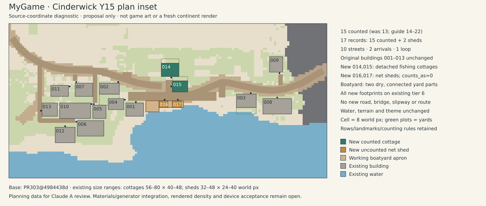

# Cinderwick town plan additions (Y15)

This MyGame proposal follows [Claude A's 28 October priority brief](https://github.com/rempemat-eng/appify/issues/149#issuecomment-6471345306): bring Cinderwick into its building guide with fishing cottages, net sheds by the quay and a boatyard. Base: PR303 `4984438d09b5fe1333d3e6ea6e6ee82be2bdc908`; target: `claude-a/continent-v53`.

The existing system is the `mygame.town_plan/1` JSON plan, existing `towns55.BLD` dimensions and the existing `scripts/review/town_plan.py` checker. This pass authors Cinderwick's data; it adds no new generator, rule or art system.

## Proposed additions

| ID              | Use                      | Footprint cells (x,y,w,h) | Faces / door cell   | Counts as |
| --------------- | ------------------------ | ------------------------- | ------------------- | --------- |
| cinderwick-b014 | Detached fishing cottage | 301,719,8,6               | Quay Lane /305,725  | 1         |
| cinderwick-b015 | Detached fishing cottage | 306,727,7,5               | Quay Lane /305,729  | 1         |
| cinderwick-b016 | Net shed                 | 300,736,4,3               | The Strand /302,735 | 0         |
| cinderwick-b017 | Net shed                 | 306,736,4,3               | The Strand /308,735 | 0         |

The cottages use the existing 56–80 by40–48 world-pixel range, with distinct64×48 and56×40 footprints. Their yards are8×2 and7×2 cells, on existing dry land beside the homes. Each cottage repeats the existing source role “a fisher's household”; no name, household size, schedule or new job is invented. Net sheds use the existing `shed` form's32–48 by24–40 range, have `counted=false` and integer `counts_as=0`, and are work storage with resident authoring deferred to X3. No separate landmark or hidden counted building is added.

The working boatyard is one connected dry area represented by two adjacent existing-format `open_uses` yard rectangles:6×5 cells for the work apron and11×3 for the net-shed frontage. Together they cover63 dry cells; the sheds occupy24, leaving39 open cells. This keeps the work beside the quay without placing a footprint on water or adding a road, bridge, slipway, transport link or gameplay action. The named boatyard is a land-use proposal, not a new operating mechanic.

Counting is now **15**, within the existing14–22 guide: the original13 plus two detached homes. There are17 building records including the two uncounted sheds; `fronts=17` preserves the exporter's separate front-record convention. The Quay district lists the four additions and the existing docks/transport-with-homes function. Detached frontage remains detached.

## Source-coordinate inset



This diagnostic is drawn from this exact plan's terrain rows, street bands, building/yard footprints, IDs and door cells. It is explicitly not game art, a fresh continent render, a phone capture or visual acceptance. The SVG's exact primitives were rasterised and inspected; no source geometry was substituted in the preview.

## Validation and preservation

```sh
python3 scripts/review/town_plan.py --town cinderwick
```

The existing checker passes15 counted buildings,10 streets, two arrivals, one loop/block, one reported dead end and2.8×1.7 screens. Additional exact-data checks verify integer contributions, detached spacing, direct door-to-existing-road contact, footprint/yard/boatyard clearance from existing buildings/plots, roads, water and barriers, and single-tier placement: every new footprint, private yard and working-yard cell is on the existing tier6 plateau in `blockout-v55.json`. The boatyard intentionally includes its two shed footprints; its remaining area stays open.

The original13 building records, streets, arrivals, district IDs, existing plots, town/terrain boxes, terrain rows, ground/material summaries, theme, residents/routines and game-layout/travel data remain unchanged. Only the four appended records, count/front summaries, shed size-table entry, Quay district description/membership/mix, two named yard rectangles and authorship note differ. Reversing those documented changes restores the complete original JSON. Required full verify/zero lint and art-repro gates apply to the exact final branch.

## Integration and limits

This is direct town-plan authoring on the latest requested branch head. Shared `towns55.py`, exporter, checker and package files are untouched, allowing other town owners to work independently. Claude A must retain these authored additions when integrating/regenerating the shared town source and recompute the material raster/summaries for the new yards. The existing ground brief already specifies basalt quay/cinder lanes and black-sand/ash yards; this proposal changes no palette or terrain raster.

No full-continent regeneration, rendered density/accessibility, collision/route simulation, live residents, device, art or placement approval is claimed. The plan checker and single-tier/clearance checks do not replace those integration reviews. Claude A reviews the proposed density, yard usefulness, source integration and drawing. W0/W1, other towns, Player, runtime, economy and existing closed-route policies remain outside this pass.
