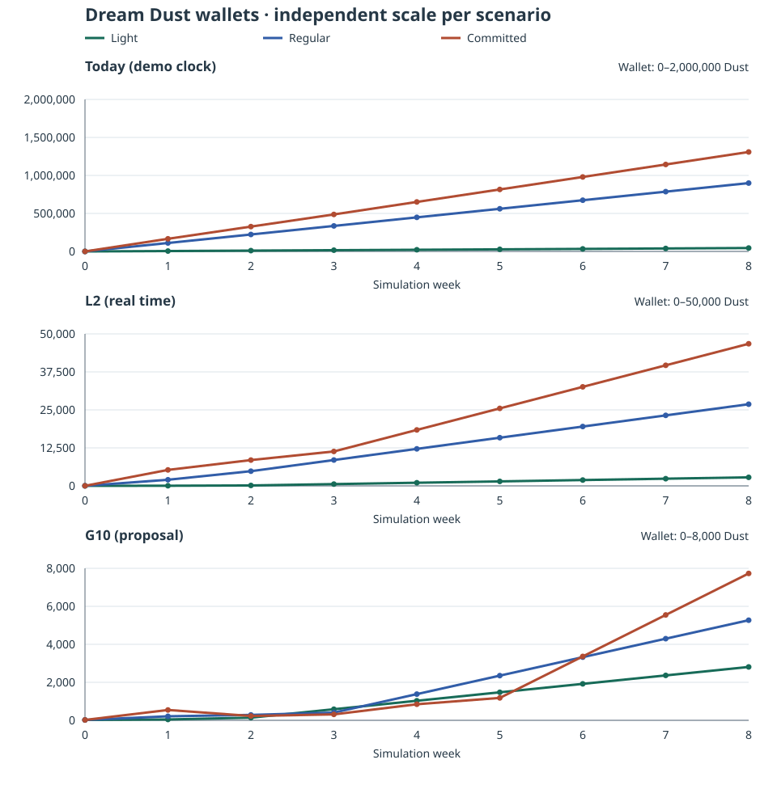

# Dream Dust economy simulation (C33)

Generated by `npm run sim:economy` from [the typed inputs](../../scripts/economy-inputs.ts). This is a deterministic solo ledger over 8 weeks (56 fixed civil days), not a change to the game. Dream Dust is the requested reporting name for the existing `grass` balance; the runtime still calls it GRASS.

An actual eight-hour explicit nap pays **28,800 today**, **960 under L2**, or **60 under G10**. Today's clock awards one displayed simulated minute per real second. All 4 current hats together cost 280. Comparing an eight-hour night with a compressed eight-minute demo would conceal this clock difference.

## Sources and scope

- Runtime and approved L2 snapshot: [main `81070e190846f51930ead7f99cb955b14d5f5600`](https://github.com/rempemat-eng/appify/commit/81070e190846f51930ead7f99cb955b14d5f5600). Current prices, missions, spending and timing: [lib/game.ts](https://github.com/rempemat-eng/appify/blob/81070e190846f51930ead7f99cb955b14d5f5600/lib/game.ts); spar cap and play budget: [lib/offline-rules.ts](https://github.com/rempemat-eng/appify/blob/81070e190846f51930ead7f99cb955b14d5f5600/lib/offline-rules.ts); free card cadence: [lib/cards.ts](https://github.com/rempemat-eng/appify/blob/81070e190846f51930ead7f99cb955b14d5f5600/lib/cards.ts). L2 specifies Rest and Focus multipliers and a conditional well-kept gift in [living-world-plan.md](https://github.com/rempemat-eng/appify/blob/81070e190846f51930ead7f99cb955b14d5f5600/docs/vision/living-world-plan.md).
- Proposal snapshot: [PR #143, `0aa6661319a204d997fcb0ef558966521377422f`](https://github.com/rempemat-eng/appify/blob/0aa6661319a204d997fcb0ef558966521377422f/docs/vision/gameplay-regions.md), especially G10 and section 6.3. It remains a proposal. This simulation uses the existing three outings and current prices; it does not adopt G3's new regional outings, outfits, comforts, ways or other proposed sinks.
- Schedule and spending are explicit assumptions, not measured player behavior. Changing [economy-inputs.ts](../../scripts/economy-inputs.ts) and rerunning the command regenerates this report and its SVG without a seed, host clock or network.

## Inputs

All profiles begin with 20 Dust, level 1, mood 80, and no hats. A week starts on Monday; session durations below are **real minutes in every scenario**. Outings stop earning at their completion deadline even when the scheduled return is later; they do not pay passive nap Dust as well. Only explicit rests count, rather than every hour the app is closed.

| Player    | Repeating rest and outing schedule                                                                                                                                                                             | Shopping / play visit                                 | Feeding and spars                               | Target level |
| --------- | -------------------------------------------------------------------------------------------------------------------------------------------------------------------------------------------------------------- | ----------------------------------------------------- | ----------------------------------------------- | ------------ |
| Light     | Mon, Wed, Fri 18:00: 30 min plain nap Tue, Thu 12:00: 30 min book Sun 14:00: 60 min mountain                                                                                                             | Mon, Tue, Wed, Thu, Fri, Sun 19:00; 60 s active       | 1 attempted / visit; 0/0/0/0/0/0/1 wins Mon–Sun | 5            |
| Regular   | Mon, Tue, Wed, Thu, Fri 10:00: 45 min plain nap Mon, Tue, Wed, Thu, Fri, Sat, Sun 18:00: 30 min plain nap Sat 14:00: 30 min book Sun 14:00: 60 min mountain Mon, Wed, Fri 23:00: 480 min plain nap | Mon, Tue, Wed, Thu, Fri, Sat, Sun 19:00; 90 s active  | 1 attempted / visit; 1/0/1/0/1/0/1 wins Mon–Sun | 10           |
| Committed | Mon, Tue, Wed, Thu, Fri, Sat, Sun 14:00: 60 min mountain Mon, Tue, Wed, Thu, Fri, Sat, Sun 18:00: 45 min plain nap Mon, Tue, Wed, Thu, Fri 23:00: 480 min plain nap                                      | Mon, Tue, Wed, Thu, Fri, Sat, Sun 19:00; 120 s active | 1 attempted / visit; 3/3/3/3/3/3/3 wins Mon–Sun | 20           |

Protected rhythm: enabled. Rest: Mon, Tue, Wed, Thu, Fri, Sat, Sun, 23:00–07:00 (enabled). Focus: Mon, Tue, Wed, Thu, Fri, 09:00–17:00 (enabled). A window crossing midnight belongs to the weekday on which it starts. These are fixed civil-day arithmetic, with no host timezone or DST transition.

| Scenario           | Credited min / real min | Plain nap Dust / credited min | Rest | Focus | Daytime payment       | Qualifying night                                 | Well-kept gift / eligible visit |
| ------------------ | ----------------------- | ----------------------------- | ---- | ----- | --------------------- | ------------------------------------------------ | ------------------------------- |
| Today (demo clock) | 60                      | 1                             | 1×   | 1×    | Uncapped              | Per minute at the applicable window rate         | 0                               |
| L2 (real time)     | 1                       | 1                             | 2×   | 1.5×  | Uncapped              | Per minute at the applicable window rate         | 0                               |
| G10 (proposal)     | 1                       | 1                             | 1×   | 1.5×  | 240 in full, then 25% | 60 per qualifying night, outside daytime ceiling | 0                               |

G10 nights need at least 240 real minutes and must start in the Rest window, or 20:00–02:00 with rhythm disabled. They grant at most 1 gift per wake day; their minutes still grant cards. Its daytime ceiling combines naps and outings, pays 240 in full plus 25% of the excess, and excludes the 60 night gift and spars. **A ceiling is a taper, not a hard daily maximum.**

L2 and G10's approved daily well-kept gift has no agreed amount or health threshold. It is set to 0 / 0 respectively in these inputs; eligible days are assumed to be visit days. No invented medicine, repair or decor spend is added. Existing feeding costs 5, restores 20 mood up to 100, and only succeeds below full mood with an affordable balance. Each visit applies the configured active seconds at one mood per 3 seconds before feeding; rest restores one mood per credited minute. These are ledger assumptions about visit timing, not a device-usage simulation.

At each visit: receive configured spar winnings and any well-kept gift, attempt feeding, buy **at most one level** toward the target, then buy **at most one unowned hat**, all subject to affordability. The target level is shopping policy, not a level cap. Levels cost 50 × current level. Hats cost CAP 30, SHADES 40, TOP HAT 60, CROWN 150. Mountain gives the first unowned hat in input order deterministically; runtime chooses an unowned hat randomly. Once all are owned, Mountain adds 50 Dust. A gated outing becomes a plain nap of the offered duration, another stated player policy. Visits are short and separated by rests, so the play allowance is not exhausted.

Outing rewards are multiplied proportionally by time spent in each protected window, then paid at completion against that day's taper. This is an interpretation of L2/G10 for comparison, since L2's implementation is pending. The whole fixed reward, including Mountain's all-hats bonus, follows that interpretation. Plain-nap accrual splits at minute boundaries and midnight. A qualifying G10 night replaces all per-minute pay, even outside the Rest window. Failed outings keep their credited minutes/cards and pay no completion reward.

## 8-week results

Earned is gross new currency, excluding the starting 20. Spent is actual successful purchases. **Wallet = 20 + earned − spent**; net new saving is earned − spent. Hat columns count purchases versus free Mountain grants, not duplicates. “All hats” is the first simulation day owning the current catalogue.

| Scenario | Player    |    Earned | Spent | Ending wallet | Level | Bought hats | Free hats | All hats day |
| -------- | --------- | --------: | ----: | ------------: | ----: | ----------: | --------: | -----------: |
| TODAY    | Light     |    45,800 | 1,020 |        44,800 |     5 |           4 |         0 |            4 |
| TODAY    | Regular   |   902,240 | 2,810 |       899,450 |    10 |           4 |         0 |            4 |
| TODAY    | Committed | 1,318,540 | 9,870 |     1,308,690 |    20 |           2 |         2 |            3 |
| L2       | Light     |     3,750 |   960 |         2,810 |     5 |           3 |         1 |            9 |
| L2       | Regular   |    29,660 | 2,810 |        26,870 |    10 |           4 |         0 |            4 |
| L2       | Committed |    56,600 | 9,870 |        46,750 |    20 |           2 |         2 |            3 |
| G10      | Light     |     3,750 |   960 |         2,810 |     5 |           3 |         1 |            9 |
| G10      | Regular   |     8,060 | 2,810 |         5,270 |    10 |           4 |         0 |            5 |
| G10      | Committed | 17,581.25 | 9,870 |      7,731.25 |    20 |           2 |         2 |            3 |

Under G10 these exact schedules earn light 3,750, regular 8,060, committed 17,581.25 over the horizon. These are not exact reproductions of #143's monthly sketch: the committed player uses today's Mountain (including its all-hats bonus), not the proposed regional outing, and no unset well-kept gift is invented. The regular profile is an additional comparison. Eight weeks is 56 days, not two calendar months. These figures compare stated assumptions; they do not demonstrate improved time away from a phone.

## Sources and sinks

Night amounts appear under “Naps” for Today and L2 because those scenarios pay per minute; G10's flat gift appears separately. All values below are Dust, after any taper.

| Scenario / player |      Naps | Outings | Night gifts | Spars | Well-kept | Feeding | Levels | Hats |
| ----------------- | --------: | ------: | ----------: | ----: | --------: | ------: | -----: | ---: |
| TODAY / Light     |    43,200 |   2,560 |           0 |    40 |         0 |     240 |    500 |  280 |
| TODAY / Regular   |   900,000 |   2,080 |           0 |   160 |         0 |     280 |  2,250 |  280 |
| TODAY / Committed | 1,306,800 |  10,900 |           0 |   840 |         0 |     280 |  9,500 |   90 |
| L2 / Light        |       720 |   2,990 |           0 |    40 |         0 |     240 |    500 |  220 |
| L2 / Regular      |    27,420 |   2,080 |           0 |   160 |         0 |     280 |  2,250 |  280 |
| L2 / Committed    |    41,010 |  14,750 |           0 |   840 |         0 |     280 |  9,500 |   90 |
| G10 / Light       |       720 |   2,990 |           0 |    40 |         0 |     240 |    500 |  220 |
| G10 / Regular     |     4,380 |   2,080 |       1,440 |   160 |         0 |     280 |  2,250 |  280 |
| G10 / Committed   |  1,256.25 |  13,085 |       2,400 |   840 |         0 |     280 |  9,500 |   90 |

| Scenario / player | Completed outings | Gated → nap | Early outings | Feeds | Card grants | Hats owned                  |
| ----------------- | ----------------: | ----------: | ------------: | ----: | ----------: | --------------------------- |
| TODAY / Light     |                24 |           0 |             0 |    48 |       2,969 | CAP, SHADES, TOP HAT, CROWN |
| TODAY / Regular   |                16 |           0 |             0 |    56 |      60,065 | CAP, SHADES, TOP HAT, CROWN |
| TODAY / Committed |                55 |           1 |             0 |    56 |      87,396 | CAP, TOP HAT, SHADES, CROWN |
| L2 / Light        |                24 |           0 |             0 |    48 |         137 | CAP, SHADES, CROWN, TOP HAT |
| L2 / Regular      |                16 |           0 |             0 |    56 |       1,065 | CAP, SHADES, TOP HAT, CROWN |
| L2 / Committed    |                55 |           1 |             0 |    56 |       1,728 | CAP, TOP HAT, SHADES, CROWN |
| G10 / Light       |                24 |           0 |             0 |    48 |         137 | CAP, SHADES, CROWN, TOP HAT |
| G10 / Regular     |                16 |           0 |             0 |    56 |       1,065 | CAP, SHADES, TOP HAT, CROWN |
| G10 / Committed   |                55 |           1 |             0 |    56 |       1,728 | CAP, TOP HAT, SHADES, CROWN |

Card grants count free rewards, not unique cards or final deck size. Existing cards have no Dust purchase price. This ledger counts one common grant per 15 cumulative credited minutes, one card per completed outing, and the level-three grant when applicable. It does not model deck composition or turn-based combat. Configured spar wins are assumed outcomes; only the first 3 daily wins pay 5 each.

## Weekly ending wallets

The panels share player colors and week positions. **Vertical scales differ by scenario** to keep each comparison readable; compare the labels, not the apparent slopes across panels.

| Scenario / player |      W1 |      W2 |      W3 |      W4 |       W5 |       W6 |        W7 |        W8 |
| ----------------- | ------: | ------: | ------: | ------: | -------: | -------: | --------: | --------: |
| TODAY / Light     |   4,935 |  10,630 |  16,325 |  22,020 |   27,715 |   33,410 |    39,105 |    44,800 |
| TODAY / Regular   | 111,085 | 222,980 | 335,725 | 448,470 |  561,215 |  673,960 |   786,705 |   899,450 |
| TODAY / Committed | 166,200 | 326,720 | 486,840 | 651,210 |  815,580 |  979,950 | 1,144,320 | 1,308,690 |
| L2 / Light        |      45 |     140 |     585 |   1,030 |    1,475 |    1,920 |     2,365 |     2,810 |
| L2 / Regular      | 2,012.5 |   4,835 | 8,507.5 |  12,180 | 15,852.5 |   19,525 |  23,197.5 |    26,870 |
| L2 / Committed    |   5,255 |   8,490 |  11,325 |  18,410 |   25,495 |   32,580 |    39,665 |    46,750 |
| G10 / Light       |      45 |     140 |     585 |   1,030 |    1,475 |    1,920 |     2,365 |     2,810 |
| G10 / Regular     |   212.5 |     285 |   407.5 |   1,380 |  2,352.5 |    3,325 |   4,297.5 |     5,270 |
| G10 / Committed   |     545 |  228.75 |   312.5 |  846.25 |    1,180 | 3,363.75 |   5,547.5 |  7,731.25 |

## Limits and reproducibility

- Solo only: raids, defense awards, Together bonuses and multiplayer are excluded. Today's raid losses therefore do not appear; L2's safe-currency change is not implemented by this work.
- No game rules, save schema, prices, art or UI change. The simulator is not imported by the app. Decorative keepsakes and hut choices remain free; no regional catalogue proposals are activated.
- Events use fixed civil minutes with deterministic ordering. No random visitors, random hats, runtime timer jitter, host date, timezone or DST is sampled. Plain-rest earnings are accrued by civil day; outing rewards and flat night gifts settle on completion/wake day.
- This models the authored rest/visit policy, including deliberately limited purchases; it is not an optimization or a forecast. Mountain's deterministic hat selection can shift purchase timing from runtime's random selection. Unknown L2 care eligibility, medicine prices and health thresholds remain outside this experiment.
- Run `npm run sim:economy` to regenerate [this Markdown](economy-sim.md) and [the accessible SVG](economy-sim.svg). Run `npm run check:economy-sim` for fixtures covering the model and deterministic report output.
