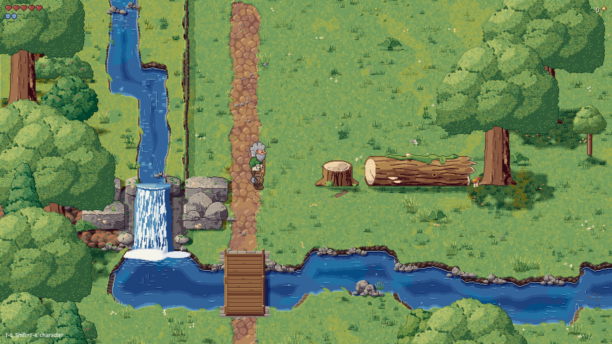
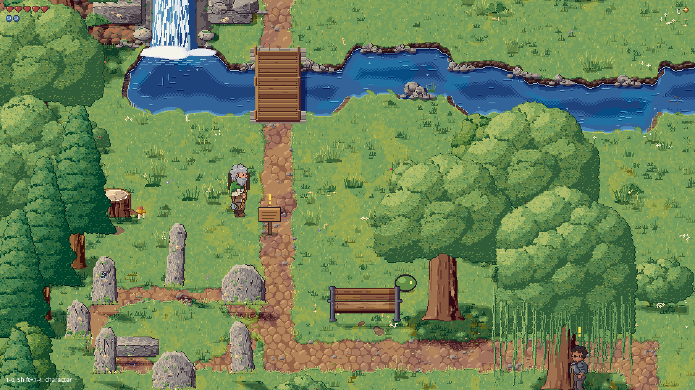
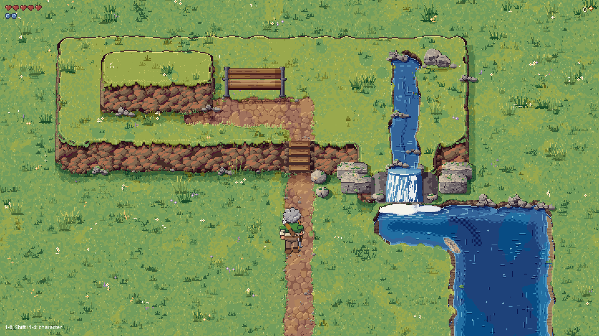

# Editor and woodland kit: acceptance evidence

Task `E1-review/r1`, slot `palette`; claim [6476248552](https://github.com/rempemat-eng/appify/issues/149#issuecomment-6476248552). This continues the review of [PR302](https://github.com/rempemat-eng/appify/pull/302) without changing its production files. **Draft evidence; no material, piece, zone or merge is approved.**

The frozen subject is `04228475cbd9fb76e0a0a9af52240d7e40a5d858`, tree `0f1bbd356f4c4a20fffd2117a8d0f548063ec12f`. Its actual target and merge base are `claude-a/soft-grid@71a402aff0bd64ee42a24b075317c31d1b7320a7`. The 415-file PR diff includes 75 PNGs. W1–W7 successors are separate proposals; this report does not claim their combined integration.

[Source pins](../reviews/editor-takeover/source-pins.json), [producer commands and exits](../reviews/editor-takeover/producer-summary.json), and the [Y12 manifest](../reviews/editor-takeover/y12/manifest.json) accompany the images. Every producer retained a clean tracked subject at the exact head before and after execution. The only authored paths are this report and `docs/reviews/editor-takeover/`.

## The game as rendered

These are real 1920×1080 Godot 4.7.2/OpenGL captures of the unchanged subject, with Mesa llvmpipe and a disposable save/profile. All three commands exited 0, the game's frame-coverage check reported `SHOT ... OK`, and no engine `ERROR:` or `SCRIPT ERROR` lines occurred. Each capture was inspected. Desktop software rendering does not establish phone performance, native-device coverage, movement correctness or visual approval.

**Woodland, arrival above the bridge.**

**Woodland, the stone-circle approach.**

**Tier lab: raised ground, steps, stream and fall.**

[Capture commands, image hashes, package hashes and source guards](../reviews/editor-takeover/captures/provenance.json) are retained with the raw logs. The environment initially lacked Xvfb and xkbcomp. Official Ubuntu packages were extracted privately; an explicitly authorised temporary `/usr/bin/xkbcomp` symlink was created atomically and removed in `finally`, with removal verified. VSync and nonfatal XKB keysym warnings remain in the logs. No subject producer or source file was patched.

## Ground detail: the existing numerical comparison

The existing `scripts.art.kit.detail_bar` was run against the committed painted woodland. Earth faces were additionally compared with the plateau swatch generated by the existing `softgrid_swatches` producer. These are **comparisons with MyGame's earlier painted ground**, not a new direct Eastward image comparison.

| Region | Edges: painted / kit | Tones: painted / kit | Flat share: painted / kit | Existing verdict |
| --- | ---: | ---: | ---: | --- |
| Water and banks | 0.2743 / 0.2812 | 12.19 / 14.26 | 0.2915 / 0.2771 | Pass |
| Paths and verges | 0.3061 / 0.3126 | 14.33 / 14.85 | 0.0619 / 0.0758 | Pass |
| Crown-shadow regions | 0.3192 / 0.3677 | 10.77 / 11.16 | 0.0119 / 0.0134 | Pass |
| Open lawn | 0.2771 / 0.2771 | 8.30 / 8.73 | 0.0312 / 0.0460 | Pass |
| Earth faces versus plateau | 0.3337 / 0.3442 | 13.60 / 17.77 | 0.0061 / 0.0083 | Pass |

[Full measurements](../reviews/editor-takeover/detail/detail_bar_woodland_kit.json) include lone pixels, outline teeth, jags and ruler-edge measures. The source requires edges and tones to reach 95% of the earlier painting and limits flat share and outline defects; lawn has its own two-sided calmness test. All five existing comparisons pass. This does not waive placement, asset, reference or approval requirements.

## Material review sheets

Seven sheets were generated by the subject's unchanged `scripts.art.kit.approval`, without `--eastward`. They show fill, transition masks, dressing and a reference-renderer layout with Bramble for scale. **They contain only generated MyGame imagery.** Eastward screenshots/crops were unavailable to this run and are neither reproduced nor committed.

| Candidate material | Sheet |
| --- | --- |
| Lawn | [Lawn and transitions](../reviews/editor-takeover/materials/approval_lawn.png) |
| Packed-earth path | [Path and transitions](../reviews/editor-takeover/materials/approval_path.png) |
| Water | [Water, banks and transitions](../reviews/editor-takeover/materials/approval_water.png) |
| Earth face | [Faces, lips and tier sides](../reviews/editor-takeover/materials/approval_earth_face.png) |
| Scree | [Scree](../reviews/editor-takeover/materials/approval_scree.png) |
| Worn ground | [Worn ground](../reviews/editor-takeover/materials/approval_worn.png) |
| Cobble road | [Cobble road](../reviews/editor-takeover/materials/approval_cobble_road.png) |

The source has seven materials, twelve transition families and a 24-texel logical cell corresponding to eight world pixels. The [whole-zone Python preview](../reviews/editor-takeover/woodland-python-live-preview.png) shows the live reference renderer with source sprites. It is distinct from the baked-ground runtime captures above; their pixels must not be substituted for one another in a parity claim.

## Building detail: the written 0.8 minimum

The seven Crossroads building designs referenced by the new library were checked as existing asset context, using `scripts.review.assets --no-sheet` with no catalogue recording. All seven detector reports pass, with zero blockers/faults and thirteen polish findings in total.

| Referenced building | Recorded Eastward-band ratio |
| --- | ---: |
| Bakery | 0.903 |
| Fern cottage | 0.876 |
| Herbalist | 0.937 |
| Hut | 0.867 |
| Library | 0.865 |
| North cottages | 0.867 |
| Smithy | 0.869 |

All exceed the written building minimum of 0.8. Five are below the detector's separate 0.9 comparison level, and their `detail_bar.passed` fields remain false; the tool treats that interval as polish, not a building blocker. The [raw asset reports](../reviews/editor-takeover/building-assets/) retain both values and all findings. These ratios use the committed reference bands and do not replace the required same-character-height visual comparison with local Eastward references.

## Gate results and remaining findings

| Existing check | Observed result | Limit |
| --- | --- | --- |
| Piece schema | 102 pieces, zero errors; exit 0 | All 102 remain `candidate`; none is approved |
| Kit rules | Four lab/prototype plans; exit 0 | Unapproved-material/piece advice remains; eleven off-grid placement advisories |
| Ground rules | Exit 0 | Crossroads `square_rubble_b` has a stage-debris advisory |
| Ground detail comparison | Five regions pass; exit 0 | Earlier MyGame painting/plateau comparison, not fresh Eastward imagery |
| Referenced building assets | Seven pass; exit 0 | Thirteen polish findings; no manual/reference approval |
| Godot import | Exit 0, no logged engine errors | Import preflight, not the full test suite |
| Real game captures | Three images; all exit 0 with clean source guards | Desktop/software renderer only |
| Full Y12 PR sheet | Exit 1; `complete=false`, `scope=detector_evidence` | Retained failing/incomplete evidence, never a passing art verdict |
| Final full verify and art reproduction | Recorded separately in the PR body against the exact report head | Required before readiness; no historical pass is substituted |

The eleven off-grid advisories are the width lab's bridge and the woodland's seven standing-stone instances, lintel, stone top and footbridge. The existing checker calls them advice in these lab/prototype plans. Their exact coordinates and messages are in the [kit-rule log](../reviews/editor-takeover/commands/kit-rules/stdout.txt); no positions were changed.

Y12 was executed from the pinned PR322 tool, commit `d572d85b8450d451eccb0d6d35435c00e6e95412`, SHA256 `0c539a9ca206f625dcc617a51496ead4cb5bc1e95e642493e6b7ad4b452d3da3`, as an offline wrapper around the independent subject checkout. A [byte-identical tool copy](../reviews/editor-takeover/tool/pr_sheet_d572.py) is included for reproduction; the original execution path remains in the command logs. Its [index](../reviews/editor-takeover/y12/index.html), manifest, previews, reports and logs are retained as one bundle. It records 75 PNG rows: 31 pass and 44 fail, with **21 blocker, 136 fault and 36 polish occurrences**. It also records **295 source-only changes**, four registered scene-source changes and 41 other changes. The whole PR is explicitly not `no_art`.

Those raw asset counts include LUT/palette-operation atlases and transparent shadow masks evaluated as ordinary visible artwork. For example, black shadow masks produce `logic.void`, and operation atlases produce void/flat/edge findings. These data representations need composed-material/context evidence; the raw counts are preserved without treating every occurrence as a demonstrated defect in the rendered world. Waterfall/decal floating-part findings also require in-context review. No detector or classifier was weakened.

All four registered kit scenes fail in the existing scene producer **before rendering**: `scripts.review.scene` supplies an empty composite, and `scripts.review.run` raises `ValueError: cannot write empty image`. Their `report.json` files are absent. The independent real captures above establish that the zones render; they do not repair this missing scene-review coverage or turn the Y12 rows into passes.

## Bounded work before acceptance

1. Extend the existing scene reader/review adapter to handle `TerrainGround` and `KitPiece` source faithfully, retaining a failing regression for the empty kit composite. Reuse the existing physical model and unit contracts; do not invent a second scene system.
2. Extend Y12's bounded representation classification/context handling for kit operation atlases, palette tables and shadow masks. Keep the raw evidence and require actual composed-material review; this is not permission to waive applicable art checks.
3. Review the recorded off-grid prototype placements and the Crossroads stage-debris condition under the written rules, on separately claimed source work.
4. Complete the library gate's independent detail audit and same-character-height Eastward comparison using local references, then obtain Matt's explicit decision on each material/design. The missing reference comparison is still missing.
5. Validate the eventual combined editor stack on its exact source. This frozen-subject report does not establish current W1–W7 integration, a clean full scene gate, collision completeness, phone performance or gameplay acceptance.

The accessible captures and material sheets make the present look reviewable. Candidate status and the review hold remain unchanged.
