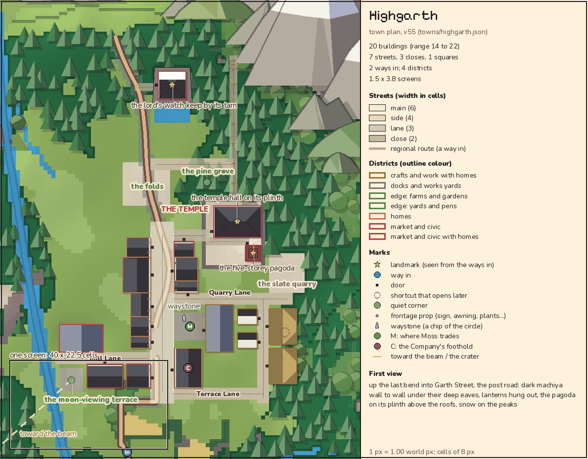

# Highgarth town data polish (Y15)

MyGame Y15 town pass, based on Claude A's PR303 head `4984438d09b5fe1333d3e6ea6e6ee82be2bdc908` (28 October 2026, 12:05:46 UTC). This is the next push after [the Y15 instruction](https://github.com/rempemat-eng/appify/issues/149#issuecomment-6467789932), so the start gate is met. The target is `claude-a/continent-v53`.

The authored Japanese post-town plan already passes the existing town checker. Its structural forms and visible inset identify a temple hall, five-storey pagoda and hot-spring bathhouse. Generic building-export labels still describe a chapel, a Company office tower and a school. This pass corrects those semantic leftovers for future plan consumers without placing anything new.

| Record                              | Before                                  | After and existing authority                                                                                                         |
| ----------------------------------- | --------------------------------------- | ------------------------------------------------------------------------------------------------------------------------------------ |
| highgarth-b001 purpose              | the chapel hall                         | the temple hall; `style.forms.temple_hall` and the existing game-layout landmark                                                     |
| highgarth-b002 purpose              | a tower                                 | the five-storey pagoda; `style.forms.pagoda` and the existing landmark name                                                          |
| highgarth-b002 occupants            | offices and the Company                 | unassigned; X3 roles and routines deferred. The actual Company foothold remains the buyer's room at post inn b005 in `theme.company` |
| highgarth-b020 purpose              | the school                              | the hot spring bathhouse; `form=bathhouse` and `style.forms.bathhouse`                                                               |
| watchkeep landmark placement reason | water's edge, seen from water and quays | stone base behind the tarn, facing the sealed north pass; `style.forms.watchkeep`, site fit and the existing keep landmark name      |

No named resident, job, routine, timetable, population, economy, travel or gameplay policy is added. In particular, the deferred pagoda occupants do not relocate the Company or invent temple staff. X3 must obtain authored roles separately.

## Layout and inset

All values other than these five fields are identical to the pinned base plan. The 27 counted units, three separate landmarks and their `counts_as` values, building IDs, forms, bays, storeys, footprints, doors, plots, streets, paths, ground/terrain, theme, waystone and sealed-pass data are preserved. Existing row variation and gardens remain the author's plan. This narrow semantic pass does not claim to complete the wider Y15 layout review.



This is the existing committed inset from the pinned base, inspected for the pass. It already labels the temple, pagoda and keep correctly. Its bytes and all map-rendered plan inputs remain unchanged; there is no new render or visual-acceptance claim. The existing renderer reads `game_layout.landmarks` for labels, not the changed building purpose/occupants or the separate counting-landmark reason. No new bitmap or art direction is authored.

## Checks and integration

Run the existing checker from the repository root:

```sh
python3 scripts/review/town_plan.py --town highgarth
```

The baseline and final plan pass with 27 counted buildings (guide 24–36), 18 streets, two arrivals, two blocks, one reported dead end and 1.9 × 3.8 screens. An exact-base structural comparison verifies that reversing only the five semantic changes restores the entire original plan. Required full verify and art-repro gates apply to the final branch; these checks do not approve the plan, art, placement, live X3 or devices.

The source plan is generated. This PR deliberately changes only Highgarth's exported JSON and this note, leaving shared generator/checker files to their owners. Claude A must preserve these town-specific semantic overrides when integrating or regenerating `towns55`/`town_plans`, rather than restore generic type labels. The stale generic labels are not a request to alter the drawing or building forms. Review/integration remains Claude A's responsibility.

Y14 PR329 is a separate completed concept packet pinned to the earlier `911edac6` plan; its fixtures and explicit source limitations remain historical evidence and are untouched here. This pass does not retrospectively claim the newer 30-record/27-counted plan was tested by Y14's earlier checks.
