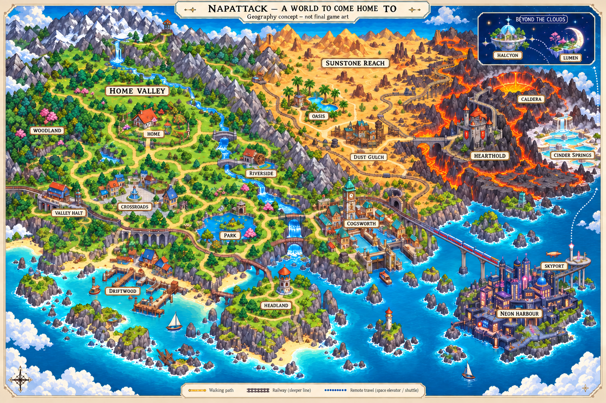

# A world to come home to

Research, geography proposal and engineering handoff for Claude · 18 October 2026

**Status: design proposal, not a live-world replacement.** Matt explicitly requested a fresh map, substantial comparable-game research, a second polish pass, path/segment logic and a GitHub handoff. This package does not import anything into the game, move an existing zone, migrate a real save, alter a rule/reward, or edit Claude's art/vision/UI lane. The initial reviewed code is `f299f59a989191a9070fd23bfdf6162f6fb34e1c`; the verification baseline is newer main `500605d39f16164eab6af50168ba6b3bccdbcd63` (Claude's foliage/detail pass).



The render communicates landforms, district identity and relative relationships. It is **not** a collision mask, a measured world projection or an instruction to copy generated pixels into the game. `topology.json` is the authoritative proposed adjacency/port contract; the prose explains its intent. The existing game remains authoritative until a separately verified implementation lands.

[Exact segment-and-crossing schematic](./connections.svg) · [Machine-readable proposal](./topology.json) · [Executable design checks](./check-topology.cjs)

## 1. The design decision

**A familiar, compact home valley; distinct journeys beyond it.** The valley is one place with a northern upland, a wooded western flank, a domestic terrace, a river descending east/south, a town and a southern estuary. It is not nine independently decorated rectangles. Distant climate and technology changes happen across real mountain/sea separation and the existing train, mine-cart, maglev, elevator and shuttle journeys.

Three alternatives were considered:

| Structure                                           | Strength                                       | Why this is not the main choice                                                                 |
| --------------------------------------------------- | ---------------------------------------------- | ----------------------------------------------------------------------------------------------- |
| All biomes round a central plaza                    | Easy overview                                  | Makes home a transport roundabout; snow, dunes, lava and neon become arbitrary adjoining rooms. |
| Entirely separate islands                           | Strong silhouettes and boundaries              | Makes even a short wander a sequence of vehicle trips; gives up continuous local walking.       |
| **Connected home valley + a few regional journeys** | Familiar short walks, readable distant changes | Chosen. Local loops provide freedom; the travel atlas honestly uses a different scale.          |

This keeps the already-approved rest → clockwork → desert/burnout → screens → deep quiet theme. It does **not** turn it into a compulsory itinerary. Home is sufficient on its own. The garden's resting clearing sits off the through-path, not at a four-way public intersection.

## 2. Research: what was actually useful

Research included actual overview/screen-map inspection for Stardew Valley, Link's Awakening DX and A Link to the Past, plus creator/official accounts for A Short Hike, Lil Gator Game, Alba, Animal Crossing, Pokémon and Spiritfarer. Community-hosted maps below establish observed geometry, not creator intention. These are transferable design observations, not claims that all these games have the same structure.

| Reference and evidence                                                                                                                                                                                                                                                                                                                                                        | Observation                                                                                                                                | Applied here; what is deliberately not copied                                                                                                                               |
| ----------------------------------------------------------------------------------------------------------------------------------------------------------------------------------------------------------------------------------------------------------------------------------------------------------------------------------------------------------------------------- | ------------------------------------------------------------------------------------------------------------------------------------------ | --------------------------------------------------------------------------------------------------------------------------------------------------------------------------- |
| **A Short Hike**, [creator on building Hawk Peak](https://blog.playstation.com/?p=356716), 13 Nov 2021; [creator on the tiny open world](https://blog.playstation.com/2021/08/05/crafting-a-tiny-open-world-a-look-behind-the-scenes-at-the-creation-of-a-short-hike/), 5 Aug 2021                                                                                            | Movement and terrain were iterated together; elevation distinguishes regions. A rear cave reconnects an unexpected approach.               | Design the shape and return connections before dressing it. Do not import stamina collecting or summit difficulty.                                                          |
| **Lil Gator Game**, [Scott Slucher/Connor Quinn interview](https://www.sixoneindie.com/post/interview-with-the-team-behind-lil-gator-game-about-their-upcoming-dlc-in-the-dark), 18 Sep 2025                                                                                                                                                                                  | The original uses distant landmarks; caves need nearby vines, tracks and rock cues instead.                                                | Navigation must fit the actual camera. Use local route materials and frames, not a landmark visible only in the atlas.                                                      |
| **Alba**, [ustwo environment artist's account](https://ustwogames.co.uk/news/the-environment-art-of-alba-a-wildlife-adventure/), 23 Jul 2021                                                                                                                                                                                                                                  | Whole areas and biome compositions moved during iteration; terrain height informed material placement.                                     | Keep distances adjustable and ground meaningful. Do not freeze the layout because props already exist.                                                                      |
| **Stardew Valley**, [in-game map on its official forum](https://forums.stardewvalley.net/threads/printable-map.31590/), community screenshot; [developer media](https://www.stardewvalley.net/media/)                                                                                                                                                                         | Farm–forest–town and farm–backwoods–mountain–town give alternative approaches; mountains, river and southern coast orient the region.      | Overlapping local circuits and distinct approaches, not daily schedules, shop attendance or a farm chore loop. Map scale is not measured walking distance.                  |
| **Link's Awakening**, [screen-capture montage](https://www.zeldaspalace.com/linksawakening/maps.php), community-hosted                                                                                                                                                                                                                                                        | Northern mountain shelf, southwest village/coast, tree belts and river/cliff channels make landscape rooms inside one island.              | Boundaries structure a continuous place. Do not copy Koholint's arrangement or require an item chain to explore.                                                            |
| **A Link to the Past / Between Worlds**, [Light World montage](https://zeldawiki.wiki/wiki/File:ALttP_Light_World_Map.png); [Nintendo developer interview](https://www.nintendo.com/en-za/Iwata-Asks/Iwata-Asks-The-Legend-of-Zelda-A-Link-Between-Worlds/The-Legend-of-Zelda-A-Link-Between-Worlds/6-Rethinking-the-Unquestioned-/6-Rethinking-the-Unquestioned-832156.html) | A few large landforms/anchors organise the Light World. Nintendo explicitly cautions that its dungeon order was less free than remembered. | Borrow legibility, not locks, compulsory combat or the assumption that a connected picture means unrestricted progression.                                                  |
| **Pokémon Hoenn/Johto**, [official ORAS page](https://www.pokemon.com/uk/pokemon-video-games/pokemon-omega-ruby-and-pokemon-alpha-sapphire); [route table](https://bulbapedia.bulbagarden.net/wiki/List_of_routes_in_the_Pok%C3%A9mon_world), secondary topology                                                                                                              | Settlements and routes alternate; cross-connections reconnect branches. Hoenn's land/water silhouette gives the network a regional form.   | Keep town and the journey between towns distinct. Do not add encounter grass, HM gates or badges.                                                                           |
| **Animal Crossing**, [Nintendo developer interview](https://www.nintendo.com/en-gb/Iwata-Asks/Iwata-Asks-Animal-Crossing-New-Leaf/Animal-Crossing-New-Leaf/1-A-Fresh-Start-for-Animal-Crossing/1-A-Fresh-Start-for-Animal-Crossing-738583.html); [Nintendo-hosted guide](https://www.nintendo.com/jp/ichikara/acbaa/02_en.html)                                               | Authorship extends from the home to its surroundings; rivers/cliffs and bridges give places physical structure.                            | Protect the personal garden and reserve its decorating space. Do not add daily scarcity or expiring opportunities. The guide is GameWith-authored, not a creator interview. |
| **Spiritfarer**, [Thunder Lotus](https://thunderlotusgames.com/games/spiritfarer/)                                                                                                                                                                                                                                                                                            | Distinct destinations are joined by an intentional boat journey.                                                                           | Distinguish walking from regional travel. Its resource/care economy is not evidence for NapAttack's wellbeing rules.                                                        |

Additional design evidence: [GDC's expert roundtable](https://www.gamedeveloper.com/design/gdc-2018-level-design-workshop-an-expert-roundtable-q-a) explicitly discusses why top-down 2D cannot rely on a persistent distant skyline; [Joris Dormans on places](https://www.gamedeveloper.com/game-platforms/the-theory-of-the-place-a-level-design-philosophy-for-unexplored-2) separates destination, primary approach, surroundings and alternative entry; [USGS on watersheds](https://www.usgs.gov/water-science-school/science/watersheds-and-drainage-basins) grounds the ridge → tributary → estuary story. The adaptation to this game is our inference.

### Second pass: after the first render

- [Liz England's Door Problem](https://lizengland.com/blog/the-door-problem/) prompted explicit definitions for traversable seams, a hut door, decorative facades and station interactions. A convincing drawing alone cannot say which is usable.
- [The Level Design Book's typology](https://book.leveldesignbook.com/process/layout/typology) informed the repetition/artificial-shortcut review. The ridge stays a purposeful short spur; it does not get an implausible loop merely to raise a graph metric.
- [Jane Ng's Firewatch production talk](https://media.gdcvault.com/gdc2016/Presentations/Ng_Jane_MakingTheWorld.pdf) supports separate design/art data and contiguous spatial streaming. It is not proof of our walking scale or performance.
- [LDtk's world-layout documentation](https://ldtk.io/docs/game-dev/json-overview/world-layout/) and [Tiled's world files](https://doc.mapeditor.org/en/stable/manual/worlds/) support explicit map coordinates, bounds and neighbours. No editor dependency is being added.
- Two independent topology reviews found and resolved the castle contradiction: a bridge-only castle cannot also be the only corridor to the caldera. The bridge's far abutment is now a fork; castle is an optional east spur and caldera is north, outside the walls. Its neighbouring springs seam is explicitly closed.

## 3. World types, without another pile of biomes

| Place family                      | Identity and fit                                                                                                                                                | Separation/transition                                                                                                                  |
| --------------------------------- | --------------------------------------------------------------------------------------------------------------------------------------------------------------- | -------------------------------------------------------------------------------------------------------------------------------------- |
| **Home Valley**                   | Domestic meadow, broadleaf wood, river/mill, upland lookout and tide-washed coast. Existing home, growing meadow, missions, shop and practice ring belong here. | Tree belts, a coherent stream, terraced bluffs and the estuary. Meadow → sparse trees → canopy; river meadow → reeds → beach.          |
| **Cogsworth waterworks**          | A small canal/rail settlement, not a giant unrelated industrial city. Clocks, locks and copper roofs express busyness.                                          | Wooded hills/inlet separate it from home; train arrival and canal towpath establish a new district.                                    |
| **Sunstone Reach / fire country** | Western dry town and spring-fed oasis become scrub, basalt, lava chasm, Hearthold and caldera. Mineral springs occupy the cooler outer basin.                   | A mountain rain shadow explains the dry region. Sand never touches snow or molten lava; scrub and cooled crust mediate the transition. |
| **Neon Harbour / Skyport**        | One compact sheltered waterfront and transit district. Different social energy, not just meadow props recoloured purple.                                        | Sea channel and an unmistakable maglev journey. No pedestrian route across the train viaduct.                                          |
| **Halcyon / Lumen**               | Orbital greenhouse followed by quiet lunar/glow-flora garden. Existing distant destinations, not land north of the city.                                        | Separate inset/local maps, reached by existing elevator and shuttle.                                                                   |

Ideas worth developing **within** these families later: a moss-water hollow in the woodland; a tide-glass cove off the harbour; a mineral/steam garden at the springs; a small glow-flora grotto on Lumen. These are atmosphere/place proposals, not four additional worlds or new mechanics. Coral, sky islands and a dream forest should remain off this initial footprint rather than filling every sea/mountain gap.

No current sprite is mandatory. Keep the useful place identities and stable data references; let Claude redraw their landforms, footprints and compositions. The map is not a demand to reuse every asset.

## 4. How the valley fits together

The proposed valley retains the current integer layout, replacing the old coastal castle position with a **new** `headland` zone. The physical castle retains its own identity and moves only under a later explicit migration.

| Row | West        | Centre            | East      |
| --- | ----------- | ----------------- | --------- |
| -1  | —           | Ridge             | —         |
| 0   | Woodland    | Garden/home       | Riverside |
| 1   | Valley Halt | Crossroads Town   | Park      |
| 2   | —           | Driftwood Harbour | Headland  |

Three overlapping walking circuits share familiar approaches:

1. Garden → Woodland → Halt → Town → Garden.
2. Garden → Riverside → Park → Town → Garden.
3. Town → Harbour → Headland → Park → Town.

The ridge is a short, visibly intentional lookout spur. Town has four approaches, but they need not converge at one congested tile: the north lane arrives through gardens, the west through the station edge, the east beside the park, and the south down the harbour lane. The home clearing remains off the public route.

The river originates below the high ridge, runs east across the lower garden terrace and turns south through Riverside/Park to the harbour estuary. Water drops tiers at visible falls; the pond has an outlet. Roads cross it only at drawn, supported bridges with dry path landings. The rail bridge is distinct from a footbridge.

## 5. Fire country, including the castle's actual access

One continuous walking region, not four loaded dioramas:

| Grid position | Place                           | Walking neighbours           |
| ------------- | ------------------------------- | ---------------------------- |
| [-1,0]        | Oasis                           | Gulch                        |
| [0,0]         | Dust Gulch                      | Oasis; basalt pass           |
| [1,0]         | Basalt pass                     | Gulch; lava bridge           |
| [2,0]         | Lava bridge + far-abutment fork | Basalt pass; castle; caldera |
| [3,0]         | Hearthold                       | Lava bridge only             |
| [2,-1]        | Caldera                         | Lava bridge; springs         |
| [3,-1]        | Cinder Springs                  | Caldera only                 |

At the far abutment, east continues on the same stone causeway to the castle's single west entrance; north climbs **outside** the walls. The mine-cart shortcut arrives at the caldera, never in the castle. Castle–springs is a touching but **blocked** seam: a continuous escarpment/wall makes that fact visible. Corner cutting must not create a diagonal entrance.

Lava runs from the elevated vent, around the castle rock and down into a crusted basin. Springs have a separate water source and outflow; a blue pool does not receive molten lava. Dragon motion remains finite/scenery-only and becomes a sleeping pose in reduced motion. No hazard damage, platforming, switches, keys or new unlocks are proposed.

## 6. The engineering contract Claude can build against

Current `regionWalk()` stitches 320 × 576 px rectangles, with 4 px walk cells, and automatically connects any open touching cells. There is no explicit crossing registry. A read-only decode of current maps found fully open seams at Woodland–Halt, Riverside–Park, Town–Harbour, Park–old castle and Oasis–Gulch. Drawing a narrow road does not constrain those crossings.

**One connection record must define both sides.** The proposal provides stable endpoints, kind (`walk`, `door`, existing `transit`), edge, half-open pixel span, arrival approach and visible barrier. Derive reciprocal ports; do not maintain two independent exit lists. Local art coordinates and atlas display coordinates are separate.

- Ordinary walking is free and physically ungated on the current source. The **mountain mission** requires level 2; the ridge landscape must not silently acquire that mission gate.
- Only declared walk-port cells connect at a seam. The rest requires a matching **visible** treeline, fence, bank, wall or cliff—not an invisible blocker. Water/rail continuity can cross a seam without granting foot access.
- Preserve lateral position across a walk opening, then land inside reachable dry approach ground. Do not snap every visitor to a map-centre spawn. A blocked tap must not snap across a closed seam, water or wall.
- Proposed walk bands are roughly 48–64 art px, snapped to the 4 px grid, with shoulders and approach bands. They are starting geometry for greyboxing, not measured comfort or approval of current grids. A 44 **screen-pixel touch target** is a separate UI requirement, not a world-width unit.
- Corridors use the existing rulebook: approximately 120–200 art px contributed by each side, one bend, a pause, a partly permeable side, and the next landmark revealed before crossing. The seam lies within shared character; the district changes at the bridge/gate/clearing, not at a rectangular texture boundary.
- Bridges need a blocked water/gap layer, a supported deck layer and reachable dry approaches at both ends. Rail is not walkable except a separately drawn authorised crossing. North/south tier changes require a visible ramp, stair or slope; no walking up a face.
- A door explicitly changes scene and preserves a return anchor. A station requires deliberate interaction and preserves the current trip rules. Merely passing a station never starts travel, a mission or a nap.
- **Physical region and transit stop are different identities.** The proposed `sunreach` contains both the existing `west` stop at Gulch and `lava` stop at Caldera. Current `travelRoute(fromRegion,toRegion)` returns no legs for the same region, and `travelPoints` has one stop per `RegionId`; therefore this is not a drop-in layout substitution. Preserve the existing service/stop IDs in a separate transit graph and adapt station selection/arrival to physical-zone coordinates. The west–lava mine-cart remains a deliberate shortcut within the same walking region. The proposal demonstrates this distinction; production code needs an explicit adapter and regression tests.
- The proposal's one-shot intent model illustrates generation-token cancellation. It is not proof the current renderer has this guard: `AtlasWalk` currently checks app activity, not independent navigation focus. That integration needs its own test.
- Preserve current garden return behaviour (`WorldLink`/`homeArrival`, yard bounds and arrival debounce); do not bounce immediately between Home and World.
- Preserve current journey semantics: inactivity currently finishes the leg, SKIP ends the full trip, reduced motion uses a still. Do not quietly replace that with the walking-cancellation policy.

The standalone checker exercises the **proposal's** graph and synthetic seam/arrival contracts. It does not inspect generated pixels, certify actual prop reachability or replace C23's canonical lint.

## 7. Existing systems: keep them intact

| Existing system                        | Map's job                                              | Must remain unchanged                                                                                                    |
| -------------------------------------- | ------------------------------------------------------ | ------------------------------------------------------------------------------------------------------------------------ |
| Home / nap / Quiet view / welcome back | Familiar safe clearing and deliberate exits            | Timers, protected return, early-return confirmation, Quiet view and ability to leave immediately.                        |
| Missions                               | Town library, park, ridge remain recognisable places   | `book`, `park`, `mountain` IDs, durations, eligibility, explicit START and settlement. Walking is not a reward shortcut. |
| Shop and arena                         | Clear doorstep/courtyard and reachable standing points | Existing prices, ownership, cards, battle rules and deliberate actions. No new shops or reward routes.                   |
| Meadow / decorating                    | Keep personal ground out of transit corridors          | Existing growth/history and owned decor. No absence penalty or new maintenance requirement.                              |
| Residents / atmosphere                 | Distinct local compositions and lighting               | Optional/cosmetic weather; no mood/reward/timer coupling, expiring sightings or attendance requirement.                  |
| Regional travel                        | Legible endpoints and vehicle vocabulary               | Existing routes/vehicles, skip and return semantics. No fares, waiting schedules or travel unlocks.                      |

## 8. Save safety is a prerequisite, not a tidy-up

Current saves hold **absolute region x/y**, not zone-local positions. Never substitute the new layout and clamp the old number. First resolve the old region and tile using the exact legacy layout/origin; retain the local offset; map the old physical place to the new physical place; then choose connected reachable approach ground using the new semantic grid.

Specific policies:

- An old coastal-castle **position** maps to Headland, which occupies that physical valley corner. It must not teleport the companion into fire country.
- Historical `castle` discovery remains recorded separately in `legacyDiscovery`; its former physical location maps to `headland`. Do not mark the newly situated inland castle visited or award a discovery/reward merely for migration. Physical resume mapping, current discovery and historical discovery are separate concerns.
- Old `west` and `lava` coordinates resolve against their old layouts before joining proposed `sunreach`. Their old minima differ; a global offset is insufficient.
- Preserve unknown fields, unknown/future discoveries, currency (including fractional balances), level, hats/cards, collection, companion, focus/mission/nap/history, decor and all unrelated data. Keep the existing storage key and recovery protections. A bad world location must never reset the player.
- Add an explicit layout version and make migration idempotent. Preserve the pre-migration data/backup. Audit return anchors, residents, mission places and transit endpoints as well as the player's current location.
- **Migrate before legacy sanitisation.** Current `save-data.ts` projects the known world shape, and `restoreWorld()` rejects unknown regions/filters unknown visited IDs. A later migration cannot recover fields already removed. Extend the version-aware save shape and run migration before those legacy filters; test a real `readSave` → `writeSave` → reload cycle, including `sunreach`, `headland`, layout version and forward discoveries. The standalone clone/fixture test does not prove this pipeline.
- The included fixture migration is a **design demonstration**, not production migration: exact path-component safe placement, pending-transition policy and old-world backups still need integration against Claude's final grids.

## 9. Handoff order and acceptance

Claude owns the detailed drawings and renderer. Please do these in small coherent slices, without parallel edits to the same world:

1. Review this geography/route contract. Revise the proposal before art if a route cannot be made plausible. Do not wire the concept PNG into the game.
2. Greybox **Garden–Town** together, including both approach bands, a real frame break, entry/return guard and current standing points. Stitch the two full maps and test the crossing in both directions.
3. Close the western and eastern valley circuits, then the coast circuit. A drawn open passage must agree with walking, keyboard and tap pathfinding. Check unlisted spans and diagonal corners, not just the golden road.
4. Draw the new Headland and build the desert/basalt/bridge/fork/castle/caldera/springs as one geographic block. Use the castle–springs closed seam as a deliberate negative test.
5. Only after final layouts exist, implement/version/test the lossless save migration. Keep the old layout available until migration is proven. Then wire the new graph/standing points and preserve existing mission/store APIs.
6. Add intricate vignettes, buildings, materials, residents, night light and finite motion **inside** the reserved access/semantic layers. Atlas art can simplify geography but must never invent a walking edge.

Before live integration: real-grid flood fill from every arrival to every action stand; semantic water/bridge/support/rail/elevation checks; every walk edge both directions; deliberately blocked spans/corners; old save fixtures at every old zone edge; reload mid-corridor; interrupted tap/held-key walks; rapid Back/Home/menu/tab switches; trip skip/background cases; mission completion/Quiet/early return regressions; 320/402 px normal/reduced day/night browser passes. Measure actual route time at current speed; no 1–5 minute promise is made by this drawing. No phone, native runtime, audio, measured FPS/RAM or multiplayer claim.

### Reproduce the proposal checks

```sh
node docs/codex/ideas/connected-world/check-topology.cjs
npm run verify
```

The first command validates this design-only package and its negative controls. The second checks the app source; it does not by itself validate a future redraw. See the PR's final handoff for exact tested commit, CI and remaining gaps.
