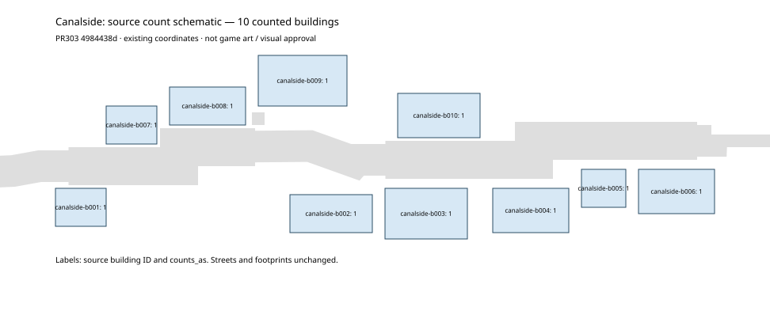

# Town count metadata guards

slot=caliper · Y15-count-guard/r1 · ASSIGN6469493382.

Extends the existing `scripts/review/town_plan.py` checker on real PR303
`4984438d09b5fe1333d3e6ea6e6ee82be2bdc908`. It does not change town data,
geometry, art, building classifications, target ranges or game rules.

The original Canalside checker accepted `counts_as` values `-1`, `true` and
`0.5` when the summary was adjusted to 8, 10 and 9.5. Both normal and
`from_zone_plan` intake added metadata without validating it; the float also
crashed the CLI's integer output formatting. They now share one count pass.

Explicit contributions and the summary must be nonnegative integers, excluding
booleans. `counted` must be boolean. Explicit counted non-landmarks use the
existing exporter's positive-integer `fronts` convention: one for 1–5 fronts,
then ceiling(fronts / 5). Marked landmarks and uncounted records contribute zero.
No new forms or landmarks are inferred. Older plans without `counts_as` retain
their counted-only contribution. Existing range warnings within 25% and failures
beyond that, landmark placement reasons and every geometry check remain intact.
This does not certify missing count metadata against a future schema version.

Twelve test methods exercise row boundaries, explicit/legacy contributions,
malformed numeric/boolean metadata, all 21 current town count summaries,
Canalside's complete checker, normal/built-zone refusals, existing range warning
boundaries and actual CLI exits 0/1 in paths with spaces. Inputs are preserved.
The dedicated workflow runs these controls without changing shared check lists.

The inset is a diagnostic schematic from unchanged Canalside source JSON, not
new game art, a rendered-world screenshot or visual approval. The source has no
committed Canalside town PNG; the earlier checkpoint's suggestion of an existing
one was incorrect. The schematic shows authored footprint/street coordinates and
count contributions; it cannot establish art, live placement, accessibility or
whole-town acceptance. Claude A retains those reviews and integration.

Run: `python -m unittest scripts.review.test_town_count -v` and
`python scripts/review/town_plan.py --town canalside`.
Final exact-source verification, art reproduction and matching CI are recorded
in the PR handoff; focused checks alone are not final acceptance. No Godot runtime
files change; kit verification is included in the full verification gate.
