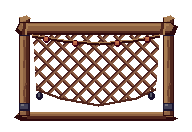
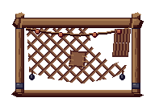

# MyGame waterfront props: first candidate batch

Two reusable designs now have four source-native pictures: a mooring bollard
with an optional coiled rope, and a net rack in drying and mending configurations.
They give Neon's working waterfront recognisable equipment without filling its
streets with unrelated clutter. The rack can later serve the fishing settlements;
neither design is placed in a production map in this change.

Matt authorised parallel prop creation before the map is finished. The bounded
lead allocation is [Y36 GO6496183343](https://github.com/rempemat-eng/appify/issues/149#issuecomment-6496183343),
claim [6496206914](https://github.com/rempemat-eng/appify/issues/149#issuecomment-6496206914),
and lab grant [6496223684](https://github.com/rempemat-eng/appify/issues/149#issuecomment-6496223684).
The genuine source parent is editor PR375 commit
`45ed3cad029c106977e6c0c833913dcb1c614fbd`, tree
`0bdea46338655dcb3c9922ad5cbcdd023310b87d`.

## Pictures for review

| Single bollard | Bollard and rope |
| --- | --- |
|  |  |

| Working net rack | Net rack being repaired |
| --- | --- |
|  |  |

The external contact sheet shows these at their native density-3 scale beside
the existing Crossroads bench, stall and crates, and the unchanged Moss idle-S
frame 3. That frame's opaque feet-to-crown height is exactly 74 art pixels;
no individual comparison sprite was rescaled. A second presentation enlarges
the entire sheet 2x by nearest neighbour. These comparison sources are from the
same parent tree. They are not newly drawn or newly approved by this batch.

## Construction and measured metadata

The designs develop existing W0 `industry_bollard` and `industry_net_rack`
concepts and the requirements in PR345's `coast-city-kit.md`. The original
concept records remain unchanged and non-placeable. The new live-library
definitions remain **candidate**, without an approver or approval date.
Legacy `bollard`, `city_quay_bollard` and `net_rack` pictures have ledger
REWORK verdicts; their pictures are not copied into this batch.

The bollard has an iron mushroom head, broad lit top and west arris, a dark
underside and east plane, a worn groove and a four-bolt rectangular base plate.
Its optional rope is seated on the same ground envelope. The rack has timber
posts with lit edges and grain, iron straps, a continuous crossbeam, transparent
diamond mesh, cork floats and weighted corners. The mending configuration has a
partly rolled net and a stitched patch. It introduces no broken/restored quest
condition. A low timber tie physically joins its feet and accounts for its
continuous blocking rectangle.

| Design | Canvas, art px | Foot, art px | Height above foot | Rectangular blocker, world px | Conservative footprint |
| --- | --- | --- | --- | --- | --- |
| Bollard, both variants | 96 x 72 | [48, 60] | 42 art px / 14 world px | [-8.5, -3.5, 16, 3.5] | 3 x 1 cells |
| Net rack, both variants | 192 x 132 | [96, 120] | 105 art px / 35 world px | [-27.5, -3, 55, 3] | 8 x 1 cells |

Canvas dimensions include transparent padding and are not solid footprints.
One soft-grid cell is 24 art pixels / 8 world pixels. The footprint lists retain
every cell with positive-area intersection with the authored rectangle. Drawn
overhang cells are recorded separately. Both designs sort at the foot and use
the existing ellipse cast-shadow metadata, displaced down and right. Their base
and material undersides provide the drawn contact seam. No unsupported
sprite-shaped shadow, multiple collider, rotation or light implementation is
claimed. The recorded ellipses still need a composed-scene visual review.

Only the south-facing designs are supplied; the placement definitions refuse
other facings rather than mirroring their lighting. The bollard snaps to a half
cell and requires water adjacent to its dry rock base. The rack snaps to the
existing cell grid and requires water within four cells of its dry earth base.
Both deny water and route ground, retain one-cell piece clearance and use tier 0
for this lab. Actual settlement placement also needs a clear walking/loading
corridor and the appropriate ground construction. Paved quay, timber deck and
sand material bindings are deferred: these definitions do not pretend those
materials already exist in the seven-material library.

`function` is empty. The designs have no shop, reward, travel action, harvest,
resident assignment, work routine or new mechanic. Movement blocking follows
the declared bases; `blocks_shots` is false and no combat cover is introduced.

## Reproduction and focused checks

`scripts/art/kit/settlement_props.py` uses existing house-palette ramps and
integer texels. It writes exactly the four pictures and does not update the
shared index, generated scenes, schemas, package files or other art.

```sh
python3 -m scripts.art.kit.settlement_props --out game/kit/props/art
```

The allocated initial generation exited 0 in 0.131 seconds. The one separately
allocated regeneration wrote to a fresh external directory and exited 0 in
0.150 seconds; all four PNG byte strings matched exactly. This standalone
generator is not on the ordinary sixteen-generator art-repro list. Its separate
result must not be described as coverage from that unrelated list.

| Picture | SHA256 |
| --- | --- |
| `industry_bollard_single.png` | `215fcd64679cad9fd002cf7d2acc750851b6999ac7108871c3c82a6eda3bdcb4` |
| `industry_bollard_rope.png` | `98081005e9d4a1fabdaf873e1012b5a4ee188e9ec66c102e9190cddee20a6b36` |
| `industry_net_rack_working.png` | `6a9d1f89b351b9bf504c7426e8e203a5c68cce014578fed7fe195400a2e88ded` |
| `industry_net_rack_repair.png` | `6947447d2377797fbad0a5846e15500cd83f29246f23eb2bbdc1474cd6278b5d` |

The two definitions pass the existing piece schema, semantic and location
checks. All opaque sprite colours belong to existing house ramps; alpha values
are only 0 and 255. The single/rope bollards contain 6/10 colours; the working
and mending racks each contain 14. Those palette counts do not establish the
detail or Eastward gates.

The new `game/kit/zones/waterfront_props_lab.json` is a small texel-coordinate,
same-tier metadata lab using existing water, scree, worn earth and path. Its two
positions have zero findings from the existing relation engine against the
actual piece/terrain definitions. Eight external negative controls detect:
bollard on water, bollard on a route, rack on a route, rack too far from water,
off-grid rack, overlapping rack, out-of-bounds rack, and wrong tier. The checks
leave the input metadata unchanged. This is focused source-metadata evidence,
not a rendered kit-rule or editor-placement pass. The lab is not baked and no
shared compiled index or scene has been generated for it.

The external result is `waterfront-props-evidence/focused-result.json`, SHA256
`450527776e8f828b028b2454d239f79f97890043505c2015354ea20662eb3aba`.
Generation logs, exact regenerated files and comparison-source hashes are kept
with that packet. The first contact-sheet-only attempt stopped because Moss
frame 0 is 72 pixels tall; the final sheet uses frame 3's measured 74 pixels.
That correction did not execute the prop painter again.

## Remaining acceptance

The official Eastward reference register is
`scripts/art/eastward_study.py`: Steam apps 977880 and 2305370 and the official
Eastward media stills. Its measured adult is 54 native pixels; the current size
guide uses 74 art pixels, a 74/54 comparison factor. Those source measurements
inform this work, but the official image crops are not available in this
workspace. **No new side-by-side official crop, matched surface-detail counts
or independent detail-auditor approval is claimed.** `eastward_ref` remains null.

Full `npm run verify`, ordinary `npm run check:art-repro`, Godot/kit checks,
composed shadows/occlusion, the current Y12 pre-review packet and actual editor
placement are NOT RUN for this source. The shared index has not been refreshed,
so the new pieces are not available through that index yet. The inherited
editor and map foundations retain their own holds. Keep the PR a draft and
label it `needs-matt-review`; Matt's explicit OK on the applicable PR is still
required before an art merge or production use.
