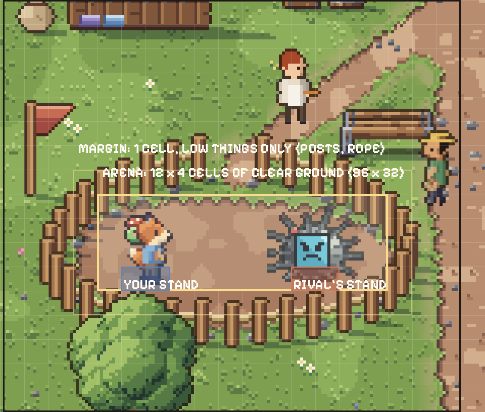
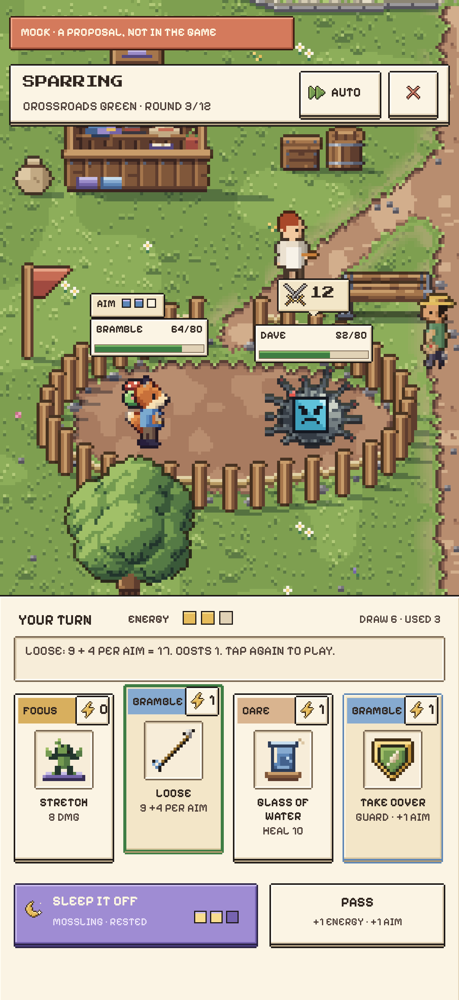

# Fights: Pokémon-style, turn-based cards

## Decision (Matt, 21 Oct 10:03)

Matt: "keep the pokémon style fighting system and build the rest of the content from that once you what the word looks like. i might want to create a spin off game, so save the live action combat system somewhere".

1. **Fights stay Pokémon-style:** today's separate battle screen (`components/game-battle.tsx`) with the turn-based card engine (`lib/battle.ts`, section 1). The folk character you play is the fighter, with the Grassling as its familiar ([cast.md](cast.md), PR #154). Fights are not moved onto the world's ground: sections 3, 4.3 and 4.5, F8 and step 2 of section 8 are superseded and kept below only as a record.
2. **Fight content waits for the world.** Foes, arenas, special enemies and abilities (the classes in section 5, the rested specials in 4.6) are built once the world's look is settled, for the battle screen above. Until then they stay proposals.
3. **The other designs are archived** in [`prototypes/`](../../prototypes/README.md), outside the app's build: the in-world turn-based prototype (`prototypes/inworld-turns/`) and the real-time action prototype (`prototypes/realtime-combat/`). The real-time one is kept for a possible spin-off game.
4. **Still open for Matt:** F3 to F5, the spar balance fixes from section 1.3 (a draw at the round limit, a rival with its own zen, Dave mirroring your familiar's family). They touch no art and hold whatever the screen. F1, F2, F6, F7 and F9 stay proposals until fight content is built.

The rest of this page is the proposal of 20 Oct (PR #157), first titled "turn-based on the world's own ground".

Matt, 20 Oct: playable fantasy characters, "choose 1 of x types at start, and unlock more later on. give them specific abilities that can be used in fights. and also ways to upgrade them ... think of a cool fight system. should the fight system be in world or pokemon style?" At 23:20 he decided the structure: one fighter stands on the field, the folk character, with the Grassling riding on its shoulder. Who the folk are, how they join and what each one stands for is [cast.md](cast.md) (PR #154); this page is the fight system they plug into, and maps cast.md's ten classes onto the card engine.

**Status: apart from the decision above, a proposal. Nothing here is built, and nothing changes a rule until Matt says yes.** Every rule change carries an id (F1 to F9, section 7). Numbers in section 5 are first-pass values for the simulation, not settings. Decorative interactions stay free of rewards, costs and chores; personality and real-world invitations add no stats; switching never happens during a mission, nap or battle (AGENTS.md). Minutes are real minutes (the game runs at demo speed, one second for a minute: `lib/offline-rules.ts`). The currency is Dream Dust (the code still says `grass`).

Pictures: the one-screen mock is [fights/fight-mock.png](fights/fight-mock.png) (402 x 874 CSS px, saved at 3x), the storyboard of one turn is [fights/storyboard.png](fights/storyboard.png), and the arena on the 8 px grid is [fights/arena.png](fights/arena.png). All three are labelled mocks; the one-screen mock and the arena show the superseded in-world layout.

## 0. In short

1. **Superseded 21 Oct (the decision at the top): in place on the world's ground, turn-based** (Sea of Stars, Chrono Trigger): a spar at a ring is fought where you stand, in that zone's own art, with the camera at twice the walk zoom and the cards in a tray under your thumb. Today's separate battle screen stays as the fallback for cramped spots, for raids (they happen in someone else's garden) and as a SIMPLE VIEW setting.
2. **Keep the card engine.** Energy (+1 a turn, up to 3), a hand of 3 (4 from level 2) from the deck that rest builds, one card a turn, pass for energy, guard, heals, the 12-round limit. The folk adds **four signature cards** to the deck for the fight and **one passive**; the Grassling on the shoulder keeps the **type** (today's REST, ROAM, FOCUS matchup, unchanged) and owns the **rested special** (three, one per family).
3. **Three readability fixes** taken from Slay the Spire and Into the Breach: the rival's next card is shown above its head (an intent), effects that weaken the foe's next card each have their own icon, and nothing random decides who wins a spar between friends beyond today's small 0 to 3 damage roll.
4. **Timed presses never punish.** A tap as the hit lands adds a quarter (or takes a quarter off a hit you receive); no tap, or a tap at the wrong moment, is a plain hit. TIMING in settings: TAP, RELAXED, OFF. Today a missed press costs 40 %.
5. **Sparring stakes nothing.** Today's 5 Dream Dust for each of the first three wins a day stays; a loss or a draw costs nothing; HP is full again afterwards. Raids keep today's rules and today's screen.
6. **Upgrades are card variants** at shared levels 4, 8 and 12 (cast.md), so no folk has a level of its own and none is ground twice. Looks come from outfits.
7. **The simulation decides the numbers.** Today's spar against Dave is decided by your Grassling's family before the first card (section 1.3): a Mossling wins 0 % of 4,000 simulated spars without perfect presses, a Pebbling 100 %. Every class goes through the same simulation before it ships, against guard rails in section 4.8.
8. **Cost per folk, for fights alone:** 24 body frames (12 per facing), about 14 effect frames, 4 card illustrations, 2 icons, 1 portrait, and its engine features (section 6). The three families' shoulder poses and specials are shared: about 36 familiar frames and 18 effect frames once.

## 1. How fights work today

Main at `c209171`.

### 1.1 The engine

| What                          | How                                                                                                                                                                                                                                                                                                 | Where                                       |
| ----------------------------- | --------------------------------------------------------------------------------------------------------------------------------------------------------------------------------------------------------------------------------------------------------------------------------------------------- | ------------------------------------------- |
| Two fighters, alternate turns | `a` (you) and `d` (the opponent); each `Fighter` has HP, energy, `nextEnergy`, a boolean `guard`, a `notified` (skip) flag, turns, hand, draw and discard                                                                                                                                           | `lib/battle.ts:14-31`                       |
| HP and zen                    | HP is 60 + 10 per level. Zen is a defensive cut of 1 % per 10 lifetime offline minutes, capped at 30 % (reached after 5 hours of rest in total, then permanent)                                                                                                                                     | `lib/battle.ts:33-34`                       |
| Matchup                       | REST beats FOCUS beats ROAM beats REST: 1.5 with the advantage, 0.67 against it, 1 in a mirror                                                                                                                                                                                                      | `matchup`, `lib/battle.ts:35-42`            |
| A turn                        | +1 energy (cap 3) plus any `nextEnergy`, draw up to the hand size; a skipped turn if `notified`; the round limit ends the fight as a loss after the opponent's 12th turn                                                                                                                            | `beginTurn`, `lib/battle.ts:98-121`         |
| One card or pass              | Pass gives +1 energy. A card pays its cost; DEEP BREATH guards (halves the next hit) and gives +1 energy; MORNING WALK gives +1 energy next turn; heals are capped at max HP                                                                                                                        | `resolveMove`, `lib/battle.ts:122-160`      |
| Damage                        | (card power, +3 if the card's habit is the fighter's, + 2 x level + a 0 to 3 roll) x matchup x timing x 0.7 if mood is under 30 x 0.5 if guarded (DIGITAL SUNSET ignores guard) x (1 - the target's zen) x 0.7 if blocked; at least 1. READ A CHAPTER has a 30 % chance to skip the foe's next turn | `lib/battle.ts:161-190`                     |
| The opponent's choice         | Heal under 35 % HP, else the strongest affordable attack, else DEEP BREATH                                                                                                                                                                                                                          | `chooseAI`, `lib/battle.ts:71-86`           |
| Nine cards, a 7-card starter  | 0 to 3 energy; power 8 to 25; heals 10 and 20; the starter is 3 STRETCH, 2 DEEP BREATH, GLASS OF WATER, SHORT WALK; hand 3, 4 from level 2; up to 20 cards, the weakest replaced; one common per 15 minutes of rest, a rare or epic per outing                                                      | `lib/cards.ts:4-129`, `offlineCards` `:173` |
| A turn is resolved once       | A cancelled and restarted animation reuses its turn's result                                                                                                                                                                                                                                        | `lib/turn-resolution.ts`                    |

### 1.2 The screen, spars and raids

- **A separate full screen** (`components/game-battle.tsx`): an HP header with two rows (`:529-530`), a stage drawn as a close-up of the world at a whole-number art zoom up to 8 (`:177-185`) on `RaidGarden` (`components/pixel-scenes.tsx:190-192`, a 216 x 150 art px stage with two 48 x 18 platforms), the fighters at 32 art px, the played card flying across (`PlayedCard`, `components/cozy-motion.tsx:87`), damage numbers, a burst, a scrolling hand tray of `HabitCard`s 120 to 168 px wide, PASS and LEAVE, an AUTO switch at double speed (`:196-206`, `:426-430`) and a history log.
- **The timing bar** sweeps for 1.2 s (`:316-331`): the centre 8 % is PERFECT (x 1.5), the middle 44 % normal (x 1), the rest WEAK (x 0.6), and letting it run out is WEAK too (`timingAt`, `lib/battle.ts:91-97`; `:325`). **Blocking** is a BLOCK! button live for 600 ms when the opponent attacks (x 0.7 if pressed, `:275-280`, `:308-312`). AUTO rolls the timing (20 % perfect, 20 % weak, `computerTiming`, `lib/battle.ts:87-90`) and blocks 60 % of hits in a 300 ms window (`:340-350`).
- **Spars** are against Doomscroll Dave only: `bot()` copies you, then sets RAT, mood 50 and his 10-card deck of 8 attacks (`lib/game.ts:1878`, `daveDeck` `lib/cards.ts:114`). A spar at one of the four regional rings is fought in front of that region's journey art, presentation only (`rings` `lib/world-places.ts:75-82`, `battlePlace` `lib/ui.ts:37`, the Arena's SPAR `components/game-screens.tsx:598-606`). A win pays 5 Dream Dust for the first three wins a day (`sparringReward`, `lib/offline-rules.ts:128-130`); a loss costs nothing.
- **Raids** need the backend, three a day, and a target who is EXPOSED (awake, past the care window, `status` `lib/game.ts:121-128`); a napping or recovering target blocks it (`startBattle` `:1698-1781`). Winning takes 30 % of the target's Dream Dust (at least 10), losing costs 10 (`raidGrass` `:1875`, `finishBattle` `:1782-1817`). The defender never plays: the attacker's result is applied to them (`applyIncoming` `:672`). C9 (approved) will stop raids taking Dream Dust and leave the companion worn out instead.
- **The play budget** pauses spending, levelling and new fights after 3 minutes in each 30 (`lib/offline-rules.ts:1-2`, `startBattle` `:1701`); a fight already running finishes ("Play time is up. Your result is safe.", `game-battle.tsx:717-721`).
- **Companion identity:** the fighter is `guardianPlayer` (the starter or a befriended visitor, taking the visitor's species, `lib/visitors.ts:64-71`), and switching is refused during a battle (`selectGuardian`, `lib/game.ts:988-995`).

### 1.3 What the engine does with a spar today (simulated)

A deterministic simulation of today's engine (`resolveMove`, `beginTurn`, `chooseAI` on both sides, Dave built as `bot()` builds him; 4,000 spars a row; the script is `sim-today.ts` in Claude A's scratchpad, `fights/tools/`), starter deck, mood 80:

| Rested so far          | Level | Your family      | No presses | Late presses (x 0.6) | AUTO (rolled, 60 % blocks) | Every press perfect, every block | Your turns (no presses)   |
| ---------------------- | ----- | ---------------- | ---------- | -------------------- | -------------------------- | -------------------------------- | ------------------------- |
| no rest yet (no zen)   | 1     | REST (Mossling)  | 0 %        | 0 %                  | 0 %                        | 28 %                             | 4.4                       |
|                        | 1     | ROAM (Roamling)  | 53 %       | 0 %                  | 85 %                       | 100 %                            | 8.6                       |
|                        | 1     | FOCUS (Pebbling) | 100 %      | 97 %                 | 100 %                      | 100 %                            | 4.7                       |
|                        | 3     | REST             | 0 %        | 0 %                  | 0 %                        | 54 %                             | 4.1                       |
|                        | 3     | ROAM             | 69 %       | 0 %                  | 94 %                       | 100 %                            | 7.6                       |
| 5 h or more (zen 30 %) | 1     | ROAM             | 4 %        | 0 %                  | 13 %                       | 100 %                            | 11.7 (53 % hit the limit) |
|                        | 3     | FOCUS            | 100 %      | 86 %                 | 100 %                      | 100 %                            | 5.9                       |

What it shows:

1. **The family decides the spar.** Dave is always ROAM, so a Mossling (REST, the matchup's 0.67) cannot win without perfect presses and a Pebbling (FOCUS, 1.5) cannot lose. With Dave taking your own family instead (a mirror, matchup 1), every family wins about half at level 1 with no presses (49 %, 53 %, 56 %) and 69 to 84 % at level 3.
2. **A missed press is a big loss.** A Roamling goes from 53 % to 0 % when every press is late. That is the opposite of "never punish".
3. **Zen is copied to Dave**, because `bot()` copies your offline seconds. Once you have rested 5 hours in total, both sides cut every hit by 30 %, fights run to the round limit and the limit counts as your loss (ROAM at level 1: 53 % of spars time out). Without the copy, a rested player wins 96 to 100 %.
4. **Fights are short enough.** Four to twelve of your turns, at about 4 s for yours and 2.5 s for Dave's: 30 s to 80 s, inside the 3-minute budget.

## 2. What other games teach

Judged against the five things a NapAttack fight must do: one-handed touch in a 2 to 10 minute session; readable at 402 px wide; accessible, with reduced motion; low frustration; cheap in art; and in theme (playful sparring, never grindy; rest makes you stronger but never forces play). Rated good, fair or poor.

| Game                                 | What it does (sourced)                                                                                                                                                                                                                                                                                                                                                                                                                                                                                                                                                                                                                                                            | One hand, short session                   | Readable at 402 px                                                   | Access and reduced motion               | Low frustration                        | Art cost                                                               | Theme                                                                             | What NapAttack takes                                                                                                                               |
| ------------------------------------ | --------------------------------------------------------------------------------------------------------------------------------------------------------------------------------------------------------------------------------------------------------------------------------------------------------------------------------------------------------------------------------------------------------------------------------------------------------------------------------------------------------------------------------------------------------------------------------------------------------------------------------------------------------------------------------- | ----------------------------------------- | -------------------------------------------------------------------- | --------------------------------------- | -------------------------------------- | ---------------------------------------------------------------------- | --------------------------------------------------------------------------------- | -------------------------------------------------------------------------------------------------------------------------------------------------- |
| **Sea of Stars**                     | Boulanger: "seamless transitions from navigation to combat, no random encounters, and no grinding"; "purely turn-based without any time bars, avoiding pressure"; timed presses increase damage and reduce damage taken; breaking an enemy's locks weakens or cancels its next move; combo points are "lost when the battle ends" ([PlayStation Blog](https://blog.playstation.com/?p=366730)). "Timing isn't necessarily required to win a battle", turns don't time out, enemy icons show what is coming, relics such as Sixth Sense auto-block ([Can I Play That?](https://caniplaythat.com/2023/11/01/sea-of-stars-accessibility-review/))                                    | good: no timers                           | good at its 640 x 360; fair on a phone (party of three, many icons)  | good: timing optional, assist relics    | good                                   | fair: fight poses per hero, but no separate battle maps                | good: no grinding, fights where you stand                                         | **The model.** In place, turn-based, optional timing, intents on the foe, resources that end with the fight                                        |
| **Chrono Trigger**                   | "Contact with enemies on a field map initiates a battle that occurs directly on the map rather than on a separate battle screen"; enemies "openly visible"; Double and Triple Techs; enemies "change positions during battle, creating opportunities" ([Wikipedia](https://en.wikipedia.org/wiki/Chrono_Trigger))                                                                                                                                                                                                                                                                                                                                                                 | fair: Active Time keeps the clock running | good                                                                 | poor: real-time pressure (ATB)          | fair                                   | good: the map is the arena                                             | good                                                                              | The map is the arena; no random encounters. Not taken: running clocks, moving positions                                                            |
| **Pokémon**                          | A separate battle scene; "A Pokémon can only know between one and four moves at a time", each limited by PP ([Bulbapedia, Move](https://bulbapedia.bulbagarden.net/wiki/Move)); super effective "the damage is doubled", not very effective "halved" ([Bulbapedia, Type](https://bulbapedia.bulbagarden.net/wiki/Type)); switching "happens before all moves" and the new Pokémon "cannot be commanded until the next turn" ([Bulbapedia, Recall](https://bulbapedia.bulbagarden.net/wiki/Recall))                                                                                                                                                                                | good: four buttons, no timing             | good: a fixed layout made for small screens                          | good                                    | fair: hard type walls                  | good: one front and one back pose per creature, a backdrop per terrain | fair: catching and battling is the loop; ours is resting                          | A fixed, small set of actions; the fallback screen. Not taken: x2 type walls (ours are already 1.5 / 0.67), mid-fight switching                    |
| **Paper Mario / Mario & Luigi**      | An Action Command "allows a character to do significantly more damage to an enemy than with a normal hit"; a timed guard takes less damage; the Simplifier badge "makes Action Commands easier"; All or Nothing makes failed commands deal nothing ([Super Mario Wiki](https://www.mariowiki.com/Action_Command))                                                                                                                                                                                                                                                                                                                                                                 | good: one button                          | good                                                                 | fair: badges ease timing, no off switch | fair: punishing variants exist         | fair: pose per action                                                  | good: playful                                                                     | Press as the hit lands, one button for attack and guard, a setting that eases it. Not taken: All or Nothing                                        |
| **Chained Echoes**                   | Enemies "visible on the map and trigger encounters on the same screen"; no level-ups ([Wikipedia](https://en.wikipedia.org/wiki/Chained_Echoes)). The Overdrive bar: "every action by the player, and by the enemies, influences the bar"; in its green section "you do way more damage and take less" (Matthias Linda, [RPGamer](https://rpgamer.com/2022/11/chained-echoes-interview/)); above it, Overheat: "receive 25% more damage" ([Sports Illustrated guide](https://videogames.si.com/guides/chained-echoes-tips-combat-overdrive-sky-armor))                                                                                                                            | good                                      | fair: one more bar to watch                                          | good: no timing                         | fair: overheating feels like a mistake | good                                                                   | good: no grinding                                                                 | A meter that ends with the fight and is managed by what you choose (Ashe's heat). Not taken: a shared bar for everyone                             |
| **Slay the Spire and card battlers** | "Each turn the player receives a fresh hand of cards and three energy points"; "Each opponent on the field will telegraph what move they will make" ([Wikipedia](https://en.wikipedia.org/wiki/Slay_the_Spire)); balanced by "a metric-driven focus early in development" (Anthony Giovannetti, GDC 2019, [Game Developer](https://www.gamedeveloper.com/design/learn-i-slay-the-spire-i-s-metrics-driven-approach-to-game-balancing-at-gdc-2019)). Marvel Snap: "matches only last for about three minutes" with 12-card decks, a "mobile-first game" ([PC Gamer](https://www.pcgamer.com/marvel-snap-is-the-first-game-from-former-hearthstone-director-ben-brodes-new-studio)) | good                                      | fair: a hand of 5 plus relics is crowded; Snap shows it fits a phone | good: no timing                         | good                                   | good: cards are small art                                              | good: our deck is built by rest                                                   | Energy and a hand (already ours), intents, balance by simulation, three-minute fights                                                              |
| **Into the Breach**                  | Fights on 8 x 8 squares, three mechs; "The player is shown the direction of the Vek unit's intended attack"; "Subset wanted each battle to be relatively short", and the turn limit keeps them short ([Wikipedia](https://en.wikipedia.org/wiki/Into_the_Breach)). Justin Ma: "every death felt like your own fault ... telegraphed enemy attacks as a core mechanic"; "it's very clear how or why you failed" ([Game Developer](https://gamedeveloper.com/game-platforms/road-to-the-igf-subset-games-i-into-the-breach-i-))                                                                                                                                                     | good: no timing, short                    | good: a small board with everything visible                          | good                                    | good: no hidden randomness             | good: tiny units                                                       | fair: a war game                                                                  | Show the foe's next card; keep randomness out of who wins; a short turn limit. Not taken: a grid you move on (art and readability cost on a phone) |
| **Cassette Beasts**                  | Monsters "fused" in combat ([Wikipedia](https://en.wikipedia.org/wiki/Cassette_Beasts)); its chemistry "replaces the systems of type effectiveness": matchups "generate different status effects" instead of "numerical damage multipliers" ([Bytten Studio](https://www.cassettebeasts.com/chemistry/))                                                                                                                                                                                                                                                                                                                                                                          | good                                      | fair: many statuses                                                  | good                                    | good: no hard walls                    | poor: a fusion sprite for every pair                                   | good: two partners                                                                | A partner on the field without a second fighter's art; softer type effects are a lesson for later. Not taken: fusion sprites                       |
| **Auto-battlers**                    | Players "place characters on a grid-shaped battlefield during a preparation phase", then units "automatically battle each other" "without any further direct input" ([Wikipedia](https://en.wikipedia.org/wiki/Auto_battler))                                                                                                                                                                                                                                                                                                                                                                                                                                                     | good                                      | good                                                                 | good                                    | good                                   | good                                                                   | fair: little to do; an auto-fight while you nap would turn rest into a fight farm | AUTO stays as a switch (it exists), never the core                                                                                                 |

**Phone and access facts used below.** Of 780 people touching their phone's screen, 49 % held it in one hand, 36 % cradled it, 15 % used two hands (Steven Hoober, [UXmatters](https://www.uxmatters.com/mt/archives/2013/02/how-do-users-really-hold-mobile-devices.php)). The Game Accessibility Guidelines: "Do not make precise timing essential to gameplay", because "there are gamers who find any kind of timing difficult or impossible", and "making precise timing optional allows the benefits without the disadvantages" ([GAG](https://gameaccessibilityguidelines.com/do-not-make-precise-timing-essential-to-gameplay-offer-alternatives-actions-that-can-be-carried-out-while-paused-or-a-skip-mechanism/)); Xbox's guideline 116 adds "Avoid repeated inputs (button-mashing/quick time events)" and "Turn off the time limit" ([Xbox XAG 116](https://devdocs.xbox.com/build/game-principles/accessibility/xag-deep-dives/xag-116-time-limits.md)).

**Gaps.** No developer source was found for Chrono Trigger's choice to fight on the map (Wikipedia only), for Pokémon's separate screen, or for an accessibility setting in Paper Mario or Mario & Luigi. The Chained Echoes zone numbers are from a guide, not the developer. The Into the Breach GDC talk (80.lv's write-up) and Bulbapedia's type page were cited from their summaries where the full page could not be fetched.

## 3. Superseded: in place, with a fallback

**Superseded on 21 Oct by the decision at the top: fights stay on the separate battle screen.** Kept as a record of the argument; the in-world prototype is in `prototypes/inworld-turns/`.

**Was confirmed on 20 Oct: the hybrid.** A spar is fought on the world's own ground, turn-based; the separate screen stays as a fallback.

- **It is the game Matt described:** "one game, not an app with a game in it. The world fills the phone" (`README.md`). A Pokémon-style cut to a battle screen is the last place where the app still swaps the world for a page.
- **The regions are built for it.** Every region has a ring in its own art (world-atlas.md, "Battles"); fighting in a backdrop painting of it, as today, throws that away and costs a backdrop per ring.
- **It reads at 402 px** if the camera zooms (section 4.3): at twice the walk scale the folk is 64 CSS px tall and the ring fills the width, which is Sea of Stars' framing at a phone's size.
- **Turn-based keeps it one-handed and calm:** nothing moves while you choose (Sea of Stars, Into the Breach), and every control sits in the bottom 40 % of the screen, where the thumb of a one-handed grip reaches.
- **The fallback** (today's `BattleScreen` with the new tray) is used where an arena does not fit (a ring inside a building, a bridge, Halcyon's corridors), for raids (fought at the friend's garden, which is not in your world) and when SIMPLE VIEW is on.

## 4. The system

### 4.1 Who is on the field (decided, cast.md section 2)

One fighter: the folk, with the Grassling (or a befriended visitor) riding on its shoulder. The folk brings the class (four signature cards and a passive); the familiar brings the type (REST, ROAM, FOCUS, today's matchup and +3 habit power, unchanged) and the rested special. The familiar is never hit: the folk takes every hit, and the familiar clings, cheers and casts the special. HP and hand size come from the one shared level. Rendering and combat identity move from `guardianPlayer` alone to the pair; switching folk or familiar is refused during a mission, nap or battle, and keeps level, Dream Dust, hats, cards, history and collection.

### 4.2 A turn

Keep everything in the engine that works, and add three things: signature cards, intents and still turns.

1. **The fight's deck** is your deck (built by rest, up to 20) plus the folk's four signature cards, one copy each, shuffled together for this fight only. A signature card has no habit (no +3), so the familiar's family still decides which habit cards hit harder.
2. **Your turn begins:** +1 energy (cap 3) and any carried `nextEnergy`, draw to the hand size (3, 4 from level 2), as today. **The rival's intent** (F2) shows above its head: an icon and a number (a hit of 12, a heal, a guard, a trick).
3. **You do one thing:** play a card (lift it, tap again, as today), use the rested special (once a fight, section 4.6), or PASS (+1 energy). One action a turn keeps a turn to about 4 s and the screen calm.
4. **A still turn** is one in which you play no damaging card (a pass, a guard, a heal). Velvet, Mirra and Nix bank from still turns; Bramble from energy left over. **One turn banks at most one point of one stack, and every stack is capped at 3** (cast.md section 4: "what a still turn can bank is capped").
5. **The hit lands**, with an optional press (section 4.4), then the rival's turn: its intent resolves, with an optional guard press.
6. **The round limit** stays at 12. In a spar it ends as a draw, "a good match" (F3); in a raid it stays a loss.

**Guard stays simple** (cast.md): DEEP BREATH and the guard cards halve the next hit, once. Only Cairn's passive makes a guard last one more hit. Effects that weaken the foe's next card stay apart and each has its own icon over the foe: Velvet's Dusk softens its damage by a third, Puddle's soak makes it cost one more, Nix's mute removes its extra effect.

### 4.3 On the world's ground (superseded)

**Superseded on 21 Oct by the decision at the top.** The arena footprint, the camera framing and the world living around a fight are not built; kept as a record.

- **Where fights start:** only at rings (spars) and from the Arena list (raids). No random encounters, never on a path you are walking. At a ring, tap the rival standing there; their card opens with SPAR.
- **The arena** is a footprint in each ring's zone data, on the 8 px grid: **12 x 4 cells (96 x 32 art px) of clear walkable ground on one tier**, with your stand (2 x 1 cells) two cells in from the west end and the rival's two cells in from the east, six cells apart (room to step in a cell and for the card to fly). A one-cell margin holds only low things (posts, rope, pebbles, under 16 px). Nothing taller than 8 px may stand in front of a stand. A check in the world audit (`check:world-audit`) proves every ring has one, as it proves doors face open ground. The town ring (centre 76, 487) already fits: [fights/arena.png](fights/arena.png).
- **The camera** eases to the arena's centre, set at 40 % of the screen's height so the tray never covers it, and zooms to the largest whole number of device pixels per art pixel that fits the arena plus a cell each side: on a 402 px phone at 3x that is 8 (2.67 CSS px per art px, twice the walk's 4), on a 375 px phone at 2x it is 4 or 5. Zoom steps go through whole device pixels (4, 6, 8), so the grid never blurs. Anticipate (the walk stops, a "!" over the rival, 150 ms), act (the camera, 400 ms), settle (the tray rises, 200 ms). With reduced motion: a cut.
- **The HUD and hotbar** slide away; a slim fight header (SPARRING, the place, the round, AUTO, LEAVE) and the tray take their place (section 4.5).
- **The world keeps living, quietly.** Day and night, lights and weather go on. Residents whose route crosses the arena stop at the nearest free cell outside the margin and turn to watch (their existing front, east or west frame); others carry on. Animals keep out; birds do not land inside. Props are never moved. Taps on the world do nothing during a fight; tapping a fighter shows its details.
- **Region ground as terrain:** what the ring stands on (snow by the bothy, sand in the corral, basalt by the lava, low gravity on Lumen) is the approved gentle condition, after C17's simulation and Matt's look at the numbers. Until then it is only seen: hit puffs take the ground's colour.
- **The fallback** (SIMPLE VIEW, cramped rings, raids): today's screen layout with `RaidGarden` and the region's yard, and the same tray.

### 4.4 Timed presses that never punish (F1)

- **Attack:** as your hit lands, a gold ring closes on the target; a tap anywhere in the lower half of the screen inside the window is NICE, x 1.25. No tap, an early tap or a late tap is a plain hit, x 1. (Today: x 0.6 for a miss, x 1.5 for perfect.)
- **Guard:** as the rival's hit lands, the same tap is BRACED, x 0.75. No tap is the hit as its intent showed. (Today: x 0.7 in a 600 ms window, nothing otherwise; already no penalty.)
- **Window:** 160 ms round the impact frame; RELAXED doubles it to 320 ms; OFF removes presses (no ring, no stamp). AUTO never presses. The numbers are balanced with presses OFF (section 4.8), so a press is a small extra, never a requirement (GAG; Sea of Stars).
- **Reduced motion:** the ring is a static outline shown for the window, the wind-up and recoil are held stills of 300 ms, there is no flash and no camera move; presses still work. Effects are finite and stop when the screen is inactive.
- **One input:** a single tap, never mashing or holding (XAG 116).

### 4.5 The screen (superseded)

**Superseded on 21 Oct:** the mock below is the in-world layout. Its tray, intent bubble and special button can be reused on the battle screen when fight content is built.

Top to bottom at 402 x 874: the MOCK tag; the fight header (title, place, round; AUTO and LEAVE at 44 px); the world, zoomed, with a plate over each fighter (name, HP as numbers and a bar, the folk's stack as pips) and the rival's intent in a speech frame; spectators at the ring's edge; then the tray in the thumb zone: whose turn and energy, the lifted card's details in a well, four card tiles (the hand: habit cards and signature cards, a signature card framed in its folk's colour), and two 54 px buttons: the familiar's rested special with its pips, and PASS (which says what passing banks). Everything is in pixel frames and the pixel font (`interface.md`).

### 4.6 The rested special (one per family)

- **Charged by real time away:** one pip for each 20 minutes of rest since your last spar, up to three (one hour). It reads the same counter zen reads (`offline_seconds`); zen itself stays as it is. It never fills from fighting, walking or waiting with the app open, and a longer rest adds nothing (no farming).
- **Once a fight, from any pip.** Using it spends the pips; not using it keeps them. Its strength scales with the pips. No time-of-day bonus (cast.md).
- **REST (Mossling and REST visitors), SLEEP IT OFF:** heal 8 per pip and guard.
- **ROAM, SECOND WIND:** refill energy to 3 and draw one card per pip (no change to the energy cap).
- **FOCUS, IN THE ZONE:** your next damaging card gets +4 power per pip and ignores guard.
- The guard rail (section 4.8): a full special moves a spar's win rate by at most 10 points. It is a treat for resting, not a requirement.

### 4.7 Win, loss and what is at stake

- **Spars** (every ring): a win pays today's 5 Dream Dust for each of the first three wins a day (unchanged); a loss and a draw cost nothing. The loser sits down for a breather (today's slumped pose), the familiar pats them, both bow, GOOD MATCH. HP, stacks and the deck reset after every fight. A first win against a ring's rival can give that ring's ribbon (#143's G7, a proposal). Unlocking a folk never needs a win (cast.md).
- **Rivals:** each ring's rival is a resident with a deck in their region's style and a fixed family; the town ring keeps Dave as the tutor (F5: he takes your familiar's family, a mirror, which makes the first spar fair for every starter; section 1.3). A rival has its own zen (Dave none), not a copy of yours (F4).
- **Raids keep today's rules:** three a day, an EXPOSED target, today's stakes until C9 lands, today's engine and screen. Classes reach raids only after they are simulated against the raid AI (cast.md section 6). Puffcap's doze never applies in a raid against an absent player (cast.md); there it softens the next card by a third instead.

### 4.8 Balance guard rails

All measured by a simulation of the new engine (Codex, after C33), with AUTO play choosing cards and presses OFF, 4,000 spars a cell:

1. **A starter finishes everything:** each of Bramble, Puffcap and Velvet, with any of the three families, no variants and no special, wins at least 40 % against every rival at that rival's suggested level.
2. **No folk strictly better:** against every rival, every folk's win rate is within 12 points of the cast's mean, and no folk is the best against every rival.
3. **No hopeless family pairing:** the worst family matchup still wins at least 35 % with each starter.
4. **Presses are a small extra:** "always NICE and BRACED" beats "never pressed" by at most 15 points.
5. **Fights stay short:** 5 to 10 of your turns on average (about 40 to 90 s), under 5 % reaching the round limit.
6. **Banking is capped:** no stack above 3, one point a turn, and no folk's best line wins more than 10 points above its average line.
7. **Variants are sidegrades:** each level-4, 8 and 12 choice is within 5 points of its pair.
8. **Rest helps, never decides:** a full special moves a spar by at most 10 points; zen 30 % on your side moves it by at most 15 (today it decides the spar, section 1.3).

## 5. The ten classes on the card engine

First-pass numbers, for the simulation, not settings. "Power" is a card's power as today, before + 2 x level, the 0 to 3 roll and the matchup; a signature card has no habit. Who each folk is, its look and its unlock: [cast.md](cast.md), section 4. Engine features (E1 to E12) are in section 5.2.

### 5.1 Passives and signature cards

| Folk (class)           | Passive                                                                                                                                                                                                                                | Four signature cards (energy: effect)                                                                                                                                                                       | Level 4, 8, 12 variant choices (examples)                                                                                                                    | Needs               |
| ---------------------- | -------------------------------------------------------------------------------------------------------------------------------------------------------------------------------------------------------------------------------------- | ----------------------------------------------------------------------------------------------------------------------------------------------------------------------------------------------------------- | ------------------------------------------------------------------------------------------------------------------------------------------------------------ | ------------------- |
| **Bramble** (striker)  | **Steady:** end your turn with at least 1 energy unspent: +1 Aim (max 3). An arrow spends all Aim for +4 power each                                                                                                                    | NOCK 0: draw 1; Steady counts this turn even with no energy left. LOOSE 1: arrow, power 9. LONG SHOT 2: arrow, power 12, +5 per Aim instead of +4, ignores guard. TAKE COVER 1: guard, +1 Aim               | 4: LOOSE as QUICK (0, power 6, +3 per Aim) or HEAVY (1, power 9, +5 per Aim). 8: NOCK or a NOCK that also draws. 12: LONG SHOT keeps or ignores guard for +2 | E1                  |
| **Puffcap** (soother)  | **Drowsy:** spores on the foe (max 3). At three the foe dozes through its next action, once a fight, and the spores clear; after that, three spores soften its next card by a third (in a raid: always the softening).                 | SPORE PUFF 0: power 5, +1 spore. LULL 1: +2 spores. SOFT LANDING 1: heal 5 now and 5 at the start of each of your next two turns. TOADSTOOL RING 2: power 10 and guard                                      | 4: LULL (+2 spores) or a LULL that heals 4 (+1 spore). 8: SOFT LANDING over two or three turns. 12: SPORE PUFF power 5 or 8                                  | E1, E3, E9          |
| **Velvet** (shade)     | **Dim:** a still turn gives +1 Dusk (max 3). Each Dusk is spent on the foe's next damaging card, which deals a third less (one Dusk a hit)                                                                                             | SHUTTER 0: guard (a still turn, so Dim banks a Dusk). LAMP LOW 1: heal 8. MOTH WING 1: power 9, +3 per Dusk held (not spent). NIGHT FALLS 2: power 6 per Dusk, spending all, ignores guard                  | 4: MOTH WING or a MOTH WING that spends one Dusk for +8. 8: LAMP LOW heal 8 or heal 5 and +1 Dusk. 12: NIGHT FALLS 6 or 7 per Dusk at 3 energy               | E1, E6, E11 (still) |
| **Cairn** (guardian)   | **Bedrock:** his guard halves two hits, not one                                                                                                                                                                                        | STAND FAST 0: guard. MOSS OVER 1: guard, heal 6. SHOULDER CHARGE 2: power 10; while guarded +10 and the guard is spent. STANDING STONE 1: power 8; while guarded +1 energy next turn                        | 4: STAND FAST or a STAND FAST that also gives +1 energy and lasts one hit. 8: MOSS OVER heal 6 or 10 at 2. 12: SHOULDER CHARGE +10 or +6 keeping the guard   | E4                  |
| **Pendle** (caster)    | **A Minute Slow:** instead of playing a card, set it on the clock: pay its cost now; it lands at the start of your next turn at x 1.5 (power and heal), before you choose. One card on the clock; the clock shows on the plate         | WIND THE SPRING 0: +1 energy next turn. SIGNAL LAMP 1: power 9. STATION BELL 2: power 12, ignores guard (18 from the clock). PLATFORM TEA 1: heal 8, draw 1                                                 | 4: set a card for x 1.5, or for x 1.25 and +1 energy when it lands. 8: SIGNAL LAMP power 9 or 6 and draw 1. 12: STATION BELL ignores guard or costs 1        | E2, E10             |
| **Puddle** (trickster) | **Tide:** his turns alternate, ebb then flow (shown on his plate). On ebb his damaging cards soak (the foe's next card costs 1 more; if it cannot pay, it holds that card back, never a skip). On flow they splash: +3 power           | PUDDLE JUMP 0: power 6. UNDERTOW 1: power 8; on ebb also -1 energy to the foe. TURN THE TIDE 0: flip the tide now. SPRING TIDE 2: power 13; on flow +6 instead of +3                                        | 4: TURN THE TIDE or a TURN THE TIDE that also guards at 1. 8: UNDERTOW's drain or +1 card. 12: SPRING TIDE +6 or no ebb soak                                 | E5                  |
| **Mirra** (support)    | **Seep:** a still turn adds a drop to her flask (max 3). Pouring is not a still turn. She never guards (that is Cairn's)                                                                                                               | POUR 0: heal 7 per drop, emptying the flask. CLEAR WATER 1: spend 1 drop: cleanse (clear the foe's softening, soak and spores on her) and heal 4. DIVINING ROD 0: power 6, draw 1. WATER HAMMER 2: power 13 | 4: POUR all, or 1 drop for 10. 8: CLEAR WATER, or a CLEAR WATER with no drop for 2 energy. 12: DIVINING ROD draw 1 or power 9                                | E1, E7, E11 (still) |
| **Ashe** (bruiser)     | **Banked fire:** +1 heat at the start of each of her turns (max 3); her damaging cards get +3 power per heat. When heat would pass 3 the bell tolls: she rests that turn (no action), heals 12 and heat falls to 0. No burn-out damage | BANK THE FIRE 0: heat -1 and guard. EMBER SWING 1: power 9 (+3 per heat). BELL TOLL 2: power 12 (+3 per heat), removes the foe's guard, +1 heat. FORGE REST 1: heat to 0, heal 5 per heat let go            | 4: BANK THE FIRE -1 heat or -2 without the guard. 8: EMBER SWING power 9 or 7 and +1 heat. 12: the bell heals 12 or 18                                       | E1, E3              |
| **Nix** (ward)         | **Do Not Disturb:** after a still turn the foe's next trick (a card's extra effect: a skip, a soak, energy, ignoring guard, spores) is muted; after two still turns in a row it is reflected onto the foe instead, once a fight        | SILENT MODE 0: +1 energy next turn. OUT OF OFFICE 1: heal 6. COURIER DASH 1: power 10. RETURN TO SENDER 2: power 10, +6 if she muted or reflected a trick this fight                                        | 4: SILENT MODE or a SILENT MODE that draws. 8: OUT OF OFFICE heal 6 or heal 3 and guard. 12: RETURN TO SENDER +6 or reflect twice a fight                    | E8, E11 (still)     |
| **Mote** (wildcard)    | **Dream:** once a fight, use your familiar's special before it is charged, at half its full strength (heal 12 and guard; refill and draw 1; +6 power), without spending the real pips. Never the strongest                             | TWINKLE 0: power 6. STARDUST 1: play the last card you played again at half strength (not POUR, the special or STARDUST). WISH 1: draw 2. SHOOTING STAR 3: power 18, ignores guard                          | 4: TWINKLE or a TWINKLE that draws. 8: STARDUST half or two thirds at 2. 12: SHOOTING STAR power 18 or 14 at 2                                               | E10, E11, E12       |

Rival rings get decks, not classes: a rival is a resident with a fixed family, a deck in their region's style and at most one passive drawn from the list above (the warden's snow guard, the cowhand's charge), which keeps a rival at about a quarter of a folk's cost (cast.md).

### 5.2 Engine features the classes need

The engine today has a boolean guard, energy capped at 3, zen as a defensive cut and one skip (READ A CHAPTER's 30 % chance). What each class needs on top:

| Id  | Feature                                  | What changes in `lib/battle.ts`                                                                                                                                                  | Who                                   | New engine?                                          |
| --- | ---------------------------------------- | -------------------------------------------------------------------------------------------------------------------------------------------------------------------------------- | ------------------------------------- | ---------------------------------------------------- |
| E1  | **Numeric stacks**                       | `Fighter.stacks` (Aim, spores, Dusk, drops, heat), each 0 to 3, one point a turn at most; shown as pips on the plate                                                             | Bramble, Puffcap, Velvet, Mirra, Ashe | **yes**                                              |
| E2  | **A delayed card**                       | `Fighter.clock = { card, x }`, resolved in `beginTurn` before the hand is drawn; intent shows it to the foe                                                                      | Pendle                                | **yes**                                              |
| E3  | **A sure skip**                          | `notified` becomes a reason (`doze`, `bell`) set deterministically, once a fight; the bell heals                                                                                 | Puffcap, Ashe                         | **yes** (today's only skip is random and card-bound) |
| E4  | Guard that lasts two hits                | `guard: boolean` becomes `guardHits: 0..2`; every other guard still sets 1                                                                                                       | Cairn                                 | small                                                |
| E5  | Cost soak                                | `Fighter.soak: 0..1`: the next card costs 1 more; `available()` and `chooseAI` read it                                                                                           | Puddle                                | yes                                                  |
| E6  | Damage softening                         | Dusk spent in the damage formula as x 2/3 on the foe's next damaging card                                                                                                        | Velvet, Puffcap                       | yes (zen is a standing cut, not a per-card one)      |
| E7  | Cleanse                                  | clears E5, E6 and spores on the user                                                                                                                                             | Mirra                                 | small                                                |
| E8  | Tricks, muted or reflected               | cards tagged with their extra effect (skip, soak, energy, ignore guard, spores); a mute flag drops it, a reflect flag turns it on the foe                                        | Nix                                   | **yes**                                              |
| E9  | Heal over time                           | `Fighter.mend = { amount, turns }`, applied in `beginTurn`                                                                                                                       | Puffcap                               | small                                                |
| E10 | The rested special and Dream             | pips from `offline_seconds` since the last spar, saved per account; a once-a-fight special per family; Mote's borrow at half                                                     | everyone, Mote                        | yes (outside the engine: a save field)               |
| E11 | Still turns and extra draws              | record whether a turn played a damaging card; `drawHand` may go one or two over the hand size until the turn ends                                                                | Velvet, Mirra, Nix, Pendle, Mote      | small                                                |
| E12 | Signature cards and variants in the deck | `createCombat` adds the folk's four (chosen variants) to the draw pile; a last-played-card memory for STARDUST                                                                   | everyone, Mote                        | yes                                                  |
| E13 | Intents                                  | the rival draws at the end of its turn and chooses at the start of yours (`chooseAI`); it re-chooses only if a soak makes its card unaffordable, and the bubble shows the change | everyone                              | yes (F2)                                             |

Flagged for Codex (cast.md section 6): every banking mechanic (E1, E2) is simulated against the raid AI before its numbers are set, and E3's doze never fires in a raid against an absent player.

## 6. Cost per folk, for the fight system

What fighting adds on top of a folk's exploration art (cast.md section 5 counts the whole folk, about 134 frames). Sprite cells are about 32 x 36 art px (a 24 to 29 px folk plus a raised arm, bow or bell); the familiar is drawn separately on a shoulder anchor stored per frame (data, not art).

| Piece                    | Per folk                                                                                                                                                          | Count                                                          |
| ------------------------ | ----------------------------------------------------------------------------------------------------------------------------------------------------------------- | -------------------------------------------------------------- |
| Fight poses, east-facing | ready x 2 (breath), wind-up, strike x 2 (the second is the impact frame the press keys on), guard, hit, cast x 2 (signature cards share it), sits down, cheer x 2 | 12 frames                                                      |
| Fight poses, west-facing | the same, drawn (not mirrored: light comes from the upper left), for raids where a friend's folk faces you                                                        | 12 frames                                                      |
| Card effects             | four signature cards, 3 to 4 frames each (an arrow and its trail, spores, a dusk veil, a clock hand, a splash, a flask's pour, an ember, a mute glyph, a twinkle) | about 14 frames                                                |
| Card illustrations       | four 16 x 16 illustrations in `lib/card-art.ts`'s style; variants reuse them                                                                                      | 4                                                              |
| Icons                    | the stack's pip icon (Aim, spore, Dusk, drop, heat; Cairn, Pendle, Puddle and Nix use a status icon instead) and the class badge on its cards                     | 2                                                              |
| Portrait                 | 16 x 16 for the plate and the select card                                                                                                                         | 1                                                              |
| Interface                | no new controls, except Pendle's clock slot on the plate and Mote's DREAM on the special button                                                                   | 0 (1 for Pendle and Mote)                                      |
| Words                    | the passive, four cards and six variants (name and one line each), three lines (start, win, sits down)                                                            | about 25 strings                                               |
| Sound                    | four card cues from the generated palette (`sound.md`), reused where they fit                                                                                     | up to 4                                                        |
| Engine                   | its features in 5.2 and one simulation run against every rival                                                                                                    | see 5.2                                                        |
| **Total**                |                                                                                                                                                                   | **24 body + about 14 effect frames, 4 illustrations, 3 icons** |

A lean set, if art time is short: ready x 2, wind-up, strike, guard, hit, sits down, cheer: 8 a facing, 16 in all, with cast and strike shared.

**Once for everyone:**

| Piece                                   | Count                                                                                                                                                                                                    |
| --------------------------------------- | -------------------------------------------------------------------------------------------------------------------------------------------------------------------------------------------------------- |
| The familiar on the shoulder, in fights | idle x 2, cling (when hit), cheer, cast x 2 = 6 per family and facing: 36 for the three Grasslings (each befriended visitor drawn for the shoulder adds 12)                                              |
| Three rested specials                   | 6 frames each: 18                                                                                                                                                                                        |
| Shared effects                          | hit spark (4), timing ring (3), braced shield flash (3), ground puff tinted by the region's ground (4), NICE / BRACED / +1 stamps (in the font)                                                          |
| Icons                                   | intents (hit, heal, guard, trick: 4; the existing swords, heart and shield serve three), the three still-turn effect icons kept apart (Dusk, soak, mute: 3), rested pip (1), the sleeping doze glyph (1) |
| Interface                               | the fight header, the tray (rows of card tiles reuse `HabitCard` in a 88 px compact form), the special and PASS buttons, over-head plates, the intent bubble: about 6 components                         |
| Code                                    | the arena footprint per ring and its check, the camera framing, the TIMING setting and SIMPLE VIEW, the simulation harness                                                                               |

A rival costs a quarter of a folk: west-facing poses only (12, or 8 lean) and two card effects.

## 7. What changes which rule

| Id  | Change                                                                                         | Rule today                                       |
| --- | ---------------------------------------------------------------------------------------------- | ------------------------------------------------ |
| F1  | Timed presses: x 1.25 or x 1, guard x 0.75 or x 1; TIMING setting; AUTO never presses          | x 0.6 / 1 / 1.5 attack, x 0.7 block (`timingAt`) |
| F2  | The rival's next card is shown before you choose                                               | chosen on its own turn (`chooseAI`)              |
| F3  | A spar that reaches the round limit is a draw                                                  | counts as your loss (`beginTurn`)                |
| F4  | A rival has its own zen; Dave has none                                                         | `bot()` copies yours                             |
| F5  | Dave takes your familiar's family (a mirror)                                                   | always ROAM                                      |
| F6  | Folk signature cards join the deck for a fight; passives; the engine features E1 to E13        | habit cards only                                 |
| F7  | The rested special per family, charged by rest since the last spar, capped at 3 pips           | zen only                                         |
| F8  | Superseded 21 Oct: spars fought in place at rings; the old screen as SIMPLE VIEW and for raids | a separate screen always (kept)                  |
| F9  | Card variants at shared levels 4, 8 and 12 (cast.md)                                           | level 2 hand of 4, level 3 DIGITAL SUNSET        |

Unchanged: the shared level and HP, energy and its cap, hand sizes, the matchup, today's cards, sparring pay, raid rules and stakes (until C9), the play budget, companion switching rules.

## 8. Order of work

1. Codex: F1, F3, F4 and F5 alone, simulated with today's engine (they fix section 1.3's findings and touch no art).
2. Superseded 21 Oct: ~~Claude A: the arena footprint for each ring and its check; the camera framing, with today's fighters (F8 behind a flag).~~
3. The starters' fight poses and the familiar's shoulder poses (after the production art in cast.md section 7).
4. Codex: E1, E4, E11, E12, E13 and the three starters' classes, simulated against the guard rails; then F7.
5. Each later folk with its region's rebuild: its features, its simulation, its poses.

## 9. Decisions for Matt

1. ~~**In place with a fallback** (section 3), or Pokémon style everywhere?~~ Decided 21 Oct 10:03: Pokémon style (the decision at the top).
2. **Presses never punish** (F1): a miss is a plain hit, a nice press +25 %, and TIMING can be turned off?
3. **Fix today's spar** first (F3 to F5, still open): a draw at the round limit, Dave without your zen and mirroring your family?
4. **Show the rival's next card** (F2)?
5. **The rested special** charged by an hour of rest since your last spar, three pips (F7)?
6. **First-pass classes** (section 5) to simulate as they are?

## Sources

- Sea of Stars: [PlayStation Blog](https://blog.playstation.com/?p=366730) (Thierry Boulanger); [Nintendo Life](https://www.nintendolife.com/news/2022/07/sea-of-stars-shares-in-depth-look-at-chrono-trigger-inspired-combat); [Can I Play That?](https://caniplaythat.com/2023/11/01/sea-of-stars-accessibility-review/)
- Chrono Trigger: [Wikipedia](https://en.wikipedia.org/wiki/Chrono_Trigger)
- Pokémon: [Bulbapedia, Move](https://bulbapedia.bulbagarden.net/wiki/Move); [Type](https://bulbapedia.bulbagarden.net/wiki/Type); [Recall](https://bulbapedia.bulbagarden.net/wiki/Recall)
- Paper Mario and Mario & Luigi: [Super Mario Wiki, Action Command](https://www.mariowiki.com/Action_Command)
- Chained Echoes: [Wikipedia](https://en.wikipedia.org/wiki/Chained_Echoes); [RPGamer interview](https://rpgamer.com/2022/11/chained-echoes-interview/) (Matthias Linda); [Sports Illustrated guide](https://videogames.si.com/guides/chained-echoes-tips-combat-overdrive-sky-armor)
- Slay the Spire: [Wikipedia](https://en.wikipedia.org/wiki/Slay_the_Spire); [Game Developer, GDC 2019](https://www.gamedeveloper.com/design/learn-i-slay-the-spire-i-s-metrics-driven-approach-to-game-balancing-at-gdc-2019)
- Marvel Snap: [PC Gamer](https://www.pcgamer.com/marvel-snap-is-the-first-game-from-former-hearthstone-director-ben-brodes-new-studio); [Wikipedia](https://en.wikipedia.org/wiki/Marvel_Snap)
- Into the Breach: [Wikipedia](https://en.wikipedia.org/wiki/Into_the_Breach); [Game Developer, Road to the IGF](https://gamedeveloper.com/game-platforms/road-to-the-igf-subset-games-i-into-the-breach-i-) (Justin Ma)
- Cassette Beasts: [Wikipedia](https://en.wikipedia.org/wiki/Cassette_Beasts); [Bytten Studio, Chemistry](https://www.cassettebeasts.com/chemistry/)
- Auto-battlers: [Wikipedia](https://en.wikipedia.org/wiki/Auto_battler)
- One-handed use: [UXmatters](https://www.uxmatters.com/mt/archives/2013/02/how-do-users-really-hold-mobile-devices.php) (Steven Hoober)
- Accessibility: [Game Accessibility Guidelines](https://gameaccessibilityguidelines.com/do-not-make-precise-timing-essential-to-gameplay-offer-alternatives-actions-that-can-be-carried-out-while-paused-or-a-skip-mechanism/); [Xbox Accessibility Guideline 116](https://devdocs.xbox.com/build/game-principles/accessibility/xag-deep-dives/xag-116-time-limits.md)
