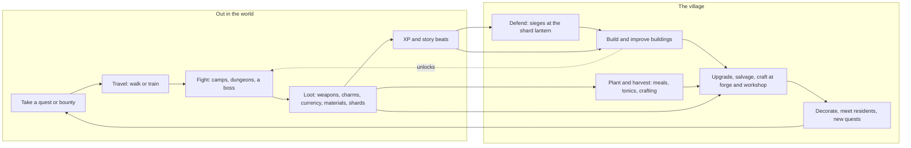

# Game design v2: an action RPG and village life sim (21 Oct)

Matt, 21 Oct 21:01: "completely remove the screen tied mechanics and give it another name. introduce the direction action (eastward type) combat system, instead of the pokemon type. continue to build the world ... i still want to keep everything else: the quests, decorating and improving your place, leveling up your character, arena fights (but redone for the new combat system) etc."

21:16: "I want to completely get rid of the rest/ dream idea. make it into an action rpg/ life sim with a story but evolving into a bit of a looter shooter (but not too massively) where you level up through quests, fighting etc., so the main part of the game is fighting and evolving and improving your village etc."

**Round 2 (21 Oct, 22:05 and 22:09).** Matt answered round 1: the starfall, Glint and all fourteen folk playable stand; Crossroads itself is the village you restore; your familiar no longer fights but backs you; defeat keeps your gear with a slight setback; the village is attacked now and then, partly in the story; and the game is **landscape only, desktop first, phones second**. This page is rewritten for all of it; what round 1 had and round 2 replaced is listed in 13.3.

**Status.** This page is the game's design from 21 Oct and the first file to read in `docs/vision/`. Where it disagrees with an older doc, this page wins; the older docs carry a "Superseded" banner (section 13). The shape is Matt's; the details are Claude A's proposal, with the smaller choices graded by two independent grader sessions (appendix A) and the choices that change the game's shape left to Matt (section 15). The project keeps its code name until Matt picks a new one; this page says "the game". Nothing in this PR changes game code.

## Contents

1. Pitch
2. Pillars
3. The core loop
4. Combat
5. Loot and the looter-shooter arc
6. Levelling
7. The village
8. Quests and story
9. Arenas
10. Economy
11. Platforms, screen and controls
12. Content scale and build order
13. What is removed or superseded
14. Lane plan
15. For Matt
16. Appendix A: the graded choices and the alternatives
17. Appendix B: first numbers for Codex

## 1. Pitch

The game is a top-down action RPG and village life sim, desktop first and playable on phones, drawn at Eastward's level of detail. On the night the moon cracked, its shards fell across the land: the storm broke the bridges and passes, and wherever a shard lies, creatures and machines turn wild. You are a folk hero from the home valley with a small familiar at your heels: you do the fighting, in real time with sword and bow and later guns, and your familiar backs you with auras, saves and, as your bond grows, a burst of its own magic. You clear camps and dungeons and bring the shards home to the stone circle in the woodland. Each region you reach by train has its own trouble, its own boss, its own kind of weapon and someone who moves to your village when it is over. Crossroads, broken by the storm, comes back to life round your hut as you restore it, and its forge, workshop and apothecary make you stronger, though the shards you bring home draw raiders to its square; and over the journey your bow and blade grow into a small, readable arsenal of region-made weapons: Cogsworth's steam rifles, Dust Gulch's carbines, Neon Harbour's lasers and finally starmetal from the moon itself.

## 2. Pillars

Every feature is checked against these five. A feature that serves none is cut.

1. **Every fight reads.** Enemies telegraph, fights are short and fair, controls are precise. You lose to your own mistakes, never to clutter, randomness or a number you could not see.
2. **The village is your power.** What you build at home changes how you fight (forge, workshop, apothecary, training yard); what you win out there builds the village. The two loops feed each other every session.
3. **A journey with a story.** Region by region along the train lines, each region a story, a boss, a weapon family and a new neighbour. The world, regions, cast and train network stay; the story gives them a reason.
4. **Loot you can read.** Few slots, few numbers, and every drop is a decision you can make in two seconds. No grind wall, no gambling, no paid loot, no inventory management.
5. **Desktop first, playable on phones, drawn like Eastward.** Landscape on every device; keyboard and mouse first, then a gamepad, then two thumbs on a landscape phone with 44 px targets and nothing hover-only. Sessions can run long or stop anywhere. Every picture at the house standard (`art-style.md`, `eastward-edges.md`), framed as Eastward frames it (11.1).

Kept from the old pillars: the warm tone (funny and kind, real stakes, never grim), no shaming, nothing that expires, no daily chores, no streaks, no energy timers. Dropped: "rest is the only engine", "short visits, lasting change" as a rule against play, "every place has a balance that rest restores" and "kind fights" (cast.md section 1).

## 3. The core loop



| Scale                                                  | What happens                                                                                                                                                                                                                                                                                                                                                                           |
| ------------------------------------------------------ | -------------------------------------------------------------------------------------------------------------------------------------------------------------------------------------------------------------------------------------------------------------------------------------------------------------------------------------------------------------------------------------- |
| Moment (2 to 40 s)                                     | Read a telegraph, dodge through it at the last moment, strike back, hit the weak point your familiar shows you, spend the bond burst, finish the pack. A cleared camp drops loot in a short burst that you walk over to collect; one tap compares and equips.                                                                                                                          |
| Session (30 to 90 min on desktop, 10 to 20 on a phone) | Leave the village with one goal from the notice board or the story, walk or ride there, clear a camp or one dungeon floor, bank the loot at a waystone, ride home, spend it at the forge or on a building, place a new decoration, pick up the next quest. Every session ends with something built or upgraded.                                                                        |
| Week (a region, 3 to 6 h)                              | A region's story chain (5 to 8 quests), its camps and one dungeon, its boss, its weapon family, its arena rival. The region's resident story ends, its folk joins, a household moves to Crossroads with a building carrying one feature of its region, and the great shard brought home raises Crossroads' attention, which may bring raiders (7.6). The way to the next region opens. |
| Whole game (25 to 35 h)                                | Eleven regions in four acts along the train lines, from the valley to the moon. The kit grows from a bow and a blade to a light arsenal; storm-broken Crossroads becomes a town of seven districts round your hut, and defends itself; the fourteen stones of the circle light one by one. After the story: the arena circuit, high-rank bounties and the deep shards.                 |

Session safety (from AGENTS.md, kept): the game can stop at any moment. Leaving mid-fight pauses; closing the app mid-dungeon resumes at the last checkpoint with every picked-up item kept. An interrupted walk never triggers a stale arrival or navigation.

## 4. Combat

Real-time and directional, after Eastward, with the readability of Hades and the mouse-aimed shooting of Enter the Gungeon. The real-time prototype (`prototypes/realtime-combat/`) is its first proof: the telegraphs, the dodge, hit-stop, the leash, the arena boss, its keyboard controls and its landscape layout all carry over. What changes: no Glares (they were screens), no "naps" at 0 HP, and the familiar backs you instead of fighting.

### 4.1 You fight; your familiar backs you

Matt, 22:05: "maybe your pet gives you boosts and you do the fighting (think about the best mechanics)". There is no switch. You are the only fighter on the field. The familiar follows a step behind, cannot be hit, and backs you in three layers that arrive in stages (appendix A, C15: four models graded, then re-graded for desktop first; the staged model won both graders, 43 and 41 out of 50).

1. **Always on, from the first fight.** An **aura** by family; a **pickup magnet** for Glint, seeds and materials; and **weak-point hints**: on elites and bosses the familiar points, and a glint marks the weak spot for a few seconds. Hits there deal half again and charge the bond.
2. **The save.** Once per leg of an outing (it recharges at every waystone and at home), the familiar reacts to a blow that would end you, in its family's way. The save is what makes the familiar felt by every player, including one who never presses its key.
3. **The bond burst, from bond level 3** (about the end of act 1). A **bond meter**, shown as a ring round the familiar, fills from skill only: **perfect dodges** (rolling through an attack in the last 0.15 s of its wind-up) and **weak-point hits**. Full, it lets you press **Familiar** (F, the left trigger, or a fourth touch button that appears only then) for the family's burst. Early fights and new touch players have nothing extra to press; the familiar grows from a pet into a partner as the bond does. A meal from your crops sets the meter's starting charge for the outing (both graders' grafts).

**The three families** (the Grasslings' families, renamed from the old REST, ROAM and FOCUS habits):

| Family    | Grassling, and the visitors of its line  | Aura                                            | Save                                                               | Burst                                                                                            |
| --------- | ---------------------------------------- | ----------------------------------------------- | ------------------------------------------------------------------ | ------------------------------------------------------------------------------------------------ |
| **Mend**  | Mossling; DOZEBUD, MOSSPUFF, LULLAPINE   | out of harm for 4 s, regain 1 % health a second | the blow leaves you at 1 health and a bloom heals a fifth over 3 s | **Bloom:** heals 30 % over 4 s and roots foes standing in it                                     |
| **Guard** | Pebbling; INKLING, PAGEMOTH, LANTERNROOT | projectiles deal 10 % less                      | a stone shell takes the whole blow                                 | **Stone ring:** a ring round you blocks shots both ways for 5 s, its own timer ring shown        |
| **Swift** | Roamling; TRAILHOP, BURRBOUND, SKYFERN   | dodges recharge 25 % faster                     | a blink carries you out of the blow                                | **Gale:** knocks nearby foes back, refreshes both dodges and speeds your attacks by 30 % for 5 s |

- **Each familiar has its own kit within its family** (one line each, so it reads at a glance). For example: DOZEBUD's aura is stronger and its burst weaker; MOSSPUFF's bloom also cleanses burn, chill and shock; INKLING shows weak points on every enemy, not only elites; PAGEMOTH's ring reflects shots; TRAILHOP refreshes one dodge on every perfect dodge; SKYFERN's gale fires twice. The region visitors (CAIRNLET from the Frostline, TICKWREN from Cogsworth, GLIMMOTH from Neon Harbour and the rest) join a family with a twist of their own. Twelve to fifteen familiars in all, chosen at the menagerie (7.3) or your hut, never during a fight, a siege or a dungeon.
- **How they grow.** Each familiar has a **bond level** from 1 to 10, raised by fights it is out for and by **feeding it meals** from your crops (7.5). Level 3 unlocks the burst; 5 lets the save recharge once after a boss phase too; 7 strengthens the aura; 10 gives a family capstone (Mend: a burst also restores the save; Guard: the ring moves with you; Swift: the burst can be held for a second charge). A new familiar joins at your best familiar's bond level minus two and earns bond twice as fast until it catches up, so nothing is ground twice. One **familiar charm** slot takes loot (5.5).
- **What it costs to draw.** The familiar needs follow, idle, point, cheer, eat, a save reaction and one burst pose per family, not a combat set: three burst effects in all, not one per familiar. The bursts stay small on screen and never hide an enemy's telegraph.
- **Pillar check.** Depth comes from which familiar you bring, its charm and how often you earn its burst; the familiar adds one input at most, and only after the others are learnt.

### 4.2 Moves

| Move         | Detail                                                                                                                                                                                                                                                                                            |
| ------------ | ------------------------------------------------------------------------------------------------------------------------------------------------------------------------------------------------------------------------------------------------------------------------------------------------- |
| Walk and run | WASD, the left stick or the floating stick (11.5): walking and running. The prototype's speeds (20 and 50 world px a second) are the start; 2x changes the art, not world units.                                                                                                                  |
| Melee combo  | Left click (or tap Attack) three times: three swings, the third a heavier finisher with knockback. Each swing steps forward a little toward the aim (the cursor, the right stick, or the soft-locked target on touch). Hold on the third: the finisher becomes a charged heavy that breaks guard. |
| Ranged       | Right click held (the right trigger; on touch, hold Attack) to draw and aim at the cursor, release to fire; the aim line shows while held. Magazine and auto-reload for guns, quiver-free for bows. Standing still while drawing builds Aim (the prototype's three pips) for bows.                |
| Dodge        | A roll of 0.42 s with invulnerability for its first 0.26 s; two charges, each back after 1.2 s. Rolling through an attack in the last 0.15 s of its wind-up is a **perfect dodge**: time slows for 0.4 s (off under reduced motion) and the bond meter charges (4.1).                             |
| Familiar     | From bond level 3, the bond burst when the meter is full (F, the left trigger, or a fourth touch button; 4.1).                                                                                                                                                                                    |
| Special      | Your folk's signature move (Q, a bumper, or the Special button), on a cooldown ring.                                                                                                                                                                                                              |
| Tonic        | R, a bumper, or the flask beside the health bar on touch: a short, interruptible drink that heals a third of the bar. Three flasks, five with the apothecary; refilled at waystones and on entering the village.                                                                                  |
| Interact     | E near a chest, lever, door or person (on touch, the Attack button's place; it never fires in a fight).                                                                                                                                                                                           |

**Feel.** Every action anticipates, acts and settles (AGENTS.md motion rule). Hits hold for 3 to 8 frames by weight (hit-stop), shake the camera by 1 or 2 art px, flash the target's outline and knock it back along the hit. Kills pop with a short burst. All of it scales down or off under reduced motion.

**Aim** (11.5). With a mouse you aim exactly where the cursor is, with no assist. On a gamepad the right stick aims with light magnetism. On touch, attacks and shots go to the nearest enemy within a 35 degree cone of the stick's direction (a small ring marks it), and dragging from the Attack button aims by hand (appendix A, C3). Assist strength is a setting.

### 4.3 The folk's signature moves

The cast's fight mechanics (cast.md section 4) were turn-based. Each is rewritten as one real-time special with the same idea, so the cast keeps its meaning:

| Folk    | Weapon kind at start        | Special (real time)                                                                                         |
| ------- | --------------------------- | ----------------------------------------------------------------------------------------------------------- |
| Bramble | billhook and short bow      | **Steady:** a rooted volley of three charged arrows; standing still before it adds Aim (from the prototype) |
| Puffcap | cap staff and spore sling   | **Spore cloud:** a cloud that slows and makes foes drowsy (they attack half as often for 4 s)               |
| Velvet  | lamp hook and dart caster   | **Dim:** her lamp shutters; enemies lose track of her for 2 s and their next attack is weaker               |
| Cairn   | stone fists                 | **Bedrock:** a guard stance that absorbs one hit fully, then a shoulder charge                              |
| Pendle  | wrench and rivet gun        | **A Minute Slow:** marks a spot; one second later it strikes again for half the damage dealt there          |
| Puddle  | gaff and harpoon gun        | **Tide:** a wave that pushes foes and soaks them (soaked foes take more shock damage)                       |
| Mirra   | diviner's rod and carbine   | **Seep:** a spring at her feet that heals you while you stand in it                                         |
| Ashe    | sword and flame lance       | **Banked fire:** heat builds with each hit; the special spends it in one burst                              |
| Nix     | baton and pulse pistol      | **Do Not Disturb:** a field that deletes enemy projectiles for 2 s                                          |
| Tally   | crook and sling             | **Round-up:** pulls nearby foes into a knot                                                                 |
| Tam     | ice axe and crossbow        | **Bothy:** once a fight, a blow that would end you leaves you at 1 HP and warms you back a little           |
| Tuff    | basalt maul                 | **Overgrow:** a layer of thrift and fern armour that absorbs damage until knocked off                       |
| Bunk    | magnet boots and arc caster | **Magnet:** pulls loose loot and small foes in, then a shock pulse                                          |
| Mote    | star wand                   | **Starfall:** a small rain of light on a marked area; Mote is the wildcard, never the strongest             |

Each folk's weapon kind is its **starting** weapon. Any folk can equip any weapon; the starting kinds give each folk a feel and a perk branch (section 6).

### 4.4 Enemy design rules

1. **Every attack is telegraphed** by a pose and a ground mark in the one reserved telegraph colour, with a shape that differs by attack kind (lane, ring, cone, circle), so colour is never the only cue. Wind-ups: 0.9 to 1.4 s for grunts, 0.6 to 1.0 s for elites, never under 0.5 s. One solid brightening at the moment of commitment, never a strobe.
2. **Attack tokens.** At most two enemies commit to an attack at the same moment (three on Hard). The others reposition. This, not low numbers, keeps packs fair.
3. **Roles by silhouette.** Six roles, each readable in one glance at the smallest view (a landscape phone): **grunt** (walks in, swings), **lunger** (long telegraphed charge), **shooter** (keeps distance, slow projectiles), **tank** (shielded front, open back), **swarmer** (small, weak, in fours), **caster** (buffs or summons, flees). Each region dresses the roles in its own creatures and machines; behaviour is shared code, art is never shared between regions (world-atlas.md: "not reskins").
4. **Projectiles are slower than the dodge** and never come from off-screen; an arrow at the screen edge marks anything about to enter.
5. **Leash.** Enemies give up beyond about 140 world px from where the fight began and drift home (the prototype's value), so a fight can always be walked away from.
6. **Freed, not killed.** Shardstruck creatures are freed: the shard pops out, the creature shakes itself and runs off into the scenery. Machines break down and Company troopers flee. The tone stays warm while the fighting is real.
7. **Camps, not random encounters.** Enemies live in visible camps, nests and patrol routes placed by the map lanes (section 14), never in invisible random encounters. Cleared camps refill after you leave the region and come back (a full refresh on each train arrival), never on a real-time clock.
8. **Cover.** Ranged fights use the map's walls, crates, rocks and a Guard familiar's stone ring. Shots stop at anything that blocks the walk mask at chest height; the map lanes mark low cover (shoot over) and high cover (blocks) in plan data.

### 4.5 Bosses

- One **region boss** at the end of each region's story (eleven), one **dungeon keeper** at the bottom of each dungeon (some regions share it with the boss), and a few **roaming elites** with names.
- Three phases at most, each with two or three learnable patterns and one new idea, and a short readable "tell" before each phase change. A checkpoint at each phase on Normal and below.
- Every boss teaches the region's new idea: the woodland's Thornback teaches the dodge, Cogsworth's Foreman Engine teaches cover and the rifle, the Isles' Basalt Crab teaches the bond burst, Neon's director teaches projectile clearing.
- Boss arenas lock with a visible boundary (the prototype's lit stones) and unlock on defeat.

### 4.6 Difficulty

| Setting | Telegraphs | Damage taken | Attack tokens | Other                                                                              |
| ------- | ---------- | ------------ | ------------- | ---------------------------------------------------------------------------------- |
| Story   | x1.5       | x0.5         | 1             | Perfect dodges with a wider window (0.3 s); strong aim assist on gamepad and touch |
| Normal  | x1.0       | x1.0         | 2             | The default                                                                        |
| Hard    | x0.85      | x1.4         | 3             | Elite variants in camps; no phase checkpoints                                      |

Changeable any time outside a fight. Loot and XP are the same on every setting, so nobody is punished for comfort (pillar 4). Hard adds only arena ranks above Gold (section 9).

### 4.7 Accessibility

Reduced motion (follows the system setting, toggle in settings: no shake, no afterimages, no perfect-dodge slow-down, flashes become outlines); colour-blind safe telegraphs (shape plus colour); aim assist strength; auto-repeat on held melee; full remapping of keys and gamepad buttons; a left-handed touch layout; touch button size and opacity; rumble and haptics on or off; text size; Story difficulty; pause anywhere, and the game pauses itself when the app goes to the background.

## 5. Loot and the looter-shooter arc

### 5.1 The arc

| Act                         | Regions                                                                          | What you fight with                                                                                                                                             |
| --------------------------- | -------------------------------------------------------------------------------- | --------------------------------------------------------------------------------------------------------------------------------------------------------------- |
| 1. The valley and the hills | the home valley and woodland, the Frostline, the Brackens                        | **Melee-led.** Your folk's melee weapon and a simple bow or sling with no affixes. Loot is melee weapons and charms. Ranged is a helper.                        |
| 2. Brass and water          | Cogsworth and the coal hills, the Lull (Lullford, Gullwick), the Tidebloom Isles | **The first guns.** The tinkerer builds you a steam rifle after Cogsworth's boss; the ranged slot opens to looted guns with affixes. Melee and ranged are even. |
| 3. Sun, fire and neon       | the Sunstone basin, the fire country, Neon Harbour                               | **Ranged-led.** Carbines, flame lances, lasers. The Company's troopers shoot back, cover matters, and the familiar's wall and gust become tools against fire.   |
| 4. Up and out               | Halcyon Station, Lumen                                                           | **Starmetal.** The moon's own weapons, one unique per boss. The post-game's deep shards drop Starforged gear.                                                   |

The melee weapon never stops mattering: it is how you stagger tanks, break guards and clear swarms, so the game grows into a shooter without dropping its first half.

### 5.2 Weapon families by region

Each region's loot table favours its own family (about 60 % of drops there), so a region's weapons look and feel like the place (world-atlas.md: every region is its own place).

| Region                       | Melee                          | Ranged                                         | Feel                                    |
| ---------------------------- | ------------------------------ | ---------------------------------------------- | --------------------------------------- |
| The valley and woodland      | billhooks, cudgels             | short bows, slings                             | quick, light                            |
| The Frostline                | ice axes, hatchets             | crossbows                                      | heavy single shots, slow reload         |
| The Brackens                 | crooks, staves                 | slings, bolas                                  | knockback, crowd control                |
| Cogsworth and the coal hills | wrench-hammers, pistons        | steam rifles, rivet guns, pressure scatterguns | pressure builds as you fire, then vents |
| The Lull and Gullwick        | gaffs, oars                    | harpoon guns, net launchers                    | pull and pin                            |
| The Tidebloom Isles          | basalt mauls, coral knives     | spear guns, spring launchers                   | piercing, bounce                        |
| The Sunstone basin           | machetes, spurs                | lever-action carbines, revolvers, sun lenses   | crits, fast follow-ups, a focused beam  |
| The fire country             | knightly swords, forge hammers | flame lances, forge mortars (lobbed)           | burn, area                              |
| Neon Harbour                 | arc batons, light blades       | pulse pistols, laser rifles, arc casters       | shock chains, high fire rate            |
| Halcyon Station and Lumen    | starmetal glaives              | gravity casters, beam lances                   | unique effects                          |

### 5.3 Rarity

| Tier       | Affixes                 | Colour (house palette) | Where                                                        |
| ---------- | ----------------------- | ---------------------- | ------------------------------------------------------------ |
| Common     | 0                       | stone                  | everywhere                                                   |
| Fine       | 1                       | leaf                   | everywhere                                                   |
| Rare       | 2                       | sky                    | elites, chests, bounties                                     |
| Heroic     | 3                       | violet                 | bosses, dungeon keepers, hard bounties                       |
| Starforged | 2 plus one named effect | gold                   | first defeat of each boss (fixed and known), the deep shards |

Rarity is shown by the frame colour and a pip count, never by colour alone.

### 5.4 Affixes

About twelve, each one line with one number: power +%, fire rate +%, reload +%, magazine +n, crit chance +%, range +%, knockback, an element (burn, chill, shock, root), on-dodge (the next shot is charged), on-burst (your next three hits after a bond burst are stronger), heal on a freed foe (small), pierce. No stacking multipliers across items, no hidden stats, no conditional chains three effects deep.

### 5.5 Slots and inventory

- **The folk:** melee, ranged, two charms. **The familiar:** one familiar charm (loot with a rarity and one or two affixes: meter fill, burst length, aura strength, save strength). **The pair:** one outfit (looks only). Five slots that affect a fight; you can see them all on one screen.
- **The satchel** holds 16 items. A new drop shows a green or red arrow per headline number against what you wear; one tap equips, one tap marks for salvage. **Auto-salvage** below a chosen rarity is a setting.
- **Seeds and materials** never enter the satchel: seeds go to the seed tin, materials to the wallet.
- **The stash** at home holds 60 items, plus a **trophy rack** that keeps one of every Starforged forever (it never takes stash space).
- Weapons show two headline numbers (**Power** and **Speed**) and their affixes. A derived damage per second is shown in the detail view only.

### 5.6 Upgrade, salvage and why it never becomes a grind

- **Gear level** follows the region: drops come at the region's level to two above. **The forge raises a favourite weapon to your current gear level** for currency and scrap, so a weapon you love lasts the whole game. Upgrading never fails.
- **Reforge** rerolls one affix at the workshop, at a rising but capped price, and shows the possible results first. One reroll per affix at a time, no chain gambling.
- **Salvage** turns an item into scrap and a little currency, with the region's material if it was a region-family item.
- **Mods** (from the workshop's second tier): one mod per ranged weapon (scope, stock, barrel), moved freely between weapons.
- **No grind wall:** the main story is tuned to be finished with what the story, bosses and chests give (every boss gives a guaranteed Heroic or better of the region's family, and every main quest a Fine or better). Farming is optional and fun, never required.
- **No gambling:** no loot boxes, no paid rerolls, no premium currency, no random shop with timers. Drop rates are listed in the journal. **Bad-luck protection:** after eight Rare-or-better drops without a Heroic, the next one is Heroic.
- **No paid loot, ever.** If the game is ever sold with extras, they are a whole purchase or cosmetic outfits, never power, never random.

## 6. Levelling

- **Character level 1 to 30** over the story (about level 3 per region), shared by every folk you own (cast.md's decided "one shared level" survives). A folk who joins late arrives at full level; nothing is levelled twice.
- **XP sources:** main quests about 55 %, side quests and bounties about 20 %, fights about 20 %, first discoveries (a viewpoint, a secret, a new place) about 5 %. Fights pay less the further below your level the enemy is, so the story leads.
- **Each level** gives a little health and one **perk point**.
- **Perks: three to pick from** (appendix A, C4; both graders chose it over a tree). At each level a card of three perks appears; you take one, and it is permanent. Each folk has its own pool of about 24 perks, each tagged with a branch (Bramble: Blade, Bow, Woodcraft). Most are plain (+10 % bow damage); about a third change how a move works (the combo's finisher looses an arrow; dodging through a telegraph reloads). You can **pin a branch**: one of the three is then always from it, and one is always from another, so builds feel directed without a menu of 18 nodes. Respec is free at the training yard. A folk who joins late gets all its picks at once, with a "choose for me" button that follows the pinned branch.
- **The familiar** grows by its own **bond level** (1 to 10), from fights it is out for and from the meals you feed it (4.1), and through its charm (5.5).
- **Character level and gear level are separate.** Character level is your health and perks; gear level is your weapons' power. An under-geared player is told so plainly at the waystone before a boss ("your rifle is level 9; the Foreman is level 12; the forge can raise it").

## 7. The village

Matt, 21 Oct 21:31: "also think about how your village could change throughout (gardening, maybe a tower defense situation?, other changes to the villages) and how it ties in to the story".

The village is the game's second half. It changes at every story beat, it feeds every fight (buildings, crops, defences) and it is where the story comes home: what you free out there moves in, and what threatens the moon comes to your door.

### 7.1 Where: Crossroads, storm-broken

Matt, 22:05: "3. b) maybe". **The village is Crossroads Town itself**, broken by the starfall's storm, and you restore it. Your hut and garden on the terrace above the square are your home inside it, reached by the gate lane and the garden's stair, as the valley plan already has them (world-plan.md 8.2: Crossroads on T1, about 640 x 560, a 240 x 176 square round the well, the library and a terrace of cottages on the north side, the bakery on the west, the stall on the square, the green with its ring to the south-west; the garden on T2 above).

Restoring a real town, rather than building on an empty meadow, means the village already has its streets, its people's houses and its story: the well choked with rubble, the library's roof torn open, the bakery cold, cottages boarded up, the mill wheel jammed, the halt's platform smashed. Every repair brings a household home and opens a service. New buildings that the old town never had (the workshop, the glassworks, the water tower) go on **burnt-out lots** where the storm's fires took a house, and on the edges of the town along the halt road, the harbour road and the millrace.

**How "broken" is drawn.** Each Crossroads building is drawn once at 2x by the kit, with its tiers. The broken state is a **damage overlay kit** laid over the same building (boards over windows, a tarp on the roof, fallen slates, scorch, scaffolding, rubble at the door), not a second drawing, so restoration costs one overlay set for the whole town plus the tiers. The same overlays show siege damage (7.6).

At the centre of the square, beside the well, stands **the shard lantern**, where the great shards rest once you bring them home, until the woodland circle is ready to take them (section 8). The lantern is what raiders want.

### 7.2 How Crossroads changes, act by act

| Stage                 | Story beat                                                                 | Crossroads                                                                                                                                                                                                                                           | New this stage                                                                                                                                                |
| --------------------- | -------------------------------------------------------------------------- | ---------------------------------------------------------------------------------------------------------------------------------------------------------------------------------------------------------------------------------------------------- | ------------------------------------------------------------------------------------------------------------------------------------------------------------- |
| 0. The morning after  | Prologue: the starfall night; the Thornback freed                          | Half the town has fled to the halt farm and Driftwood. The square is rubble round a choked well; only Moss's stall is open. Your hut on the terrace survived; its garden beds are scorched. A shard crater smokes in the park                        | The smithy repaired (the forge), the notice board, the waystone, four crop beds on the terrace, the shard lantern; **the first night**                        |
| 1. The square reopens | Act 1: the Frostline, the Brackens, Cairn wakes                            | The well cleared; the bakery lit; the herbalist's (the apothecary) and the green's ring (the training yard) repaired; the library's bell cupola rebuilt; three households back in the north terrace; the halt's platform rebuilt so trains run again | Apothecary, training yard, bell tower, eight beds, the halt; **Planting Day**; **the wolf moon**                                                              |
| 2. The market town    | Act 2: Cogsworth, the Lull, the Isles; the Company appears                 | The mill turns again; the halt gets a brass clock and a canopy; a burnt lot on the halt road becomes the workshop; Company posters go up on the Crossroads board, then come down; the park's crater becomes a pond                                   | Workshop, kitchen and mill, menagerie and greenhouse (in the park), the halt's canopy; **the Brass Fair**; **the diggers**                                    |
| 3. The town grows     | Act 3: Sunstone, the fire country, Neon Harbour; the Company's crime known | A water tower and channels on the terrace, a glassworks and the great forge's chimney on the harbour road's burnt lots, arc lamps on the square; the dragon visits the library roof at dusk; families from Company towns move into new cottages      | Trophy hall (the library's east wing), lookout (a mast on the library), great forge, water tower, sixteen beds; **Harvest Lanterns**; **the night of lights** |
| 4. The beacon         | Act 4: Halcyon and Lumen                                                   | A lit path from the lantern up the stair and through the woodland to the circle; everyone in the square; the crack in the night sky shrinks with each shard, then closes                                                                             | **The shardstorm**, then **Full Moon Night**                                                                                                                  |
| After the story       | The moon mended                                                            | The town whole, busier than before the storm; seasons keep turning; raids still come now and then (7.6)                                                                                                                                              | Ranked sieges, festivals each year, the last cottages and beds                                                                                                |

A stage's buildings are offered the moment its beat lands, so a player who only follows the main quests still sees each stage.

### 7.3 Buildings

| Building                              | Where in Crossroads                                 | Stage  | What it gives (tiers 1 to 3)                                                                                      |
| ------------------------------------- | --------------------------------------------------- | ------ | ----------------------------------------------------------------------------------------------------------------- |
| Your hut                              | the garden terrace above the square                 | 0      | Your bed (save, change folk), the stash, the keepsake chest; tiers add rooms to decorate                          |
| Moss's stall                          | the square                                          | 0      | Buys and sells materials, seeds and junk; tiers widen the stock (never timed, never random)                       |
| The forge                             | the old smithy, off the square                      | 0      | Upgrade weapons to gear level, salvage; tier 3 is the great forge (stage 3)                                       |
| The notice board and the waystone     | the square                                          | 0      | Quests and bounties; fast travel and tonic refills                                                                |
| Crop beds                             | the garden terrace, then the water tower's channels | 0      | 4, then 8, 12 and 16 beds (7.5)                                                                                   |
| The shard lantern                     | the square, by the well                             | 0      | Holds the great shards; the heart of every siege (7.6)                                                            |
| The apothecary                        | the herbalist's, west of the square                 | 1      | Tonics: four, then five flasks; stronger tonics; a cleanse tonic; brewed from crops                               |
| The training yard                     | the green and its ring, south-west                  | 1      | Perk respec, a damage dummy, combo trials; the town's own arena ring                                              |
| The bell tower                        | the library's cupola                                | 1      | Shows coming raids and their lanes; starts a siege when you ring it; the watch night; ranked sieges later         |
| The library                           | the north side of the square                        | 1      | The journal, the bestiary, drop rates and the codex; tiers add the trophy hall (east wing) and the lookout (mast) |
| The bakery, then the kitchen and mill | the bakery; the mill on the millrace                | 1, 2   | Bread from tier 1; meals from crops from tier 2 (one buff for the next outing); flour for better meals            |
| The workshop                          | a burnt lot on the halt road                        | 2      | Reforge, mods, familiar charms re-rolled                                                                          |
| The menagerie and greenhouse          | the park, by the crater pond                        | 2      | Befriended visitors live here and can be chosen as the familiar; six beds for exotic seeds that grow in winter    |
| The station                           | Valley Halt, west on the halt road                  | 1 to 4 | (7.8)                                                                                                             |
| The water tower                       | the garden terrace                                  | 3      | Irrigation: every bed grows one stage faster                                                                      |
| The glassworks                        | a burnt lot on the harbour road                     | 3      | Lenses and lanterns; greenhouse tier 2                                                                            |
| Cottages (up to 12)                   | the north terrace, burnt lots, new lanes            | 1 to 4 | A home for each household that returns or moves in; each can be styled                                            |

Each repair or building is paid with Glint, scrap and region materials at the workbench in your hut ("restore here" on a marked building or lot). Work is instant once paid: no timers.

### 7.4 Who moves in

Each region you free sends someone home with you to Crossroads, and they bring their place with them:

| From                | Who moves in                                    | What they bring (a building with one feature of their home)                          |
| ------------------- | ----------------------------------------------- | ------------------------------------------------------------------------------------ |
| The valley          | the smith and the families who fled the storm   | the forge reopened; the north terrace's cottages lived in again                      |
| The Frostline       | the bothy keeper                                | the training yard, with a bothy's stone hut and a kettle always on                   |
| The Brackens        | the drover's niece and three sheep              | a fold and a loom (wool for the stall and outfits); the sheep graze the green        |
| The valley's circle | the gardener's daughter                         | the apothecary, with a herb garden                                                   |
| Cogsworth           | the tinkerer's journeyman                       | the workshop, with a brass clock and a steam whistle                                 |
| The Lull            | the bargee's cook                               | the kitchen and the water mill on the stream                                         |
| The Tidebloom Isles | the naturalist's assistant; befriended visitors | the menagerie and the greenhouse, with a turtle pond                                 |
| The Sunstone basin  | the caravan trader's son                        | the water tower and irrigation (the oasis's know-how), a striped awning on the stall |
| The fire country    | the castle's steward; Ember forge hands         | the trophy hall; the great forge's chimney and the glassworks' kiln                  |
| Neon Harbour        | Dave's runner; families who left Company towers | the lookout as a radio mast; arc lamps along the harbour road                        |
| Halcyon and Lumen   | Bunk's station crew (after the story)           | a telescope on the lookout; moon lilies in the greenhouse                            |

- **The residents stay in their regions** (the world keeps its people); their households, apprentices and helpers are who move.
- **The folk** who join live in Crossroads between outings, give their own quests and can be posted as champions in a siege (7.6).
- **Befriended visitors** (GLIMMOTH, CAIRNLET, TICKWREN and the rest) live in the menagerie and can be chosen as the familiar (AGENTS.md's companion rules).
- **A world-rules exception** (made in `world-rules.md` in this PR): world-atlas.md keeps each region's props in its region. A mover's building is the one exception: it is drawn in the valley's materials and palette, with **one** feature of its home region (the brass clock, the striped awning, the arc lamp), so the village tells the journey without becoming a theme park.

### 7.5 Gardening and crops

The garden's old meadow (garden-growth.md: six beds and three orchard pits) on your hut's terrace becomes the first beds and the orchard, now grown by play.

- **Growth by outings** (appendix A, C13): each time you come home from a trip (any quest, camp or dungeon), every planted plot grows one stage; three stages to harvest (two with the water tower). Nothing ever wilts, rots or is lost if left. Real time never grows or spoils anything.
- **Plots show their stage** (sown, sprout, leaf, bud, ripe; the beds' growth sprites from `garden_meadow.py`, redrawn at 2x). Watering a plot on a visit is optional and grows it one extra stage once per visit; skipping it costs nothing.
- **Seeds are loot.** Regional foes and chests drop that region's seeds (a common drop, straight into the seed tin, never the satchel); bosses drop a rare seed; Moss's stall sells the basic ones.
- **Harvest** is one tap at the plot sign ("harvest all"), and replanting the same seed is one more.
- **Crops feed three things:** the **kitchen** (meals: one buff until you next come home, such as +15 % health, +10 % ranged damage, faster dodge recharge or resistance to burn, chill or shock), the **apothecary** (stronger tonics, the cleanse tonic), and **crafting** (fibre and dye for outfits and charms at the workshop; flour at the mill for better meals).
- **Crops, one or two per region:** sweetroot and meadow beans (valley), frostberries (Frostline), heather for honey (Brackens), river cress (the Lull), salt melons (the Isles), sunmelons and prickly pears (Sunstone), ember peppers (the fire country), glowcaps in a dark shed (Neon Harbour), moon lilies (Lumen, after the story). The orchard's three trees (apple, pear, plum) give fruit for festival dishes.
- **Seasons** (7.9): outdoor plots grow in spring, summer and autumn; in winter only frostberries and the greenhouse grow.
- **Crops grown are scored at Harvest Lanterns** (7.9), for a decoration, never for power.

### 7.6 Village defence: sieges

Tower defence before the fight, action during it (appendix A, C11: Matt's tower-defence idea was drafted in full and against two simpler designs, graded twice, and this prepared form won both rounds; Matt answered round 1 with raids "every once in a while", built in below). The great shards in the lantern draw the shardstruck and, later, the Company. They come at the village along at most three lanes; your buildings' defences stand on fixed pads, you choose which stands where, and then you fight alongside them.

**How a siege plays.**

1. **Prepare (optional, untimed).** At the bell tower, one screen shows the town from above (one zoom step out, 11.2), the lanes the bell predicts, and the pads. Click or tap a pad to cycle through the defence kinds you have; post a spare folk as a champion on a pad (one per pad). Every pad starts filled with its building's own kind, and afterwards the screen remembers your last layout, so **Ring the bell** starts a siege with zero taps for anyone who does not want to plan.
2. **Waves.** Three to six, each announced by a horn and a lane marker. Once the bell rings there is no building or upgrading: the waves are pure real-time fighting. The game pauses at any time, and a siege left mid-way resumes at the start of its current wave.
3. **Fight alongside.** You play as everywhere else, your familiar's save and burst included. Some foes (shielded, flying, burrowing) need you rather than the pieces, so a siege never plays itself.
4. **The goal:** keep the raiders off the shard lantern until the last wave. The lantern has its own health bar.

**Defence pieces.**

- **Fixed pads:** 2 in the first night, 6 at stage 1, 8 at stage 2, 12 at stage 3, at the village's junctions and gates in the valley's plan data. A pad is a level patch of flagstones that looks like part of the village when empty. Pieces never sit on decorations, and the lanes stay walkable.
- **Each building unlocks one defence kind** in its region's style. There are no schematics and no second loot track: the village's growth is the defence's growth. A piece's level is its building's tier, so there is nothing to gear.

| Building (region)                      | Defence kind     | What it does                            |
| -------------------------------------- | ---------------- | --------------------------------------- |
| The forge (valley)                     | hurdle barricade | blocks a lane until broken              |
| The hut (valley)                       | archer post      | steady single shots                     |
| The apothecary (valley)                | spore pot        | a cloud that makes foes drowsy          |
| The training yard (Frostline)          | crossbow nest    | heavy, slow, piercing bolts             |
| The fold and loom (Brackens)           | bola trap        | slows the first foes over it            |
| The workshop (Cogsworth)               | steam turret     | fast shots; pressure builds, then vents |
| The kitchen and mill (the Lull)        | net launcher     | pins one foe                            |
| The menagerie (the Isles)              | spring trap      | bounces foes back down the lane         |
| The water tower (Sunstone)             | water cannon     | pushes foes and puts out fire           |
| The great forge (fire country)         | flame mortar     | lobbed area burn                        |
| The glassworks (fire country)          | lens tower       | a focused beam that ramps up            |
| The lookout (Neon Harbour)             | arc pylon        | shock that chains between foes          |
| The telescope (Lumen, after the story) | gravity well     | pulls foes together                     |

- **Villagers** are posted once, as a lasting choice, never a menu each time: the bothy keeper in a crossbow nest reloads it faster, the journeyman's steam turrets vent later, and so on.
- **Champions.** Folk you own but are not playing can stand on a pad as champions, one per pad: they fight from it and use their special every 12 s. This gives the fourteen folk a use beyond being chosen at your hut.
- **Rewards:** Glint, materials for the buildings that defend, and seeds; the first win of each story siege moves the story on.

**When the town is attacked** (appendix A, C18; Matt, 22:05: "your village being attacked every once in a while is interesting (partly during story) and later on without making it annoying"). Four models were graded; the winner (40 / 39) is attention earned by play, announced, and never sprung on you:

- **Story sieges.** Five, hand-staged, one ending each act (the table below), each about 5 to 8 minutes, short enough for a phone sitting, each started when you choose at the story's prompt.
- **Raids drawn by what you do.** Crossroads gathers **attention** from your progress: each great shard brought home, each Company site you wreck, some bounties. When it is high enough, a raid is **announced on your next return home**: a horn from the bell tower, the raiders' camp visible on the edge of town (on the halt road, in the park, on the harbour road), and their lanes shown at the bell. You then choose:
  - **Defend now:** the prepare screen, then the siege.
  - **Not tonight:** the raid waits for your next return home, up to two times. The camp stays visible, and villagers mention it.
  - **Break their camp:** go out and fight the camp as a field fight instead, without your defences, for the same reward.
  - After two postponements the raid begins when you next walk into town, still with the untimed prepare screen first.
- **Caps that keep it from becoming a chore.** At most one raid pending at a time; never two returns in a row; about one per region chapter during the story and about one per five returns home after it; never during a festival, an outing, a dungeon or while the game is closed; never on a real-time clock. A **calm town** setting turns off everything but the story sieges for anyone who wants that.
- **The watch night.** The bell always offers an optional siege you start yourself, with small rewards and no stakes, for anyone who wants more (both graders' graft). After the story, ranked sieges (Bronze to Star) replay each story siege at higher levels.
- **Variety.** Raiders come from the faction of the region you are in (shardstruck beasts of that region, Company squads, smugglers), with a modifier (night, rain, fog, an air lane) and one of four objectives: hold the lantern; keep crows and boars off the crop terraces; get the families from the north terrace to the library; bring down an airship before it lands its squads. Scaled to your level and to the pads you have.
- **Rewards.** A siege chest: Glint, materials for the buildings that defend, seeds, and a guaranteed Rare or better weapon of the raiders' family.

**Losing** (appendix A, C19: a delayed repair, 39 / 36). If the lantern falls, the siege ends. **Nothing you built is destroyed.** Up to two buildings the raiders reached show the damage overlay (7.1) and work at tier 1, their basic service, until you finish one outing and come home; then the villagers have repaired them, for free, with a short skippable scene and a line from whoever did the work. You keep everything you picked up during the siege. The first raid lost in the story costs nothing at all, to teach the rule. After two losses in a row the bell offers an easier retry (sturdier pieces), with the same rewards. A story siege lost is simply tried again; the story waits.

**How each act escalates.**

| Siege                       | Raiders                                                                           | New idea                                                                           | New pieces                                        | Last wave                                                                   |
| --------------------------- | --------------------------------------------------------------------------------- | ---------------------------------------------------------------------------------- | ------------------------------------------------- | --------------------------------------------------------------------------- |
| The first night (prologue)  | thornlings and briar swarmers from the woodland                                   | one lane, three waves: choose two pads, fight alongside                            | barricade, archer post                            | a thorn knot that only you can break                                        |
| The wolf moon (act 1)       | shard wolves down from the Brackens, crows over the col                           | three lanes; fliers that skip barricades                                           | crossbow nest, bola trap, spore pot               | Old Fang's mate, who goes for the lantern, not you                          |
| The diggers (act 2)         | the Company's clockwork diggers, automata, river smugglers                        | burrowers that surface mid-lane; a lane by water                                   | steam turret, net launcher, spring trap           | a foreman in a walker that targets your pieces                              |
| The night of lights (act 3) | Company troopers with lasers, an airship dropping squads, shardstruck salamanders | an air lane; troopers that shoot pieces from range; fire                           | water cannon, flame mortar, lens tower, arc pylon | the airship itself; the freed dragon comes to help in the final wave        |
| The shardstorm (finale)     | everything the Hollow's storm wakes, from every region                            | shards fall on the village and turn whatever they hit; hold while the circle fires | every piece; every villager and folk posted       | hold the lantern until the beacon fires, then board the train to the rocket |

### 7.7 Other visible changes: districts

Crossroads' own parts come back one by one, and the town grows outward along its roads.

| District              | Opens   | What is there                                                                                                 |
| --------------------- | ------- | ------------------------------------------------------------------------------------------------------------- |
| The square            | stage 0 | the well, the shard lantern, Moss's stall, the forge, the herbalist's, the bakery, the library and its bell   |
| The garden terrace    | stage 0 | your hut, the crop beds and orchard, later the water tower and its channels                                   |
| The north terrace     | stage 1 | the cottages of the families who come back                                                                    |
| The green             | stage 1 | the training yard and ring; the drover's fold and loom                                                        |
| The halt road         | stage 1 | the station (7.8), the workshop on a burnt lot, new cottages                                                  |
| Millside and the park | stage 2 | the mill and the kitchen garden; the menagerie, the greenhouse and the crater pond; the festival ground       |
| The harbour road      | stage 3 | the great forge's chimney and the glassworks on burnt lots, arc lamps, cottages of families from Neon Harbour |

Each is a plan-data area the valley's lane draws once (Claude E, with Claude B's props), with its broken state as overlays and its empty lots marked. Crossroads stays a real town (world-rules.md: places make sense): lots sit along its lanes and the millrace, never in a grid.

### 7.8 The station grows

Valley Halt, west of the square on the halt road, is Crossroads' station.

| Stage | The station                                                                                                                                      |
| ----- | ------------------------------------------------------------------------------------------------------------------------------------------------ |
| 0     | Wrecked by the storm: the platform smashed, no trains                                                                                            |
| 1     | **Rebuilt:** a timber platform and a lamp; the valley line runs again once W3 is mended                                                          |
| 2     | **The market halt:** a brass clock, a whistle and a glazed canopy from Cogsworth                                                                 |
| 3     | **The junction:** the desert line's platform reopened, a water crane from Sunstone, a departure board from Neon Harbour, a signal box            |
| 4     | **The beacon platform:** the line's last special train runs from here to the Launch Cape for the rocket; afterwards the platform keeps its flags |

### 7.9 Seasons and festivals

- **Seasons follow the story,** not the calendar: spring in the prologue and act 1, summer in act 2, autumn in act 3, winter in act 4, spring again at the ending. After the story they turn every ten returns home. Seasons change the village's look (blossom, long grass, leaves, snow on the roofs), the crops that grow outdoors and the festival. They change no reward, no enemy and no number (living-world-plan.md's atmosphere rule, kept).
- **Festivals,** one per season, each an evening on the green when its story beat lands. Each has a meal, a small game and a decoration to keep; none is timed or missable (in the post-game each comes back every year):

| Festival         | When                           | What happens                                                                                                  |
| ---------------- | ------------------------------ | ------------------------------------------------------------------------------------------------------------- |
| Planting Day     | spring, after Cairn wakes      | the village plants the green together; a seed swap; a ribbon on the first tree                                |
| The Brass Fair   | summer, after Cogsworth        | the tinkerer's journeyman brings a carousel; a shooting gallery for the new rifle; an arena exhibition        |
| Harvest Lanterns | autumn, after the fire country | the crop show (your best harvest is judged, for a decoration); lanterns floated on the millpond               |
| Full Moon Night  | the ending                     | every villager and folk on the green under the mended moon; the fourteen stones lit; the credits roll over it |

### 7.10 The village reacts to the story

| Beat                                  | The village                                                                                   |
| ------------------------------------- | --------------------------------------------------------------------------------------------- |
| The starfall                          | the crater smokes; villagers whisper at night; the crack is visible in the night sky          |
| Each great shard brought home         | the lantern glows one step brighter; the crack in the sky shrinks a little                    |
| A Company buyer in Crossroads (act 1) | a poster offering Glint for shards appears on the Crossroads board                            |
| The Company's crime revealed (act 3)  | the posters are torn down; villagers talk of nothing else; families from Company towns arrive |
| A region freed                        | its banner goes up on the green; its mover arrives on the next train with their luggage       |
| The dragon freed                      | the dragon visits the bell tower roof at dusk, as scenery (it grants nothing)                 |
| A folk joins                          | a stone in the woodland circle lights; the folk's house lamp comes on in the village          |
| Before the finale                     | the lit path from the lantern to the circle; everyone gathers                                 |
| The ending                            | the moon whole; Full Moon Night; the crater pond full of moon lilies                          |

Villagers' lines (the resident routines already built, `lib/resident-routes.ts`) react to the current beat and to what you built.

### 7.11 Decorating

Keepsakes (world-atlas.md, "Decorating the hut") stay: every place still leaves one, and you place them freely inside and out. Added: boss trophies, festival keepsakes, fences, paths, lamps and planters from the stall, the hut's exterior choices (Claude B's B1) and each cottage's style. **Decorations add no stats** (AGENTS.md: decorative interactions add no rewards, costs or chores) and never sit on a build pad or a siege lane (the placement check refuses them), so decorating stays pure play and never weakens a defence.

### 7.12 How the village links back to combat

| Village thing          | Combat effect                                          |
| ---------------------- | ------------------------------------------------------ |
| Forge tier             | the highest gear level for weapons and defence pieces  |
| Workshop               | reforge, mods, familiar charms re-rolled               |
| Apothecary             | tonic count and strength                               |
| Kitchen and crops      | one outing buff                                        |
| Training yard          | perk respec; combo trials that teach advanced moves    |
| Waystones and the halt | how fast you get back out                              |
| Lookout                | camp, shard and siege markers                          |
| Every building         | one defence kind for sieges, levelled by its tier      |
| Sieges                 | materials, seeds and Glint; champions give folk a role |
| Villagers              | quests, and through quests XP and loot                 |

## 8. Quests and story

### 8.1 The threat: the starfall (decided by Matt, 22:05)

**The starfall.** One night the moon, Lumen, cracked. Pieces of it fell across the land in one great storm: the storm that broke the nine ways (world-plan.md section 10: the stile, the col, the landslip, the washed-out bar, the Rift's bridge, the lava crossings, Lullford's swing bridge). Where a shard lies, the land's creatures turn **shardstruck** and its machines run wild. The stone circle in the woodland, older than the valley, wakes: it was built to hold the moon's light, and it calls for the shards.

Why you travel by train: the great shards fell far apart, one per region, each guarded by whatever it has twisted. The valley line, the desert line, the mine cart, the ferry, the maglev, the rocket and the lander are the way to each. Every way you mend opens the next region. The nine ways keep their names and places (world-plan.md section 10); they now open by story and fights, not by time away or Dream Dust, and their order follows the story: W1 to W3 in act 1, W4 and W7's swing span in act 2, W5, W6 and W7's maglev in act 3, W8 and W9 in act 4. Each way is guarded: mending it is a fight.

**The Company.** A well-dressed buyer turns up in Crossroads in act 1, offering Glint for shards, and its foremen fence off a coal-hills seam early in act 2. In act 2 you find people buying shards: the Meridian Company (a working name) of Neon Harbour, which turns shard light into power. In act 3 it becomes clear the Company drilled the moon from Halcyon Station, and the crack is its doing. Its foremen, troopers and machines are the human enemies of acts 2 and 3. The end is on Lumen, at the heart of the crack.

**The fourteen stones** (cast.md's symbol, kept): each folk who joins lights a stone in the woodland circle. Each great shard brought home fills the circle's light. With all fourteen lit and the great shards returned, the circle sends the light back up and the moon mends. It counts friends and deeds, never days.

### 8.2 The main arc

| Act      | Region and its trouble                                                                                                  | Boss                                                        | Folk who joins | Moves to Crossroads                     | Ways                                                   |
| -------- | ----------------------------------------------------------------------------------------------------------------------- | ----------------------------------------------------------- | -------------- | --------------------------------------- | ------------------------------------------------------ |
| Prologue | The valley: the starfall night; a shard in the woodland's stone circle; thorns over the gardener's beds; the forge cold | the Thornback (a boar in a bramble shell), under the circle | (starters)     | a smith from Crossroads (forge)         | W1, the Headland stile                                 |
| 1        | The Frostline: shard crows over the col; the hut warden holds the bothy alone                                           | the Rime Wyrm in the ice caves under Snowmelt Lake          | Tam            | the bothy keeper (training yard)        | W2, the ridge col                                      |
| 1        | The Brackens: shard wolves scatter the drover's flock                                                                   | Old Fang, the pack leader                                   | Tally          | the drover's niece (wool for the stall) |                                                        |
| 1        | The valley again: the circle wakes; Cairn stands up                                                                     | (the circle's trial, an arena fight)                        | Cairn          | the gardener's daughter (apothecary)    | W3, the Millrace landslip                              |
| 2        | Cogsworth and the coal hills: automata run wild on shard power; the tinkerer finds the Company buying shards            | the Foreman Engine in the foundry                           | Pendle         | the journeyman (workshop)               | (the first guns)                                       |
| 2        | The Lull: smugglers have the bargee's barge; the swing bridge waits for a gear from Cogsworth                           | the Lull Pike, in the oxbow                                 | Puddle         | the bargee's cook (kitchen)             | W7, Lullford's swing bridge (with the maglev in act 3) |
| 2        | The Tidebloom Isles (by ferry): the volcano's shard wakes the basalt; the naturalist is cut off at the headwaters       | the Basalt Crab at Black-sand Cove                          | Tuff           | the naturalist's assistant (menagerie)  | W4, the Shell Bar and the ferry                        |
| 3        | The Sunstone basin (the desert line): the Company's drill has stopped the oasis spring; Dust Gulch is dry               | the Dune Borer, a Company drill gone wild                   | Mirra          | the caravan trader's son (water tower)  | W5, the Rift                                           |
| 3        | The fire country: the Company presses the Ember forge for weapons; the dragon of Hearthold is shardstruck               | the dragon, freed (it stays as Hearthold's keeper)          | Ashe           | the castle's steward (trophy hall)      | W6, the chasm bridge                                   |
| 3        | Neon Harbour (the maglev): the Company's city; a courier and a fixer lead you up through the Heights                    | the director, in the Company's tower                        | Nix            | Dave's runner (lookout)                 | W7's maglev in; W8, the rocket, out                    |
| 4        | Halcyon Station: the Company's drilling platform                                                                        | the Drill's mind                                            | Bunk           | (none: the station is far)              | W9, the lander                                         |
| 4        | Lumen: the crack's heart, the Moon Grove                                                                                | the Hollow, the thing the drilling woke                     | Mote           | (the moon mends)                        |                                                        |

Velvet, Puffcap and Bramble are the starters: you choose one at the start, and the other two join in act 1 through side quests (cast.md had them join later through the stone circle; joining early gives the first act three playable folk).

### 8.3 Quest kinds

| Kind             | Count | Shape                                                                                                                         |
| ---------------- | ----- | ----------------------------------------------------------------------------------------------------------------------------- |
| Main quests      | 70    | the arc above, about 5 to 8 per region; always marked with a "!" in the world (README: show, do not explain)                  |
| Resident stories | 33    | each region's resident in three chapters (the stories in #197, rewritten: chapters move on by quests and fights, not by rest) |
| Folk quests      | 14    | one per folk after they join: a personal fight or dungeon, ending in a unique perk added to their pool                        |
| Bounties         | open  | from the notice board: a named elite, a camp, a collection; picked, never timed                                               |
| Village quests   | ~20   | villagers' requests that open building tiers and decorations                                                                  |

A quest never expires, never runs on a real-time clock and never asks you to come back tomorrow.

### 8.4 What changes in the existing stories and cast

- **Survives:** every region, place and route; the resident of each region and their apprentice (the folk); the fourteen folk and the order they join; the stone circle; the dragon; the train lines and the nine ways; the rings and their rivals; the keepsakes.
- **Rewritten:** every story beat that moved on by resting near someone ("while you were away ..."). The residents' troubles become what the shards or the Company did to their place; the endings are still about someone getting their balance back, now because you cleared the trouble. #197's places and props for the map lanes mostly survive.
- **Renamed or redrawn (dream and rest flavour):** Dream Dust (section 10); the Dream Grove on Lumen becomes the Moon Grove; Mote is "a star mote", not "a star of Dream Dust"; Puffcap's nap-cap becomes a cap; Velvet's lighthouse "keeps the night dark for the sleepers" becomes a lighthouse that guides ships past the shards in the bay; Hearthold's "bedtime bell" becomes the castle's alarm bell; every folk's "rest ritual" line is cut. Doomscroll Dave becomes Dave, Neon Harbour's fixer. Place names with a quiet sound (the Lull, the Sleepwater) stay unless Matt wants them changed: they are names, not mechanics.
- **Round 2 (Crossroads restored, the familiar backs you).** cast.md stays consistent: its section 2 already has the Grassling as a familiar that follows a step behind and rides along in fights while one fighter stands on the field, which is round 2's design; what goes is the familiar's "type" matchup and rested special (now the families of 4.1). world-atlas.md stays consistent in its places; what changes is that Crossroads Town, its square, library, bakery, green and park, becomes the village you restore, the town ring becomes the training yard, Valley Halt becomes the station that grows, and the garden is your hut's terrace in the town. Neither doc needs more than its banner (updated in this PR). The visitors DOZEBUD and LULLAPINE keep their names until Claude K's rename list (they are sleep-flavoured).
- **Cut:** the familiar's "rested special", the zen defence, nap poses as a mechanic (a sleeping pose may stay as scenery for villagers at night), the rest-themed folk passives (rewritten in 4.3).

## 9. Arenas

Every region's ring (world-atlas.md: the harbour jetty, the castle courtyard, Cogsworth's gear floor, the dusty corral, the basalt ring, the neon rooftop, the zero-g dome, plus the village's training yard) becomes a **combat challenge** in real time.

- **Rival duels.** Each ring has its rival from the cast (the hut warden, the tinkerer, the cowhand, the smith and the rest of #195's ten), each fighting with a folk-like kit of their own: a duel against a human opponent with dodges and specials, the most skill-testing fights in the game. Rematches rise with your level.
- **Trials.** Three per ring: waves (survive five waves), a time trial (free a camp fast), a rule trial (melee only, no tonics, no hits).
- **Ranks:** Bronze, Silver, Gold on Normal; Star on Hard. First Bronze pays currency and XP; first Gold pays a guaranteed Heroic of the ring's region family; Star gives a title and a trophy for the trophy hall. Replays pay a little currency and nothing else, so the arena is a test, not a farm.
- **The Circuit.** Ten rings, ten rivals, a final at Neon Harbour's rooftop after the story. Finishing it is the post-game's first goal.
- **Friends** (later, with the backend): ghost times on trials and a shared board. Raids into another player's garden are removed.

## 10. Economy

### 10.1 One currency, plus scrap and region materials

- **The currency: Glint** (appendix A, C6; Matt, 22:05: "whatever works best"): small bright fragments of the fallen moon, found everywhere after the starfall. It is the coin everyone now trades in. The icon is a cut shard of pale gold light. It replaces Dream Dust everywhere a player sees it; save fields keep their old names (`grass`) until Codex's migration (section 14).
- **Scrap:** from salvage; used for upgrades and building.
- **Region materials:** one per region (timber, frost iron, fleece, brass, river reed, basalt, sunstone, ember ore, neon glass, station alloy, Moonsilver), used for that region's buildings, its weapon family's upgrades and kitchen recipes. Lumen's Moonsilver is the endgame's material and the Starforged weapons' metal, never a second currency. Materials sit in a wallet, never in the satchel, are picked up automatically, and show only on the build, forge and stall screens; the HUD shows Glint alone. Salvage defaults to one tap: "salvage all marked".

### 10.2 Sources and sinks

| Sources                                                       | Sinks                                                       |
| ------------------------------------------------------------- | ----------------------------------------------------------- |
| Main and side quests (the largest share of Glint)             | Buildings and their tiers (the largest sink)                |
| Freed enemies (small amounts), camp chests, dungeon chests    | Forge upgrades (to gear level)                              |
| Bosses (Glint, a region material bundle, a guaranteed weapon) | Reforging an affix, mods                                    |
| Salvage (scrap, a little Glint, region materials)             | Tonic upgrades, meals                                       |
| Selling junk and spare materials at Moss's stall              | Decorations and outfits at the stall                        |
| Arena first clears, bounties                                  | Buying a material you are short of (at a fixed, high price) |
| Sieges (Glint, materials for the buildings that defend)       | Seeds at the stall                                          |
| Crops (sold, or cooked and brewed instead of bought)          | Festival dishes and decorations                             |

No source runs on real time and none expires.

**Defeat** (Matt, 22:05: "a) but you lose currency or something (a slight set back)"; appendix A, C16: a Glint cache, 36 / 36). You keep your gear and everything else and wake at the last waystone. **A fifth of the Glint you picked up since you were last home** drops where you fell as a lit cache, with an arrow at the screen's edge and a mark on the map. Walk back and touch it to recover all of it. Falling again before then leaves the old cache where it is and drops no new one, so a bad run never compounds. No cache drops for the first defeat in a chapter, or for a defeat at a boss's phase checkpoint, so learning a boss costs nothing (both graders' grafts). Loot on the floor when you fell is still there. Fast travel is free. Travel by train is free (the journeys are scenery, world-atlas.md).

### 10.3 Paid things

None in this design. If the game is sold, it is sold whole; any later extra is a region or cosmetics, never loot, power, currency or randomness.

## 11. Platforms, screen and controls

Matt, 22:09: "the screen should be horizontal on mobile or desktop. desktop first, mobile second". This replaces the phone-first, portrait design of every earlier doc. The game is **landscape only on every device**. **Desktop is first**: keyboard and mouse, then a gamepad. **Phones are second**, in landscape with two thumbs. Today desktop means the web build in a desktop browser; a packaged desktop app is a later step (section 15, item 5).

### 11.1 The view: one rule, Eastward's framing

The 2x art draws an adult at 50 texels. The view targets **640 x 360 texels, which is 320 x 180 world px**: Eastward's own native framing at its own character height, about 13 adults across and 7 tall. One texel is always a whole number of device pixels, so the rule is:

- **k** (device px per texel) = round(min(window width / 640, window height / 360)), at least 1, stepped down by one if the short side would then show fewer than 300 texels (150 world px).
- The visible world is the window divided by k. On screens wider than 21:9 the view stops at 840 texels across and the HUD sits in the side margins.

The numbers for full-screen windows (the browser's own bar takes about 80 to 130 px off a windowed desktop browser; the rule absorbs it):

| Screen                                                   | Device px   | k   | Texels visible            | World px visible | Adult on screen        |
| -------------------------------------------------------- | ----------- | --- | ------------------------- | ---------------- | ---------------------- |
| **Desktop 1920 x 1080 (the reference)**                  | 1920 x 1080 | 3   | 640 x 360                 | 320 x 180        | 150 px, 14 % of height |
| **Desktop 2560 x 1440 (the reference)**                  | 2560 x 1440 | 4   | 640 x 360                 | 320 x 180        | 200 px, 14 %           |
| Desktop 3840 x 2160                                      | 3840 x 2160 | 6   | 640 x 360                 | 320 x 180        | 300 px, 14 %           |
| Desktop 1920 x 1080, windowed browser (about 1920 x 950) | 1920 x 950  | 3   | 640 x 317                 | 320 x 158        | 150 px, 16 %           |
| Laptop 1366 x 768                                        | 1366 x 768  | 2   | 683 x 384                 | 341 x 192        | 100 px, 13 %           |
| MacBook Air 13 (1470 x 956 at 2x)                        | 2940 x 1912 | 5   | 588 x 382                 | 294 x 191        | 250 px, 13 %           |
| Steam Deck                                               | 1280 x 800  | 2   | 640 x 400                 | 320 x 200        | 100 px, 13 %           |
| iPhone 17 Pro, landscape                                 | 2622 x 1206 | 3   | 840 x 402 (cap; 874 wide) | 420 x 201        | 150 px, 12 %           |
| iPhone 17 Pro Max, landscape                             | 2868 x 1320 | 4   | 717 x 330                 | 358 x 165        | 200 px, 15 %           |
| iPhone 16e, landscape                                    | 2532 x 1170 | 3   | 840 x 390 (cap)           | 420 x 195        | 150 px, 13 %           |
| iPhone SE, landscape                                     | 1334 x 750  | 2   | 667 x 375                 | 333 x 187        | 100 px, 13 %           |
| Galaxy S25 and most 1080 px Androids, landscape          | 2340 x 1080 | 3   | 780 x 360                 | 390 x 180        | 150 px, 14 %           |
| Pixel 9 Pro, landscape                                   | 2856 x 1280 | 4   | 714 x 320                 | 357 x 160        | 200 px, 16 %           |
| iPad Air 11, landscape                                   | 2360 x 1640 | 4   | 590 x 410                 | 295 x 205        | 200 px, 12 %           |

So every screen shows between about 290 and 420 world px across and 160 and 205 down: the same game everywhere, a little wider on tall phones. This is the zoom both graders chose for landscape (appendix A, C17, Z2: 41 / 41, over keeping today's 300-across portrait zoom at 21 / 22). It replaces world-plan.md's decision 1 ("12 adults across", in portrait); section 15 asks Matt to confirm it.

### 11.2 The density engine and the camera

- **`lib/pixel-scale.ts`** (Claude M, reviewed by Claude A). `WORLD_ACROSS = 300` and `ART_ACROSS_AT` (texels across a portrait column) become a view target in both directions, `VIEW_WORLD = { w: 320, h: 180 }`, with texels = world x density, so at density 1 the same world shows at twice k. `pixelGrid(width, height, dpr)` applies the rule in 11.1. The 75 % fallback and the step to density 1 stay for tiny windows. `interfaceGrid` (the interface's own unit, from #198) stays separate, so the HUD keeps its size when the world's k changes.
- **`lib/layout.ts`.** The 640 px portrait column (`gameLayout.maxWidth`, `gameColumn`, `gameSideInset`) goes for the world, which is full-bleed; sheets and menus get their own width caps.
- **`lib/art-density.ts`** is unchanged: density stays 2, measured from pixels; exports stay 4 image px per world px for zones and 2 for world tiles. A texel is 2 image px in a zone picture and shows at k device px with nearest-neighbour sampling, which lands on whole pixels for every k as long as the camera snaps to device pixels (it already does).
- **The camera** follows the folk with a look-ahead toward the aim (the mouse or the right stick), up to 48 world px, a 16 px dead zone and device-pixel snapping. It never zooms in a fight. Enemies attack only from inside the view, less a 16 px margin (section 4.4, rule 4), which matters more now that the view is 180 world px tall. Screens without real-time play (the siege prepare screen, the map) may step k down by one to show more (both graders' graft).
- **Memory.** The view covers 57,600 world px², a third of the old portrait view's 196,500, so 2 x 2 to 3 x 2 world tiles of 256 px are in view instead of up to 12. The tile budget only gets easier.

### 11.3 Zones, the world canvas and the map lanes' compositions

- **Zones (320 x 576 world px)** were portrait screens. The landscape view is 320 world px across, so on a 16:9 screen a zone fills the width and scrolls vertically; on wider phones the neighbouring zones show at its sides (seamless mounting already does this). Zones are not resized. The world canvas (256 px tiles, `region-canvas.md`) is the long-term answer, and landscape is one more reason to finish it before the old zones are retired.
- **Region plans** are in world px and do not change.
- **Compositions.** Every rule that said "a screen" now means **a landscape window of 320 x 180 world px** (and a 420 x 180 crop for tall phones): the focal point, the quiet clearing beside the folk, interactables per screen (the benchmark's numbers scale with area: a portrait screen held about 3.2 landscape windows), and Claude A's review of three screens per region. Landmark spacing (576 to 1152 px along a route) is in world px and stays. Tall things (towers, the rocket, cliff faces over 140 px) are now often cut by the frame's top: compose them to read when cropped, as Eastward does, and use the camera's look-ahead to show their tops when the folk faces them.
- **Cover and combat spaces** (section 4.4) are sized to the landscape view: a boss arena of about 20 x 14 cells (160 x 112 world px) fits inside one 320 x 180 window with a margin.

### 11.4 The 2x pilot scene (#221)

The woodland at 2x stays the golden screen. What changes is how it is framed: the golden's "phone view at 402 CSS px" becomes a 1920 x 1080 desktop frame (640 x 360 texels at k = 3) and a landscape phone frame (874 x 402 texels); the nine 3x crops stay. The woodland zone is 320 wide, so it fills a 16:9 window exactly and scrolls on its long axis; its neighbours (the garden, the halt road) need their 2x art before the vertical slice, or the slice uses the world canvas for the valley's terrace (section 12.2). The `?density=2` preview gains a landscape lock.

### 11.5 Controls

| Action                       | Keyboard and mouse (first)                                        | Gamepad (next)               | Touch, landscape (second)                                    |
| ---------------------------- | ----------------------------------------------------------------- | ---------------------------- | ------------------------------------------------------------ |
| Move                         | WASD (arrows remappable)                                          | left stick                   | floating stick, left half                                    |
| Aim                          | the mouse: the folk faces the cursor; a reticle shows it          | right stick, light magnetism | soft lock in a 35 degree cone of the stick's direction (4.2) |
| Melee                        | left click: the combo; hold on the third for the charged finisher | X / Square                   | Attack button, tap                                           |
| Ranged                       | right click: hold to draw or fire, release to loose               | right trigger                | Attack button, hold                                          |
| Dodge                        | Space (toward the movement, or the cursor when standing)          | A / Cross                    | Dodge button                                                 |
| Special                      | Q                                                                 | right bumper                 | Special button                                               |
| Familiar burst (from bond 3) | F                                                                 | left trigger                 | a fourth button, shown only from bond 3                      |
| Tonic                        | R                                                                 | left bumper                  | tap the flask by the health bar                              |
| Interact                     | E                                                                 | Y / Triangle                 | the Attack button's place, out of fights                     |
| Map, gear, menu              | M, Tab (gear), Esc                                                | View, Menu                   | the menu button                                              |

- **Everything is remappable** on keyboard and gamepad; every action has a touch path; nothing depends on hover (tooltips also show on focus and long-press).
- **Touch** keeps 44 px targets and above: Attack 72, Dodge 60, Special 52 and, from bond level 3, Familiar 52, each with 8 px between. The stick and buttons sit inside the phones' safe areas (about 59 CSS px each side on notched iPhones in landscape, 21 at the bottom).
- **Aim assist**: none with a mouse; light magnetism on a gamepad; the soft lock on touch.

### 11.6 The HUD in landscape

```
+------------------------------------------------------------------+
| HP ##########..  tonic x3  [bond]           Glint 1,240   map  || |
|                                                                  |
|                                                                  |
|                         the world                                |
|                    (640 x 360 texels)                            |
|                                                                  |
| quest: free the Thornback's thicket                        Q  E  |
+------------------------------------------------------------------+
  touch only: stick bottom-left; Attack, Dodge, Special bottom-right
```

On desktop the HUD keeps to the top corners and one quest line; key hints appear beside each prompt in the keyboard's or the gamepad's glyphs, whichever was used last. An interface scale setting (100 to 200 %) sits beside the world's fixed zoom.

### 11.7 Sessions

On desktop a session runs 30 to 90 minutes: a region's chapter in two or three sittings, a dungeon of 20 to 40 minutes with a checkpoint at each room. On a phone, 10 to 20 minutes. Both are served by one rule: the game saves at every waystone, room and siege wave, and quitting at any moment resumes at the last of them with every item kept. No fatigue, no energy, no daily limits, and nothing asks you to come back.

### 11.8 Rules that change (proposed wording)

AGENTS.md is left unedited until Matt confirms; the wording below is ready to paste.

- **AGENTS.md, "Keep it portable to iOS and Android"**, proposed: "## Desktop first, ready for phones. The game is landscape on every device. Desktop (keyboard and mouse, then gamepad) is first; phones in landscape are second and stay a target, so everything stays portable to iOS and Android (`docs/native-readiness.md`): browser objects only behind `Platform.OS === 'web'` or in `.web.tsx` files with a native sibling; packages added with `npx expo install` and no DOM libraries outside `.web` files; assets bundled with `import`. Input: every action works with keyboard and mouse, with a gamepad and with touch; touch targets are at least 44 points and nothing depends on hover. Layout from `useWindowDimensions` and safe-area insets, landscape only."
- **AGENTS.md, "Verify the exact result"**, proposed: replace "Play-test the current PR preview in a disposable local profile" with "Play-test the current PR preview in a desktop browser at 1920 x 1080 with keyboard and mouse, and at a landscape phone size (874 x 402 CSS px) with touch emulation, in a disposable local profile."
- **`docs/native-readiness.md`**: rule 5 "Touch first" becomes "Every input": every action works with a tap on targets of at least 44 points, with keyboard and mouse, and with a gamepad; nothing depends on hover; keyboard, mouse and Gamepad API code is web-only (`.web.ts`) with a touch path on native. Rule 6's "The app is portrait" becomes "The app is landscape" (`app.config.ts` `orientation: 'landscape'`). The rest stands: native readiness is the path to a later phone release.
- **`docs/vision/interface.md`**, "Layout": the portrait diagram and the hotbar give way to 11.6; frames, type and the 44 px rule stand.
- **`docs/vision/size-guide.md`**, line 17: "The phone shows 300 x 655 world px (12 x 26 A)" becomes "The view shows 320 x 180 world px (13 x 7 A) on a 16:9 screen, 640 x 360 texels at density 2; landscape phones show up to 420 x 205." Every size in the guide is in world px and stands.
- **`docs/vision/world-plan.md`**, section 16 decision 1 ("Keep the zoom at 12 adults across") is superseded by 11.1 once Matt confirms; sections 1.2 and 1.4's phone views are restated in the same terms.
- **`docs/vision/regions/README.md`** ("one screen 320 x 576 px") and **`rules-system.md`** (the golden's phone view at 402 CSS px; the three review screens) take the landscape window of 11.3.
- **Lane R** play-tests at 1920 x 1080 with keyboard and mouse and at 874 x 402 with touch, instead of 360 and 402 px wide.
- **`docs/vision/README.md`**, "One game, not an app with a game in it. The world fills the phone" becomes "... The world fills the screen."
- **`docs/vision/world-rules.md`** 5.6, "Readable on a phone", becomes "Readable at the smallest view (a landscape phone, about 160 world px tall)"; its measures stand.

### 11.9 The desktop spin-off merges into the game

Matt's spin-off (21 Oct: "a spin off game for the computer using some of the assets") was the home for desktop-only work. With desktop first, that work is the main game's:

- **`prototypes/realtime-combat/`** stops being an archive for a spin-off and becomes the reference for the game's combat: its loop, telegraphs, dodge, hit-stop and leash are what Claude L ports into `lib/combat/` (section 14). Its landscape layout and keyboard controls were already there. The `prototypes/README.md` note "kept for a possible spin-off" is updated in the same PR that ports it.
- **Material tagged "spin-off"** (coherence-plan.md's rule "desktop-only work is tagged spin-off and kept"; characters/animation.md's old 32 px `Pet`) is now graded like everything else: the asset ledger decides KEEP, REWORK or retire. Nothing is kept merely because it was tagged.
- **A separate spin-off game** is no longer planned unless Matt asks for one; the rule in coherence-plan.md is superseded.

### 11.10 Migration plan by lane

| Lane         | Now (with the combat prototype)                                                                                                                                                                                                                              | Can wait                                                                                                       |
| ------------ | ------------------------------------------------------------------------------------------------------------------------------------------------------------------------------------------------------------------------------------------------------------ | -------------------------------------------------------------------------------------------------------------- |
| Claude A     | This section; review M's `pixel-scale` change; re-frame the golden (11.4); the doc edits in 11.8 except AGENTS.md; the review window in `rules-system.md`                                                                                                    | the size guide's and world plan's restated views (after Matt confirms 11.1)                                    |
| Claude M     | `pixel-scale.ts` and `layout.ts` (11.2), `app.config.ts` to landscape, keyboard, mouse and gamepad input as `.web.ts` modules with touch siblings, the landscape combat HUD; a frame-time test of the renderer on a mid-range laptop and a mid-range Android | reflowing every old sheet and page to landscape (they work letterboxed meanwhile); the interface scale setting |
| Claude L     | Build the combat prototype landscape-first with keyboard and mouse, then gamepad, then touch                                                                                                                                                                 | phone tuning of aim assist                                                                                     |
| Claude J     | Nothing changes in the rigs; review timing at k = 3 (an adult is 150 device px on 1080p, so animation reads at a larger size than before)                                                                                                                    | aim poses for 8 mouse directions (4 drawn, diagonals blended), if the four facings read stiffly                |
| Lanes B to I | Compose and review in 320 x 180 landscape windows (11.3); plan data is unchanged                                                                                                                                                                             | re-checking already-drawn zones' compositions in landscape                                                     |
| Lane R       | Play-tests at 1920 x 1080 (keyboard and mouse) and 874 x 402 (touch)                                                                                                                                                                                         |                                                                                                                |
| Codex        | Tests for `pixelGrid` across the 11.1 table; input remapping data; a check that every action has a binding on all three inputs                                                                                                                               | a desktop packaging spike, once Matt chooses (section 15)                                                      |

Conflicts flagged: world-plan.md decision 1 (12 adults across), the size guide's view line, `WORLD_ACROSS` and `ART_ACROSS` in code, `gameLayout.maxWidth`, `orientation: 'portrait'` in `app.config.ts`, AGENTS.md's "touch first" and native-readiness rule 5 and 6, interface.md's portrait layout, the regions' "one screen 320 x 576" and lane R's portrait play-test sizes. None conflicts with the size guide's sizes, the soft grid, the density decision or any world rule.

## 12. Content scale and build order

### 12.1 The whole game

| Content                        | Count                                                                                                                                                                                                |
| ------------------------------ | ---------------------------------------------------------------------------------------------------------------------------------------------------------------------------------------------------- |
| Regions                        | 11 (unchanged), in 4 acts                                                                                                                                                                            |
| Main quests                    | about 70                                                                                                                                                                                             |
| Side quests, bounties, village | about 120                                                                                                                                                                                            |
| Dungeons                       | 11 (one per region; 3 to 6 rooms and a keeper)                                                                                                                                                       |
| Enemy types                    | about 55 (5 per region, 6 roles shared in code) plus elites                                                                                                                                          |
| Bosses                         | 11 region bosses, about 6 dungeon keepers, about 10 named elites                                                                                                                                     |
| Weapons                        | about 90 base weapons in 10 families, plus 11 Starforged                                                                                                                                             |
| Playable folk                  | 14 (cast.md), each with a special and a perk pool                                                                                                                                                    |
| Familiars                      | 12 to 15 in three families (the Grasslings, nine visitors, a few region visitors), each with an aura, a save and a burst (4.1)                                                                       |
| Village (Crossroads)           | about 18 buildings and repairs plus cottages, 3 tiers each; 7 districts; 5 story sieges, earned raids about once per region chapter, a standing watch night; 13 defence kinds; 12 crops; 4 festivals |
| Arenas                         | 10 rings, 10 rivals, 30 trials                                                                                                                                                                       |
| Length                         | 25 to 35 hours for the story; the Circuit and the deep shards after                                                                                                                                  |

### 12.2 The vertical slice first

**What:** the valley woodland at 2x (#221), the garden terrace and the square of storm-broken Crossroads as one playable hour: the prologue, in landscape at 1920 x 1080 first.

- **Combat:** Bramble with the Mossling (the folk and familiar with the most finished art; the Mossling's aura, magnet, weak-point hints and save, the burst later), keyboard and mouse first with a gamepad and touch after, four enemy types of the woodland (a grunt, a lunger, a shooter, a swarmer), one named elite, the Thornback.
- **One dungeon:** the Undercroft under the stone circle, three rooms and the Thornback's chamber, on the cliff core's tiers.
- **Loot:** about eight weapons of the valley family at Common to Rare, two charms, the satchel and compare.
- **Levels:** 1 to 4, four perk picks from Bramble's pool.
- **The village start:** storm-broken Crossroads: your hut on the terrace, Moss's stall, the smithy repaired as the forge (tier 1: upgrade and salvage), the notice board and the waystone on the square, one broken building repaired in front of the player; three quests (two main, one villager). Two beds planted with valley seeds, grown by the slice's outings. **The first night** (one lane, three waves, two pads) closes the prologue; it may move to M2 if the slice runs long.
- **The test:** a new player at a desktop frees the first camp without help, beats the Thornback within three tries on Normal, upgrades a weapon at the forge, repairs one Crossroads building, harvests a crop and holds the first night, in 45 to 70 minutes; then the same on a landscape phone with touch.

### 12.3 After the slice

| Milestone | Content                                                                                               | Proves                                                                   |
| --------- | ----------------------------------------------------------------------------------------------------- | ------------------------------------------------------------------------ |
| M0        | Claude L's combat prototype in the woodland 2x zone (section 14), landscape, keyboard and mouse first | the feel; the frame budget on a mid-range laptop and a mid-range Android |
| M1        | The vertical slice (12.2)                                                                             | the loop                                                                 |
| M2        | Act 1: the Frostline and the Brackens, Tam, Tally, Cairn, two buildings                               | a region from plan to play at the slice's bar                            |
| M3        | Cogsworth: the first guns, the workshop, the Company                                                  | the looter arc's turn                                                    |
| M4        | The rest of act 2, then acts 3 and 4, a region at a time with its folk                                | scale                                                                    |
| M5        | The Circuit, the deep shards, friends' ghost times                                                    | the post-game                                                            |

## 13. What is removed or superseded

Nothing is deleted. Docs get a one-line banner; code is retired in the PRs that replace it, with saves migrated (Codex).

### 13.1 Systems

| System                                                                                                                            | Where                                                                           | Becomes                                                                  |
| --------------------------------------------------------------------------------------------------------------------------------- | ------------------------------------------------------------------------------- | ------------------------------------------------------------------------ |
| Rewards for time away from the phone, real or simulated (offline minutes, protected hours, multipliers, the daily well-kept gift) | `lib/offline-rules.ts`, `player.offline_seconds`, `lib/game.ts`                 | removed; Glint comes from play                                           |
| Real screen-time and app-usage access, rest recognition                                                                           | roadmap.md "Later", #195's `lib/rest-recognition.ts` and `lib/rest-flag*.ts`    | removed                                                                  |
| Naps: the NAP tab, the nap screen and sheet, the bed's nap, waking, nap poses as a mechanic                                       | `components/game-menus.tsx`, interface.md, the hotbar, sound.md (`nap`, `wake`) | the bed saves and changes folk; the sounds retire                        |
| Break ideas and the rhythm editor                                                                                                 | interface.md, `docs/break-experience.md`                                        | removed                                                                  |
| Missions as timed outings away                                                                                                    | `lib/game.ts`, `components/mission-departure.tsx`                               | quests in the world                                                      |
| Dream Dust (once GRASS)                                                                                                           | README.md, everywhere a player sees it                                          | Glint (section 10)                                                       |
| Pokémon-style turn-based card fights, the card engine, zen, the rested special, timed presses                                     | fights.md, `lib/battle.ts`, `lib/cards.ts`, `components/game-battle.tsx`        | real-time combat (section 4)                                             |
| Raids into a garden                                                                                                               | `lib/battle.ts`, living-world-plan.md                                           | replaced by village sieges (7.6): started only by you, nothing ever lost |
| World health and decay from phone use                                                                                             | living-world-plan.md L3                                                         | removed                                                                  |
| The garden growing from time away                                                                                                 | garden-growth.md, `lib/garden-growth.ts`                                        | crop plots that grow by outings, never by time (7.5)                     |
| The ways opened by time away and Dream Dust                                                                                       | #95                                                                             | opened by story and fights (8.1)                                         |
| The theme "a journey from rest to screens and back to sleep"                                                                      | world-atlas.md, cast.md section 1                                               | the starfall (8.1)                                                       |
| The five rest pillars                                                                                                             | cast.md section 1                                                               | section 2 here                                                           |

### 13.2 Docs marked superseded (this PR)

| Doc                                                     | Banner                                                                                                                                                                                      |
| ------------------------------------------------------- | ------------------------------------------------------------------------------------------------------------------------------------------------------------------------------------------- |
| `docs/vision/fights.md`                                 | superseded in full                                                                                                                                                                          |
| `docs/vision/garden-growth.md`                          | superseded in full                                                                                                                                                                          |
| `docs/vision/living-world-plan.md`                      | superseded where it rests on time away, decay and raids                                                                                                                                     |
| `docs/vision/cast.md`                                   | superseded in section 1, the rituals, the familiar's type and rested special, and the turn-based mechanics; the roster and section 2 (the familiar follows, one fighter on the field) stand |
| `docs/vision/world-atlas.md`                            | superseded in its theme and battle notes; Crossroads Town becomes the village you restore; the places stand                                                                                 |
| `docs/vision/roadmap.md`                                | superseded in full; section 12 here is the roadmap                                                                                                                                          |
| `docs/vision/interface.md`                              | superseded in the hotbar and the nap sheet; frames and type stand                                                                                                                           |
| `docs/vision/home-hub.md`                               | superseded where it mentions the nap; the one walk screen stands                                                                                                                            |
| `docs/vision/sound.md`                                  | superseded in the `nap` and `wake` cues                                                                                                                                                     |
| `docs/vision/world-rules.md`                            | not superseded: gains the movers' exception (one feature of a home region on a mover's building)                                                                                            |
| `docs/break-experience.md`, `docs/companion-roadmap.md` | superseded in full                                                                                                                                                                          |

Owned by other lanes and left to them (section 14): `docs/vision/characters/animation.md` (Claude J: nap states), `docs/story/**` and `art/story/**` on #197 (Claude K), `docs/mechanics/**` on #195 (Claude L), `docs/codex/**` (Codex).

### 13.3 Round 1 choices that round 2 replaced

| Round 1 (this page, earlier on 21 Oct)                     | Round 2                                                                                              |
| ---------------------------------------------------------- | ---------------------------------------------------------------------------------------------------- |
| Two characters and a switch; the familiar casts and fights | you do all the fighting; the familiar backs you with an aura, a save and, from bond 3, a burst (4.1) |
| Four touch buttons, phone first, portrait first            | landscape only, desktop first with keyboard and mouse, then gamepad, then touch (11)                 |
| The village on the hut's meadow beside Crossroads          | Crossroads itself, storm-broken, restored round your hut (7.1)                                       |
| Defeat keeps everything                                    | defeat keeps your gear; a fifth of the Glint since home drops as a recoverable cache (10.2)          |
| Sieges only when you ring the bell, plus watch nights      | raids announced by attention you earn, postponable, capped; the watch night stays (7.6)              |
| The familiar's focus slot                                  | the familiar charm and bond levels (4.1, 5.5)                                                        |
| The desktop spin-off kept apart                            | merged into the game (11.9)                                                                          |

## 14. Lane plan

Streams hand each other data, as before (coherence-plan.md, "Five streams"). The new streams' names stay; their work changes.

| Lane                                           | Next                                                                                                                                                                                                                                                                                                                                                                                                                                                                                                                                                                                                                                                                                                                                                                                                                  |
| ---------------------------------------------- | --------------------------------------------------------------------------------------------------------------------------------------------------------------------------------------------------------------------------------------------------------------------------------------------------------------------------------------------------------------------------------------------------------------------------------------------------------------------------------------------------------------------------------------------------------------------------------------------------------------------------------------------------------------------------------------------------------------------------------------------------------------------------------------------------------------------- |
| **Claude A**                                   | This doc; integration and merging; the starfall's look (shard craters, shardstruck ground) and the damage overlay kit for Crossroads as kit pieces; the golden re-framed for landscape (11.4); the doc edits in 11.8 except AGENTS.md; the style bible.                                                                                                                                                                                                                                                                                                                                                                                                                                                                                                                                                               |
| **Claude J** (characters and combat animation) | Replace the nap, react and card-cast states in `art/characters/animation-spec.json` with the combat set, in four facings with west drawn: idle, walk, run, combo 1 to 3, charged heavy, draw and fire (bow, gun, heavy gun), reload, dodge roll (about 12 frames), hit, knockdown, get up, special, victory, tonic. Share aim and fire poses per weapon class across folk of one rig. The familiar no longer fights: follow, idle, point, cheer, eat, a save reaction and one burst pose per family (three in all). Enemies: one rig per role with telegraph poses. Bramble and the Mossling first. Effects as `art/fx/*.json`: hits, muzzle flashes, telegraphs, the shard pop, the three bursts. Defence pieces: idle, fire and hit frames for the 13 kinds. #202's folk designs stand; their nap rows are dropped. |
| **Claude K** (story and quests)                | Rewrite the main arc (section 8) as `art/story/arc.json` and the eleven resident stories in #197 with quests and fights instead of rest; quest data (giver, steps, rewards, the "!" place); the prologue's script first; the restoration of Crossroads as story (who comes back when, 7.2 and 7.4); the five story sieges' staging; raid announcements and villagers' lines about raiders' camps; the four festivals; the renames in 8.4 (with DOZEBUD and LULLAPINE); the Company and its people.                                                                                                                                                                                                                                                                                                                    |
| **Claude L** (combat, loot, levelling)         | A playable combat prototype in the valley woodland 2x zone on #221, landscape, keyboard and mouse first, behind a dev flag: the pure `lib/combat/` step (fixed 60 Hz, seeded) ported from `prototypes/realtime-combat/`, the dodge and perfect dodge, mouse aim, four woodland enemies and the Thornback, hit-stop, reduced motion; then the familiar's aura, save, weak points and bond burst; the loot model and the perk pools as data; a deterministic sim for time-to-kill and boss fairness, reusing #195's harness. After the slice's combat: sieges and raids (attention, announcement, postponement, caps, the prepare screen's rules, waves, pieces, champions, the lantern), crops, and the defeat cache, as pure modules.                                                                                 |
| **Claude M** (input, interface, platforms)     | The landscape migration in 11.10: `pixel-scale.ts` and `layout.ts`, `app.config.ts` to landscape, keyboard, mouse and gamepad input as `.web.ts` modules with touch siblings and remapping, the landscape combat HUD, the compare popup and satchel, the tabbed menu, the siege prepare screen, the touch layout (stick and buttons inside the safe areas); the renderer frame-time test on a mid-range laptop and a mid-range Android. #210's height-budget method carries over to landscape phones.                                                                                                                                                                                                                                                                                                                 |
| **Lanes B to I** (maps)                        | Keep building regions on the kit. Compose and review in 320 x 180 landscape windows (11.3). Add to every region's plan data: enemy camps and patrol routes (by role), the dungeon's entrance and rooms, the boss arena (about 20 x 14 cells), low and high cover where ranged fights happen, waystones, the shard's crater, and an announced raiders' camp site near any settlement that can be attacked. Claude E and B: Crossroads as the village: its broken state as overlays, the burnt lots, the seven districts (7.7), crop beds on the garden terrace, the twelve defence pads, at most three siege lanes per raid out of the town's four roads, the shard lantern by the well, and the station (7.8). Claude G: the ways as fight sites. Benchmark rule: a camp or event every 576 to 1152 px of route.      |
| **Lane R**                                     | Play-tests the combat prototype and the slice at 1920 x 1080 with keyboard and mouse and at 874 x 402 with touch; reports fairness (unseen hits, off-screen damage, stuck spots) as well as the world.                                                                                                                                                                                                                                                                                                                                                                                                                                                                                                                                                                                                                |
| **Codex**                                      | Data tables and schemas for weapons, affixes, enemies, familiars, quests and buildings; the damage, XP and bond formulas (appendix B) with tests; loot tables with the bad-luck counter and published rates; siege wave tables, raid attention and caps, crop, meal and tonic data; tests for `pixelGrid` across the 11.1 table and for every action having a binding on all three inputs; the save migration (14.1); checks that no loot table has a paid or timed source and no siege, raid or crop rule reads the real clock.                                                                                                                                                                                                                                                                                      |

### 14.1 Save migration (Codex)

Existing saves keep: the folk and familiar, the shared level (capped at 5 so the slice is not skipped), hats as outfits, keepsakes and their places, befriended visitors, walked places. Dream Dust converts to Glint at one to one. Cards, zen, offline minutes, missions in progress and raid state are dropped, with a one-time welcome note that says what changed.

### 14.2 Open PRs this design makes obsolete

| PR   | What it is                                                                                     | Salvage                                                                                                                                                                                         | Drop                                                                                         |
| ---- | ---------------------------------------------------------------------------------------------- | ----------------------------------------------------------------------------------------------------------------------------------------------------------------------------------------------- | -------------------------------------------------------------------------------------------- |
| #195 | Lane L: fight content for the card engine, a balance sim, rest recognition, the Dream Dust map | the deterministic sim harness and `check:mechanics` pattern; the folk passives' ideas (now 4.3's specials); the ten ring rivals and their levels; the `fightAnimation` needs list for Claude J  | the card numbers, the rested special, rest recognition and the rest flag, the Dream Dust map |
| #197 | Lane K: progression spine and resident stories, with a pacing sim                              | `progression.json`'s structure (regions, ways, folk joining order, lanes); the eleven residents, their apprentices, places and the map lanes' props; the grading method; the pacing sim harness | every chapter trigger that is rest; Dream Dust prices and pacing                             |
| #210 | Lane M: short screens (nap chip, spar hand, HUD name), no early focus ring                     | the height budget method for short phones, the HUD name fix, the focus ring fix, the 375 x 667 checks                                                                                           | the nap screen and spar hand layouts                                                         |
| #211 | Codex C40: economy sim with real-minute rest and raids                                         | the economy sim's scaffolding: seeded streams, milestone scans, reports and charts, for Glint sources and sinks                                                                                 | real-minute rest, the foreground grace, nap caps, raids                                      |

Also affected, all drafts: #146 (home base growing with rest: its home steps become the village's tiers), #95 (ways opened by time away: the nine ways' places stand, their prices go), #143 (gameplay by region: its reasons to visit become quests), #18 (raid currency: retire). Claude A closes none of these; the owners or Matt do, after salvaging.

## 15. For Matt (round 2)

Round 1's answers are built in (13.3). These are the only calls left that are truly his. The bold option is the recommendation.

1. **The view and the rules that follow from landscape.** **Yes: every screen shows about 320 x 180 world px (13 adults across, 7 down), Eastward's own framing at 640 x 360 texels, replacing "12 adults across"; and AGENTS.md and native readiness take the wording in 11.8 (desktop first, landscape, every action on keyboard and mouse, gamepad and touch).** Or keep a wider view (about 655 x 300 on a phone, characters a third smaller).
2. **Crossroads as the village** ("b) maybe"). **Yes: restore storm-broken Crossroads round your hut on its terrace, with new buildings on burnt lots and the town's edges (7.1).** Or a new hamlet on the hut's meadow beside it.
3. **How insistent raids are.** **Announced on your return home, postponable twice, then they begin when you next walk into town (prepare screen still untimed); a "calm town" setting keeps only story sieges.** Or postponable for ever (raids never start on their own).
4. **The spin-off.** **Fold it into the game: no separate desktop game; prototypes and spin-off-tagged material are judged by the asset ledger like everything else (11.9).** Or keep a separate spin-off planned.
5. **How the desktop version ships, later.** **The browser now; a packaged desktop app (a Tauri or Electron wrapper of the same web build, for Steam or itch.io) once the vertical slice is fun.** Or browser only, or a native desktop port.

## 16. Appendix A: the graded choices and the alternatives

Method. The smaller choices (ten, then four more for the village after Matt's 21:31 note, then five in round 2 with the familiar re-graded for desktop first) were drafted as two or three options each and given, with the pillars and the context, to two independent grader sessions (separate headless Claude runs that did not see each other's work or this page). Grader 1 judged player experience on a phone, as a designer of mobile action games; grader 2 judged production cost, coherence with the world and cast, and Matt's own words. Each scored every option from 1 to 10 against each of the five pillars (totals out of 50). Both picked the same option on every choice; the winners carry the grafts noted, and the choices that change the game's shape also go to Matt in section 15.

| Choice                                                       | Options (grader 1 total / grader 2 total)                                                                                                                                                                                                          | Picked | Grafts taken from the others                                                                                                                                                                                  |
| ------------------------------------------------------------ | -------------------------------------------------------------------------------------------------------------------------------------------------------------------------------------------------------------------------------------------------- | ------ | ------------------------------------------------------------------------------------------------------------------------------------------------------------------------------------------------------------- |
| C1 Who holds the guns (replaced in round 2)                  | A the folk is the arsenal, familiar the caster (39 / 39); B the familiar is the gunner (34 / 34); C no switch, AI familiar (36 / 30)                                                                                                               | A      | the bench gives a small aura, so a switch is always a gain (4.1)                                                                                                                                              |
| C2 Touch buttons (replaced in round 2)                       | A three, special on a hold of Switch (33 / 36); B four with cooldown rings (35 / 38); C gestures (23 / 25)                                                                                                                                         | B      | start with three and reveal Special when learnt; a layout editor (11)                                                                                                                                         |
| C3 Aiming                                                    | A soft lock in a 35 degree cone (35 / 38); B drag to aim (31 / 32); C stop to shoot (32 / 30)                                                                                                                                                      | A      | drag from Attack overrides the lock; auto-fire when still as an optional assist (4.2)                                                                                                                         |
| C4 Perks                                                     | A a tree per folk (35 / 32); B pick one of three each level (38 / 36); C one shared board (23 / 25)                                                                                                                                                | B      | branch tags and a pinned branch weight the draws (6)                                                                                                                                                          |
| C5 Materials                                                 | A currency only (31 / 31); B currency, scrap and one material per region (38 / 37); C four shared tiers (27 / 28)                                                                                                                                  | B      | the HUD shows Glint only; materials auto-collect; one-tap salvage (10.1)                                                                                                                                      |
| C6 Currency name                                             | A Glint (37 / 38); B Crowns (34 / 31); C Moonsilver (29 / 31)                                                                                                                                                                                      | A      | Moonsilver becomes the endgame material, never a second currency (10.1)                                                                                                                                       |
| C7 Where the village is                                      | A the hut's meadow grows into a village (35 / 39); B restore Crossroads Town (34 / 36); C an old hamlet (30 / 27)                                                                                                                                  | A      | displaced Crossroads families move into your plots; two shuttered Crossroads shops to repair (7.2)                                                                                                            |
| C8 The threat                                                | A the starfall (39 / 41); B the Rust (30 / 29); C the Company alone (29 / 28)                                                                                                                                                                      | A      | foreshadow the Company from act 1 (8.1)                                                                                                                                                                       |
| C9 Defeat                                                    | A keep everything (37 / 40); B drop and walk back (24 / 26); C lose a tenth (29 / 29)                                                                                                                                                              | A      | what lay on the floor when you fell is still there (10.2)                                                                                                                                                     |
| C10 Healing                                                  | A tonic flasks (36 / 41); B drops only (25 / 25); C the familiar heals (34 / 31)                                                                                                                                                                   | A      | drink by tapping the flask, not a fifth button (4.2); a late familiar perk refills half a flask per boss phase                                                                                                |
| C11 Village defence (two rounds)                             | round 1: A full tower defence (33 / 34); B wave fights, no placing (36 / 37); C no village combat (31 / 30). Round 2: A (23 / 19); B with an automatic garrison (37 / 38); D prepared defence (38 / 39)                                            | D      | every pad pre-filled with its building's own kind and the last layout remembered, so the prepare screen is optional (both); at most three lanes; one champion per pad; villager posts a one-time choice (7.6) |
| C12 How often                                                | A story sieges only (37 / 37); B story sieges plus optional watch nights you start (41 / 40); C recurring raids (22 / 17)                                                                                                                          | B      | the five story sieges stay hand-staged and short (about 5 minutes); watch nights are generated from them (7.6)                                                                                                |
| C13 How crops grow                                           | A by outings (39 / 41); B real time (26 / 24); C no growing (28 / 29)                                                                                                                                                                              | A      | visible stages; optional watering for one extra stage per visit; one or two crops per region (7.5)                                                                                                            |
| C14 Losing a siege                                           | A nothing destroyed, free repair (41 / 43); B stops working until paid (27 / 25); C raiders take goods (19 / 22)                                                                                                                                   | A      | scaffolding, a skippable repair scene and a villager's line; an easier retry after two losses (7.6)                                                                                                           |
| C15 The familiar (round 2, then re-graded for desktop first) | phone: A bond burst (31 / 30); B active boost on a cooldown (28 / 29); C passive and reactive, no button (38 / 37); D aura, save and burst together (32 / 34). Desktop first: C+ (36 / 38); D (38 / 33); E staged, the burst from bond 3 (43 / 41) | E      | the meter fills from perfect dodges and weak-point hits only; meals set its starting charge; bursts small, with their own timer ring (4.1)                                                                    |
| C16 Defeat setback                                           | A a fifth of the Glint since home as a recoverable cache (36 / 36); B lose the leg's loot (22 / 21); C a short debuff (29 / 28); D gear wear and repairs (27 / 25); E A and C (33 / 31)                                                            | A      | a screen-edge arrow and map mark; no cache on a chapter's first defeat or at a boss checkpoint (10.2)                                                                                                         |
| C17 Landscape zoom                                           | Z1 keep today's 300-across zoom (22 / 21); Z2 short side about 180 to 200 world px (41 / 41); Z3 about 150 (30 / 27)                                                                                                                               | Z2     | non-real-time screens may step out one zoom level; desktop's 16:9 lands exactly on 320 x 180 (11.1)                                                                                                           |
| C18 How often raids come                                     | A opt-in only (28 / 30); B earned, announced, postponable, capped (40 / 39); C every fifth return home (29 / 30); D a random chance (26 / 26)                                                                                                      | B      | the watch night stays as an opt-in extra (7.6)                                                                                                                                                                |
| C19 Losing a raid                                            | A nothing (31 / 31); B up to two buildings at tier 1 until your next outing ends (39 / 36); C a fifth of the chest stolen (22 / 28)                                                                                                                | B      | scaffolding and a villager repairing in view; the story's first raid lost costs nothing (7.6)                                                                                                                 |

Grader notes worth keeping: a hold on Switch is unreliable under pressure (both); gestures misfire (both); a tree of 18 nodes for each of 14 folk is about 250 nodes to design and too much menu for a phone (grader 2); stop-to-shoot turns every fight into the same pattern and clashes with a dodge-led game (both); a corpse run is harsh when a phone call interrupts it (both). Grader 2's cost note: fourteen folk each need a melee and an aim set, reduced by sharing aim poses per weapon class (Claude J, section 14). On the village: full tower defence was judged a second game on a 402 px portrait screen (placing, upgrading and dodging at once) and its schematics a second loot track, so round two moved all the tower-defence decisions before the bell and tied the pieces to buildings; plain wave fights stayed a close second (37 / 38) as the cheaper fallback; real-time crops would bring back the screen-time habit the pivot removed (both).

## 17. Appendix B: first numbers for Codex

First values for the simulation, not settings. Codex owns the formulas as code and tests; Claude L tunes them with the sim.

- **Health:** health = 100 + 12 x (level - 1). Tonic heals 33 % (45 % at apothecary tier 3).
- **Weapon power** at gear level g: base(family, kind) x 1.09^(g - 1). Rarity adds affixes, not base power, so a Common at your level stays useful.
- **Damage** = power x (1 + sum of +% affixes) x level gap x crit, where level gap = clamp(1 + 0.06 x (g - enemy level), 0.7, 1.3) and crit = 1.75 when it lands. No other multipliers.
- **Enemy health** at level e: role base x 1.11^(e - 1). Role bases: swarmer 20, grunt 60, shooter 45, lunger 70, caster 50, tank 140 (front armour halves damage). A grunt takes about four melee hits at equal level.
- **Time to free:** a grunt 3 to 5 s, a camp 20 to 40 s (the prototype's field fights took 20 to 40 s), a boss 90 to 180 s on Normal.
- **XP to next level:** 100 x level^1.5. Main quest: 40 % of the current level's need; a grunt: 1 %.
- **Drops:** grunt 6 % an item; elite 60 %; camp chest 1 to 2 items, one Fine or better; boss: one Heroic or better of its family plus 1 to 2 more. Rarity weights from a normal enemy: Common 60, Fine 28, Rare 10, Heroic 2. Bad-luck counter: 8.
- **Glint:** a grunt 2 to 4, a camp chest 40, a main quest 150 to 400 by act, a building tier 300 to 6,000. A region's quests and fights pay about 1.3 times what its buildings cost, so the village keeps pace without farming.
- **Upgrade to gear level:** Glint 40 x g x rarity factor (1, 1.2, 1.5, 2, 2.5) plus scrap 5 x g.
- **Dodge:** 0.42 s roll, 0.26 s invulnerable, two charges, 1.2 s each. **Bond meter:** 100; a perfect dodge +25, a weak-point hit +10; a meal starts it at 25 to 50. **Save:** once per leg. **Defeat cache:** 20 % of Glint picked up since home. **Raids:** attention +1 per great shard, Company site or marked bounty; a raid at 3; caps in 7.6.
