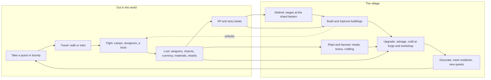

# Game design v2: an action RPG and village life sim (21 Oct)

Matt, 21 Oct 21:01: "completely remove the screen tied mechanics and give it another name. introduce the direction action (eastward type) combat system, instead of the pokemon type. continue to build the world ... i still want to keep everything else: the quests, decorating and improving your place, leveling up your character, arena fights (but redone for the new combat system) etc."

21:16: "I want to completely get rid of the rest/ dream idea. make it into an action rpg/ life sim with a story but evolving into a bit of a looter shooter (but not too massively) where you level up through quests, fighting etc., so the main part of the game is fighting and evolving and improving your village etc."

**Status.** This page is the game's design from 21 Oct and the first file to read in `docs/vision/`. Where it disagrees with an older doc, this page wins; the older docs carry a "Superseded" banner (section 13). The shape is Matt's; the details are Claude A's proposal, with the smaller choices graded by two independent grader sessions (appendix A) and the choices that change the game's shape left to Matt (section 15). The project keeps its code name until Matt picks a new one; this page says "the game". Nothing in this PR changes game code.

## Contents

1. Pitch
2. Pillars
3. The core loop
4. Combat
5. Loot and the looter-shooter arc
6. Levelling
7. The village
8. Quests and story
9. Arenas
10. Economy
11. Interface and controls on a phone
12. Content scale and build order
13. What is removed or superseded
14. Lane plan
15. For Matt
16. Appendix A: the graded choices and the alternatives
17. Appendix B: first numbers for Codex

## 1. Pitch

The game is a top-down action RPG and village life sim for phones, drawn at Eastward's level of detail. On the night the moon cracked, its shards fell across the land: the storm broke the bridges and passes, and wherever a shard lies, creatures and machines turn wild. You are a folk hero from the home valley with a small familiar at your heels. You fight in real time, switching between the two, clear camps and dungeons, and bring the shards home to the stone circle in the woodland. Each region you reach by train has its own trouble, its own boss, its own kind of weapon and someone who moves to your village when it is over. Your hut grows into a village whose forge, workshop and apothecary make you stronger, and over the journey your bow and blade grow into a small, readable arsenal of region-made weapons: Cogsworth's steam rifles, Dust Gulch's carbines, Neon Harbour's lasers and finally starmetal from the moon itself.

## 2. Pillars

Every feature is checked against these five. A feature that serves none is cut.

1. **Every fight reads.** Enemies telegraph, fights are short and fair, controls are made for thumbs. You lose to your own mistakes, never to clutter, randomness or a number you could not see.
2. **The village is your power.** What you build at home changes how you fight (forge, workshop, apothecary, training yard); what you win out there builds the village. The two loops feed each other every session.
3. **A journey with a story.** Region by region along the train lines, each region a story, a boss, a weapon family and a new neighbour. The world, regions, cast and train network stay; the story gives them a reason.
4. **Loot you can read.** Few slots, few numbers, and every drop is a decision you can make in two seconds. No grind wall, no gambling, no paid loot, no inventory management.
5. **Made for a phone, drawn like Eastward.** Sessions of 5 to 20 minutes that can stop anywhere, two thumbs at most, 44 px touch targets, and every picture at the house standard (`art-style.md`, `eastward-edges.md`). A desktop version is kept possible, never designed against.

Kept from the old pillars: the warm tone (funny and kind, real stakes, never grim), no shaming, nothing that expires, no daily chores, no streaks, no energy timers. Dropped: "rest is the only engine", "short visits, lasting change" as a rule against play, "every place has a balance that rest restores" and "kind fights" (cast.md section 1).

## 3. The core loop



| Scale                     | What happens                                                                                                                                                                                                                                                                                                                                  |
| ------------------------- | --------------------------------------------------------------------------------------------------------------------------------------------------------------------------------------------------------------------------------------------------------------------------------------------------------------------------------------------- |
| Moment (2 to 40 s)        | Read a telegraph, dodge through it, strike back, switch to the familiar for a root or a wall, finish the pack. A cleared camp drops loot in a short burst that you walk over to collect; one tap compares and equips.                                                                                                                         |
| Session (5 to 20 min)     | Leave the village with one goal from the notice board or the story, walk or ride there, clear a camp or one dungeon floor, bank the loot at a waystone, ride home, spend it at the forge or on a building, place a new decoration, pick up the next quest. Every session ends with something built or upgraded.                               |
| Week (a region, 3 to 6 h) | A region's story chain (5 to 8 quests), its camps and one dungeon, its boss, its weapon family, its arena rival. The region's resident story ends, its folk joins, a villager moves home with a building of their region's style, and the great shard brought home draws a siege on the village. The way to the next region opens.            |
| Whole game (25 to 35 h)   | Eleven regions in four acts along the train lines, from the valley to the moon. The kit grows from a bow and a blade to a light arsenal; the hut grows from one house to a village of about twelve buildings; the fourteen stones of the circle light one by one. After the story: the arena circuit, high-rank bounties and the deep shards. |

Session safety (from AGENTS.md, kept): the game can stop at any moment. Leaving mid-fight pauses; closing the app mid-dungeon resumes at the last checkpoint with every picked-up item kept. An interrupted walk never triggers a stale arrival or navigation.

## 4. Combat

Real-time and directional, after Eastward (John and Sam), with the readability of Hades and the touch controls of Archero. The real-time prototype (`prototypes/realtime-combat/`) is its first proof: the floating stick, the telegraphs, the dodge, hit-stop, the leash and the arena boss all carry over. What changes: no Glares (they were screens), no "naps" at 0 HP, and the familiar fights.

### 4.1 Two characters, one switch

You control one of two characters at a time; the other follows a step behind and cannot be hit (Eastward's rule, which keeps the screen readable).

| Character                                                       | Role                                                                                                                    | Attack                                                                                                                                                                      | Special (one, on a cooldown)                                              |
| --------------------------------------------------------------- | ----------------------------------------------------------------------------------------------------------------------- | --------------------------------------------------------------------------------------------------------------------------------------------------------------------------- | ------------------------------------------------------------------------- |
| **The folk** (Bramble, Puffcap, Velvet at the start; 14 in all) | The fighter and the arsenal: a melee weapon and a ranged weapon (a plain bow or sling in act 1; looted guns from act 2) | Tap: a three-hit melee combo. Hold: draw and aim the ranged weapon, release to fire                                                                                         | The folk's signature move (4.3)                                           |
| **The familiar** (a Grassling, or a befriended visitor)         | The caster: control, cover and a little reach. Its magic never runs out, but it hits softly                             | Its family's spell: Mossling roots (slows, then holds), Pebbling raises a stone wall (cover that blocks shots both ways), Roamling gusts (pushes, knocks projectiles aside) | A stronger form of its spell (a root field, a ring of walls, a whirlwind) |

- **The switch** is instant. The character coming in lands a **tag strike** (the folk a lunge, the familiar a burst of its spell) and has 0.2 s of invulnerability, so a well-timed switch is also an escape. Cooldown 2.5 s, shown as a ring on the Switch button.
- **The bench gives something.** While benched, the familiar keeps a small aura round the folk (Mossling: enemies close to you move a little slower; Pebbling: the first hit in each fight is halved; Roamling: dodges recharge a little faster), and the folk on the bench steadies the familiar (its spell recharges faster). A switch is always a gain, never a chore (both graders' graft, appendix A).
- **One health bar** for the pair (as the party in Eastward feels in play): simple to read on a phone, and it means switching is never about babysitting.
- **The looted guns belong to the folk** (appendix A, C1). The familiar's power grows through its **focus**, one slot that changes its spell's shape (wider walls, longer roots, a double gust), not through guns.

### 4.2 Moves

| Move         | Detail                                                                                                                                                                                                                                                       |
| ------------ | ------------------------------------------------------------------------------------------------------------------------------------------------------------------------------------------------------------------------------------------------------------ |
| Walk and run | Floating stick: a short push walks, a full push runs. The prototype's speeds (20 and 50 world px a second) are the start; 2x changes the art, not world units.                                                                                               |
| Melee combo  | Tap, tap, tap: three swings, the third a heavier finisher with knockback. Each swing steps forward a little toward the soft-locked target. Tap, tap, then hold: the finisher becomes a charged heavy that breaks guard (a plain hold is the ranged weapon).  |
| Ranged       | Hold Attack to draw and aim, release to fire; the aim line shows while held. Magazine and auto-reload for guns, quiver-free for bows. Standing still while drawing builds Aim (the prototype's three pips) for bows.                                         |
| Dodge        | A roll of 0.42 s with invulnerability for its first 0.26 s; two charges, each back after 1.2 s. Rolling through a telegraph at the last moment slows time for 0.4 s (a **close call**, also off under reduced motion).                                       |
| Switch       | Swap control with a tag strike (4.1).                                                                                                                                                                                                                        |
| Special      | The active character's signature move, on a cooldown ring.                                                                                                                                                                                                   |
| Tonic        | Tap the flask beside the health bar (44 px; it can be moved into the thumb arc in the layout editor): a short, interruptible drink that heals a third of the bar. Three flasks, five with the apothecary; refilled at waystones and on entering the village. |
| Interact     | Walking up to a chest, lever, door or person shows its one action on the Attack button's place (it never fires in a fight).                                                                                                                                  |

**Feel.** Every action anticipates, acts and settles (AGENTS.md motion rule). Hits hold for 3 to 8 frames by weight (hit-stop), shake the camera by 1 or 2 art px, flash the target's outline and knock it back along the hit. Kills pop with a short burst. All of it scales down or off under reduced motion.

**Aim assist** (appendix A, C3). Attacks and shots go to the nearest enemy within a 35 degree cone of your facing and inside the weapon's range; a small ring marks it. Holding Attack shows the aim line; dragging the thumb from the Attack button while holding overrides the lock and aims by hand, with 8 degrees of magnetism. Assist strength is a setting (off, light, strong), and **auto-fire when still** (the ranged weapon fires at the locked target while you stand still) is an optional assist for players who want it.

### 4.3 The folk's signature moves

The cast's fight mechanics (cast.md section 4) were turn-based. Each is rewritten as one real-time special with the same idea, so the cast keeps its meaning:

| Folk    | Weapon kind at start        | Special (real time)                                                                                         |
| ------- | --------------------------- | ----------------------------------------------------------------------------------------------------------- |
| Bramble | billhook and short bow      | **Steady:** a rooted volley of three charged arrows; standing still before it adds Aim (from the prototype) |
| Puffcap | cap staff and spore sling   | **Spore cloud:** a cloud that slows and makes foes drowsy (they attack half as often for 4 s)               |
| Velvet  | lamp hook and dart caster   | **Dim:** her lamp shutters; enemies lose track of her for 2 s and their next attack is weaker               |
| Cairn   | stone fists                 | **Bedrock:** a guard stance that absorbs one hit fully, then a shoulder charge                              |
| Pendle  | wrench and rivet gun        | **A Minute Slow:** marks a spot; one second later it strikes again for half the damage dealt there          |
| Puddle  | gaff and harpoon gun        | **Tide:** a wave that pushes foes and soaks them (soaked foes take more shock damage)                       |
| Mirra   | diviner's rod and carbine   | **Seep:** a spring at her feet that heals the pair while standing in it                                     |
| Ashe    | sword and flame lance       | **Banked fire:** heat builds with each hit; the special spends it in one burst                              |
| Nix     | baton and pulse pistol      | **Do Not Disturb:** a field that deletes enemy projectiles for 2 s                                          |
| Tally   | crook and sling             | **Round-up:** pulls nearby foes into a knot                                                                 |
| Tam     | ice axe and crossbow        | **Bothy:** once a fight, a blow that would end the pair leaves it at 1 HP and warms it back a little        |
| Tuff    | basalt maul                 | **Overgrow:** a layer of thrift and fern armour that absorbs damage until knocked off                       |
| Bunk    | magnet boots and arc caster | **Magnet:** pulls loose loot and small foes in, then a shock pulse                                          |
| Mote    | star wand                   | **Starfall:** a small rain of light on a marked area; Mote is the wildcard, never the strongest             |

Each folk's weapon kind is its **starting** weapon. Any folk can equip any weapon; the starting kinds give each folk a feel and a perk branch (section 6).

### 4.4 Enemy design rules

1. **Every attack is telegraphed** by a pose and a ground mark in the one reserved telegraph colour, with a shape that differs by attack kind (lane, ring, cone, circle), so colour is never the only cue. Wind-ups: 0.9 to 1.4 s for grunts, 0.6 to 1.0 s for elites, never under 0.5 s. One solid brightening at the moment of commitment, never a strobe.
2. **Attack tokens.** At most two enemies commit to an attack at the same moment (three on Hard). The others reposition. This, not low numbers, keeps packs fair.
3. **Roles by silhouette.** Six roles, each readable in one glance at phone size: **grunt** (walks in, swings), **lunger** (long telegraphed charge), **shooter** (keeps distance, slow projectiles), **tank** (shielded front, open back), **swarmer** (small, weak, in fours), **caster** (buffs or summons, flees). Each region dresses the roles in its own creatures and machines; behaviour is shared code, art is never shared between regions (world-atlas.md: "not reskins").
4. **Projectiles are slower than the dodge** and never come from off-screen; an arrow at the screen edge marks anything about to enter.
5. **Leash.** Enemies give up beyond about 140 world px from where the fight began and drift home (the prototype's value), so a fight can always be walked away from.
6. **Freed, not killed.** Shardstruck creatures are freed: the shard pops out, the creature shakes itself and runs off into the scenery. Machines break down and Company troopers flee. The tone stays warm while the fighting is real.
7. **Camps, not random encounters.** Enemies live in visible camps, nests and patrol routes placed by the map lanes (section 14), never in invisible random encounters. Cleared camps refill after you leave the region and come back (a full refresh on each train arrival), never on a real-time clock.
8. **Cover.** Ranged fights use the map's walls, crates, rocks and the Pebbling's walls. Shots stop at anything that blocks the walk mask at chest height; the map lanes mark low cover (shoot over) and high cover (blocks) in plan data.

### 4.5 Bosses

- One **region boss** at the end of each region's story (eleven), one **dungeon keeper** at the bottom of each dungeon (some regions share it with the boss), and a few **roaming elites** with names.
- Three phases at most, each with two or three learnable patterns and one new idea, and a short readable "tell" before each phase change. A checkpoint at each phase on Normal and below.
- Every boss teaches the region's new idea: the woodland's Thornback teaches the dodge, Cogsworth's Foreman Engine teaches cover and the rifle, the Isles' Basalt Crab teaches the familiar's wall, Neon's director teaches projectile clearing.
- Boss arenas lock with a visible boundary (the prototype's lit stones) and unlock on defeat.

### 4.6 Difficulty

| Setting | Telegraphs | Damage taken | Attack tokens | Other                                         |
| ------- | ---------- | ------------ | ------------- | --------------------------------------------- |
| Story   | x1.5       | x0.5         | 1             | Close calls on every dodge; strong aim assist |
| Normal  | x1.0       | x1.0         | 2             | The default                                   |
| Hard    | x0.85      | x1.4         | 3             | Elite variants in camps; no phase checkpoints |

Changeable any time outside a fight. Loot and XP are the same on every setting, so nobody is punished for comfort (pillar 4). Hard adds only arena ranks above Gold (section 9).

### 4.7 Accessibility

Reduced motion (follows the phone, toggle in settings: no shake, no afterimages, no close-call slow-down, flashes become outlines); colour-blind safe telegraphs (shape plus colour); aim assist strength; auto-repeat on held melee; a left-handed layout (buttons on the left, stick on the right); button size and opacity; haptics on or off; text size; Story difficulty; pause anywhere, and the game pauses itself when the app goes to the background.

## 5. Loot and the looter-shooter arc

### 5.1 The arc

| Act                         | Regions                                                                          | What you fight with                                                                                                                                             |
| --------------------------- | -------------------------------------------------------------------------------- | --------------------------------------------------------------------------------------------------------------------------------------------------------------- |
| 1. The valley and the hills | the home valley and woodland, the Frostline, the Brackens                        | **Melee-led.** Your folk's melee weapon and a simple bow or sling with no affixes. Loot is melee weapons and charms. Ranged is a helper.                        |
| 2. Brass and water          | Cogsworth and the coal hills, the Lull (Lullford, Gullwick), the Tidebloom Isles | **The first guns.** The tinkerer builds you a steam rifle after Cogsworth's boss; the ranged slot opens to looted guns with affixes. Melee and ranged are even. |
| 3. Sun, fire and neon       | the Sunstone basin, the fire country, Neon Harbour                               | **Ranged-led.** Carbines, flame lances, lasers. The Company's troopers shoot back, cover matters, and the familiar's wall and gust become tools against fire.   |
| 4. Up and out               | Halcyon Station, Lumen                                                           | **Starmetal.** The moon's own weapons, one unique per boss. The post-game's deep shards drop Starforged gear.                                                   |

The melee weapon never stops mattering: it is how you stagger tanks, break guards and clear swarms, so the game grows into a shooter without dropping its first half.

### 5.2 Weapon families by region

Each region's loot table favours its own family (about 60 % of drops there), so a region's weapons look and feel like the place (world-atlas.md: every region is its own place).

| Region                       | Melee                          | Ranged                                         | Feel                                    |
| ---------------------------- | ------------------------------ | ---------------------------------------------- | --------------------------------------- |
| The valley and woodland      | billhooks, cudgels             | short bows, slings                             | quick, light                            |
| The Frostline                | ice axes, hatchets             | crossbows                                      | heavy single shots, slow reload         |
| The Brackens                 | crooks, staves                 | slings, bolas                                  | knockback, crowd control                |
| Cogsworth and the coal hills | wrench-hammers, pistons        | steam rifles, rivet guns, pressure scatterguns | pressure builds as you fire, then vents |
| The Lull and Gullwick        | gaffs, oars                    | harpoon guns, net launchers                    | pull and pin                            |
| The Tidebloom Isles          | basalt mauls, coral knives     | spear guns, spring launchers                   | piercing, bounce                        |
| The Sunstone basin           | machetes, spurs                | lever-action carbines, revolvers, sun lenses   | crits, fast follow-ups, a focused beam  |
| The fire country             | knightly swords, forge hammers | flame lances, forge mortars (lobbed)           | burn, area                              |
| Neon Harbour                 | arc batons, light blades       | pulse pistols, laser rifles, arc casters       | shock chains, high fire rate            |
| Halcyon Station and Lumen    | starmetal glaives              | gravity casters, beam lances                   | unique effects                          |

### 5.3 Rarity

| Tier       | Affixes                 | Colour (house palette) | Where                                                        |
| ---------- | ----------------------- | ---------------------- | ------------------------------------------------------------ |
| Common     | 0                       | stone                  | everywhere                                                   |
| Fine       | 1                       | leaf                   | everywhere                                                   |
| Rare       | 2                       | sky                    | elites, chests, bounties                                     |
| Heroic     | 3                       | violet                 | bosses, dungeon keepers, hard bounties                       |
| Starforged | 2 plus one named effect | gold                   | first defeat of each boss (fixed and known), the deep shards |

Rarity is shown by the frame colour and a pip count, never by colour alone.

### 5.4 Affixes

About twelve, each one line with one number: power +%, fire rate +%, reload +%, magazine +n, crit chance +%, range +%, knockback, an element (burn, chill, shock, root), on-dodge (the next shot is charged), on-switch (the tag strike is stronger), heal on a freed foe (small), pierce. No stacking multipliers across items, no hidden stats, no conditional chains three effects deep.

### 5.5 Slots and inventory

- **The folk:** melee, ranged, two charms. **The familiar:** one focus. **The pair:** one outfit (looks only). Five slots that affect a fight; you can see them all on one screen.
- **The satchel** holds 16 items. A new drop shows a green or red arrow per headline number against what you wear; one tap equips, one tap marks for salvage. **Auto-salvage** below a chosen rarity is a setting.
- **Seeds and materials** never enter the satchel: seeds go to the seed tin, materials to the wallet.
- **The stash** at home holds 60 items, plus a **trophy rack** that keeps one of every Starforged forever (it never takes stash space).
- Weapons show two headline numbers (**Power** and **Speed**) and their affixes. A derived damage per second is shown in the detail view only.

### 5.6 Upgrade, salvage and why it never becomes a grind

- **Gear level** follows the region: drops come at the region's level to two above. **The forge raises a favourite weapon to your current gear level** for currency and scrap, so a weapon you love lasts the whole game. Upgrading never fails.
- **Reforge** rerolls one affix at the workshop, at a rising but capped price, and shows the possible results first. One reroll per affix at a time, no chain gambling.
- **Salvage** turns an item into scrap and a little currency, with the region's material if it was a region-family item.
- **Mods** (from the workshop's second tier): one mod per ranged weapon (scope, stock, barrel), moved freely between weapons.
- **No grind wall:** the main story is tuned to be finished with what the story, bosses and chests give (every boss gives a guaranteed Heroic or better of the region's family, and every main quest a Fine or better). Farming is optional and fun, never required.
- **No gambling:** no loot boxes, no paid rerolls, no premium currency, no random shop with timers. Drop rates are listed in the journal. **Bad-luck protection:** after eight Rare-or-better drops without a Heroic, the next one is Heroic.
- **No paid loot, ever.** If the game is ever sold with extras, they are a whole purchase or cosmetic outfits, never power, never random.

## 6. Levelling

- **Character level 1 to 30** over the story (about level 3 per region), shared by the folk and the familiar and by every folk you own (cast.md's decided "one shared level" survives). A folk who joins late arrives at full level; nothing is levelled twice.
- **XP sources:** main quests about 55 %, side quests and bounties about 20 %, fights about 20 %, first discoveries (a viewpoint, a secret, a new place) about 5 %. Fights pay less the further below your level the enemy is, so the story leads.
- **Each level** gives a little health and one **perk point**.
- **Perks: three to pick from** (appendix A, C4; both graders chose it over a tree). At each level a card of three perks appears; you take one, and it is permanent. Each folk has its own pool of about 24 perks, each tagged with a branch (Bramble: Blade, Bow, Woodcraft). Most are plain (+10 % bow damage); about a third change how a move works (the combo's finisher looses an arrow; dodging through a telegraph reloads). You can **pin a branch**: one of the three is then always from it, and one is always from another, so builds feel directed without a menu of 18 nodes. Respec is free at the training yard. A folk who joins late gets all its picks at once, with a "choose for me" button that follows the pinned branch.
- **The familiar** levels with you and grows through its focus (5.5) and through familiar perks that appear in every folk's pool.
- **Character level and gear level are separate.** Character level is your health and perks; gear level is your weapons' power. An under-geared player is told so plainly at the waystone before a boss ("your rifle is level 9; the Foreman is level 12; the forge can raise it").

## 7. The village

Matt, 21 Oct 21:31: "also think about how your village could change throughout (gardening, maybe a tower defense situation?, other changes to the villages) and how it ties in to the story".

The village is the game's second half. It changes at every story beat, it feeds every fight (buildings, crops, defences) and it is where the story comes home: what you free out there moves in, and what threatens the moon comes to your door.

### 7.1 Where

The hut in the valley stays your home, and the meadow round it, between the woodland and Crossroads Town, grows into **your village** (appendix A, C7). Crossroads Town stays the valley's market town next door, with its station, well and people, so the world plan's valley does not change. The village grows on the hut's meadow and the riverside fields beside it, in five districts that open one after another (7.2). Claude E and Claude B size and place the plots, the build pads for defences, the siege lanes and the districts in the valley's plan data.

At its centre stands **the shard lantern**: a stone lantern on the green where the great shards rest once you bring them home, until the woodland circle is ready to take them (section 8). The lantern is what the raiders want.

### 7.2 How the village changes, act by act

| Stage                                                 | Story beat                                                                    | The village                                                                                                                                                                                                                               | New this stage                                                                                                                   |
| ----------------------------------------------------- | ----------------------------------------------------------------------------- | ----------------------------------------------------------------------------------------------------------------------------------------------------------------------------------------------------------------------------------------- | -------------------------------------------------------------------------------------------------------------------------------- |
| 0. The scorched meadow                                | Prologue: the starfall night; the Thornback freed                             | The hut, Moss's stall, a cold forge, a shard crater still smoking in the meadow, four weedy beds and the old orchard pits. Two Crossroads shops are shuttered                                                                             | The forge lit, the notice board, the waystone, four crop plots, the shard lantern; **the first night** (siege tutorial)          |
| 1. The hamlet (**the Green**)                         | Act 1: the Frostline, the Brackens, Cairn wakes                               | Families displaced from Crossroads move into the first cottages; a palisade of hurdles goes up; the crater becomes a pond; the two Crossroads shops reopen                                                                                | Apothecary, training yard, bell tower, eight plots, three cottages; **Planting Day**; **the wolf moon** siege                    |
| 2. The market village (**Millside** and **Halt Row**) | Act 2: Cogsworth, the Lull, the Isles; the Company appears                    | A brass clock on a new halt; a water mill on the stream; a greenhouse; Company posters on the Crossroads noticeboard, then torn down; the palisade becomes a stone wall with gates                                                        | Workshop, station halt, kitchen and mill, menagerie, greenhouse; **the Brass Fair**; **the diggers** siege                       |
| 3. The town (**Kiln Lane** and **Lantern Row**)       | Act 3: Sunstone, the fire country, Neon Harbour; the Company's crime revealed | A water tower and irrigation channels from Sunstone, a glassworks and the great forge's chimney from the fire country, arc lamps along a new street from Neon; the freed dragon visits the bell tower; refugees from Company towns arrive | Trophy hall, lookout, great forge (forge tier 3), irrigation, sixteen plots; **Harvest Lanterns**; **the night of lights** siege |
| 4. The beacon                                         | Act 4: Halcyon and Lumen                                                      | The circle and the lantern are joined by a lit path; every villager and folk gathers; the moon's crack in the night sky shrinks with each shard home, then closes                                                                         | **The shardstorm** (the final siege), then **Full Moon Night**                                                                   |
| After the story                                       | The moon mended                                                               | The village at peace; seasons keep turning; the bell offers ranked sieges (echo nights); new decorations from the Circuit and the deep shards                                                                                             | Ranked sieges, festivals each year, the remaining plots and cottages                                                             |

The village is never behind the story: a stage's buildings are offered the moment its beat lands, so a player who only follows the main quests still sees each stage.

### 7.3 Buildings

| Building             | Stage  | What it gives (tiers 1 to 3)                                                                             |
| -------------------- | ------ | -------------------------------------------------------------------------------------------------------- |
| The hut              | 0      | Your bed (save, change folk), the stash, the keepsake chest; tiers add rooms to decorate                 |
| Moss's stall         | 0      | Buys and sells materials, seeds and junk; tiers widen the stock (never timed, never random)              |
| The forge            | 0      | Upgrade weapons to gear level, salvage; tiers raise the upgrade cap (tier 3 is the great forge, stage 3) |
| The notice board     | 0      | Side quests and bounties from villagers and every region you have reached                                |
| The waystone         | 0      | Fast travel to any waystone you have touched; refills tonics                                             |
| Crop plots           | 0      | 4, then 8, 12 and 16 plots (7.5)                                                                         |
| The shard lantern    | 0      | Holds the great shards; the heart of every siege (7.6)                                                   |
| The apothecary       | 1      | Tonics: four, then five flasks; stronger tonics; a cleanse tonic; brewed from crops                      |
| The training yard    | 1      | Perk respec, a damage dummy, combo trials; the village's own arena ring                                  |
| The bell tower       | 1      | Rings in a siege when you choose (7.6); shows the next siege's lanes; after the story, ranked sieges     |
| The workshop         | 2      | Reforge, mods, the familiar's focus gems; the steam turret (7.6)                                         |
| The kitchen and mill | 2      | Meals from crops: one buff for your next outing; the mill grinds grain into flour for better meals       |
| The station halt     | 2      | The train stops at your door (7.8)                                                                       |
| The menagerie        | 2      | Befriended visitors live here and can be chosen as the familiar                                          |
| The greenhouse       | 2      | Six plots for exotic seeds; grows in winter                                                              |
| The water tower      | 3      | Irrigation: every plot grows one stage faster                                                            |
| The glassworks       | 3      | Lens towers and lanterns; greenhouse tier 2                                                              |
| The trophy hall      | 3      | Boss trophies, the trophy rack of Starforged weapons, arena ranks and siege ranks                        |
| The lookout          | 3      | Shows camps, shards and the next siege's lanes on the world map                                          |
| Cottages (up to 10)  | 1 to 4 | A home for each household that moves in; each can be styled                                              |

Each is built and upgraded with Glint, scrap and region materials from the workbench in the hut ("build here" on a marked plot). Building is instant once paid: no timers. Each building is drawn once per tier at 2x by the kit (rules-system.md).

### 7.4 Who moves in

Each region you free sends someone home with you, and they bring their place with them:

| From                | Who moves in                                    | What they bring (a building with one feature of their home)                          |
| ------------------- | ----------------------------------------------- | ------------------------------------------------------------------------------------ |
| The valley          | a smith from Crossroads; displaced families     | the forge; the first cottages                                                        |
| The Frostline       | the bothy keeper                                | the training yard, with a bothy's stone hut and a kettle always on                   |
| The Brackens        | the drover's niece and three sheep              | a fold and a loom (wool for the stall and outfits); the sheep graze the green        |
| The valley's circle | the gardener's daughter                         | the apothecary, with a herb garden                                                   |
| Cogsworth           | the tinkerer's journeyman                       | the workshop, with a brass clock and a steam whistle                                 |
| The Lull            | the bargee's cook                               | the kitchen and the water mill on the stream                                         |
| The Tidebloom Isles | the naturalist's assistant; befriended visitors | the menagerie and the greenhouse, with a turtle pond                                 |
| The Sunstone basin  | the caravan trader's son                        | the water tower and irrigation (the oasis's know-how), a striped awning on the stall |
| The fire country    | the castle's steward; Ember forge hands         | the trophy hall; the great forge's chimney and the glassworks' kiln                  |
| Neon Harbour        | Dave's runner; families who left Company towers | the lookout as a radio mast; arc lamps along Lantern Row                             |
| Halcyon and Lumen   | Bunk's station crew (after the story)           | a telescope on the lookout; moon lilies in the greenhouse                            |

- **The residents stay in their regions** (the world keeps its people); their households, apprentices and helpers are who move.
- **The folk** who join live in the village between outings, give their own quests and can be posted as champions in a siege (7.6).
- **Befriended visitors** (GLIMMOTH, CAIRNLET, TICKWREN and the rest) live in the menagerie and can be chosen as the familiar (AGENTS.md's companion rules).
- **A world-rules amendment** (Claude A, with this PR's follow-up in `world-rules.md`): world-atlas.md keeps each region's props in its region. A mover's building is the one exception: it is drawn in the valley's materials and palette, with **one** feature of its home region (the brass clock, the striped awning, the arc lamp), so the village tells the journey without becoming a theme park.

### 7.5 Gardening and crops

The old meadow (garden-growth.md: six beds and three orchard pits) becomes the first plots and the orchard, now grown by play.

- **Growth by outings** (appendix A, C13): each time you come home from a trip (any quest, camp or dungeon), every planted plot grows one stage; three stages to harvest (two with the water tower). Nothing ever wilts, rots or is lost if left. Real time never grows or spoils anything.
- **Plots show their stage** (sown, sprout, leaf, bud, ripe; the beds' growth sprites from `garden_meadow.py`, redrawn at 2x). Watering a plot on a visit is optional and grows it one extra stage once per visit; skipping it costs nothing.
- **Seeds are loot.** Regional foes and chests drop that region's seeds (a common drop, straight into the seed tin, never the satchel); bosses drop a rare seed; Moss's stall sells the basic ones.
- **Harvest** is one tap at the plot sign ("harvest all"), and replanting the same seed is one more.
- **Crops feed three things:** the **kitchen** (meals: one buff until you next come home, such as +15 % health, +10 % ranged damage, faster dodge recharge or resistance to burn, chill or shock), the **apothecary** (stronger tonics, the cleanse tonic), and **crafting** (fibre and dye for outfits and charms at the workshop; flour at the mill for better meals).
- **Crops, one or two per region:** sweetroot and meadow beans (valley), frostberries (Frostline), heather for honey (Brackens), river cress (the Lull), salt melons (the Isles), sunmelons and prickly pears (Sunstone), ember peppers (the fire country), glowcaps in a dark shed (Neon Harbour), moon lilies (Lumen, after the story). The orchard's three trees (apple, pear, plum) give fruit for festival dishes.
- **Seasons** (7.9): outdoor plots grow in spring, summer and autumn; in winter only frostberries and the greenhouse grow.
- **Crops grown are scored at Harvest Lanterns** (7.9), for a decoration, never for power.

### 7.6 Village defence: sieges

Tower defence before the fight, action during it (appendix A, C11: Matt's tower-defence idea was drafted in full and against two simpler designs, graded twice, and this prepared form won both rounds; the final choice is Matt's, section 15, item 8). The great shards in the lantern draw the shardstruck and, later, the Company. They come at the village along at most three lanes; your buildings' defences stand on fixed pads, you choose which stands where, and then you fight alongside them.

**How a siege plays.**

1. **Prepare (optional, untimed).** At the bell tower, one portrait screen shows the village from above, the lanes the bell predicts, and the pads. Tap a pad to cycle through the defence kinds you have; post a spare folk as a champion on a pad (one per pad). Every pad starts filled with its building's own kind, and afterwards the screen remembers your last layout, so **Ring the bell** starts a siege with zero taps for anyone who does not want to plan.
2. **Waves.** Three to six, each announced by a horn and a lane marker. Once the bell rings there is no building or upgrading: the waves are pure real-time fighting. The game pauses at any time, and a siege left mid-way resumes at the start of its current wave.
3. **Fight alongside.** You play as everywhere else: the folk and the familiar, the switch, the Pebbling's walls as extra cover. Some foes (shielded, flying, burrowing) need you rather than the pieces, so a siege never plays itself.
4. **The goal:** keep the raiders off the shard lantern until the last wave. The lantern has its own health bar.

**Defence pieces.**

- **Fixed pads:** 2 in the first night, 6 at stage 1, 8 at stage 2, 12 at stage 3, at the village's junctions and gates in the valley's plan data. A pad is a level patch of flagstones that looks like part of the village when empty. Pieces never sit on decorations, and the lanes stay walkable.
- **Each building unlocks one defence kind** in its region's style. There are no schematics and no second loot track: the village's growth is the defence's growth. A piece's level is its building's tier, so there is nothing to gear.

| Building (region)                      | Defence kind     | What it does                            |
| -------------------------------------- | ---------------- | --------------------------------------- |
| The forge (valley)                     | hurdle barricade | blocks a lane until broken              |
| The hut (valley)                       | archer post      | steady single shots                     |
| The apothecary (valley)                | spore pot        | a cloud that makes foes drowsy          |
| The training yard (Frostline)          | crossbow nest    | heavy, slow, piercing bolts             |
| The fold and loom (Brackens)           | bola trap        | slows the first foes over it            |
| The workshop (Cogsworth)               | steam turret     | fast shots; pressure builds, then vents |
| The kitchen and mill (the Lull)        | net launcher     | pins one foe                            |
| The menagerie (the Isles)              | spring trap      | bounces foes back down the lane         |
| The water tower (Sunstone)             | water cannon     | pushes foes and puts out fire           |
| The great forge (fire country)         | flame mortar     | lobbed area burn                        |
| The glassworks (fire country)          | lens tower       | a focused beam that ramps up            |
| The lookout (Neon Harbour)             | arc pylon        | shock that chains between foes          |
| The telescope (Lumen, after the story) | gravity well     | pulls foes together                     |

- **Villagers** are posted once, as a lasting choice, never a menu each time: the bothy keeper in a crossbow nest reloads it faster, the journeyman's steam turrets vent later, and so on.
- **Champions.** Folk you own but are not playing can stand on a pad as champions, one per pad: they fight from it and use their special every 12 s. This gives the fourteen folk a use beyond being switched to.
- **Rewards:** Glint, materials for the buildings that defend, and seeds; the first win of each story siege moves the story on.

**When sieges happen** (appendix A, C12).

- **Five story sieges,** hand-staged, each ending an act, each short enough for one session (about 5 minutes) and starting when you choose at the story's prompt: the first night (prologue), the wolf moon (act 1), the diggers (act 2), the night of lights (act 3) and the shardstorm (the finale).
- **Watch nights:** each great shard you bring home draws one optional siege, generated from the story sieges' waves and shown on the bell tower. You ring it when you like, or never; ignoring it costs nothing and nothing in the village is ever attacked without your say. It only pays: Glint, materials, seeds.
- **After the story:** ranked sieges at the bell (Bronze to Star, as the arenas), replaying each story siege at higher levels.
- **Never** on a real-time clock, never while you are away, never as a daily task.

**Losing** (appendix A, C14). If the lantern falls, the siege ends. **Nothing you built is destroyed.** Pieces and buildings that were hit show scaffolding and scorch marks, and the villagers repair them by your next return home, for free, with a short skippable scene and a line from whoever did the work. You keep everything you picked up during the siege and can ring the bell again at once. After two losses in a row the bell offers an easier retry (sturdier pieces), with the same rewards. A story siege lost is simply tried again; the story waits.

**How each act escalates.**

| Siege                       | Raiders                                                                           | New idea                                                                           | New pieces                                        | Last wave                                                                   |
| --------------------------- | --------------------------------------------------------------------------------- | ---------------------------------------------------------------------------------- | ------------------------------------------------- | --------------------------------------------------------------------------- |
| The first night (prologue)  | thornlings and briar swarmers from the woodland                                   | one lane, three waves: choose two pads, fight alongside                            | barricade, archer post                            | a thorn knot that only you can break                                        |
| The wolf moon (act 1)       | shard wolves down from the Brackens, crows over the col                           | three lanes; fliers that skip barricades                                           | crossbow nest, bola trap, spore pot               | Old Fang's mate, who goes for the lantern, not you                          |
| The diggers (act 2)         | the Company's clockwork diggers, automata, river smugglers                        | burrowers that surface mid-lane; a lane by water                                   | steam turret, net launcher, spring trap           | a foreman in a walker that targets your pieces                              |
| The night of lights (act 3) | Company troopers with lasers, an airship dropping squads, shardstruck salamanders | an air lane; troopers that shoot pieces from range; fire                           | water cannon, flame mortar, lens tower, arc pylon | the airship itself; the freed dragon comes to help in the final wave        |
| The shardstorm (finale)     | everything the Hollow's storm wakes, from every region                            | shards fall on the village and turn whatever they hit; hold while the circle fires | every piece; every villager and folk posted       | hold the lantern until the beacon fires, then board the train to the rocket |

### 7.7 Other visible changes: districts

| District    | Opens   | What is there                                                                                              |
| ----------- | ------- | ---------------------------------------------------------------------------------------------------------- |
| The Green   | stage 1 | the hut, the stall, the forge, the lantern, the bell tower, the first cottages, the pond in the old crater |
| Millside    | stage 2 | the kitchen and water mill on the stream, the menagerie and its turtle pond, the greenhouse                |
| Halt Row    | stage 2 | the station halt, the workshop, the drover's fold and loom                                                 |
| Kiln Lane   | stage 3 | the great forge, the glassworks, the water tower and its channels, the trophy hall                         |
| Lantern Row | stage 3 | arc lamps, the lookout's mast, the cottages of families from Neon Harbour                                  |

Each district is a plan-data area the map lanes draw once, with empty plots that fill as you build. The village is never a grid of identical lots (world-rules.md: places make sense): plots sit along lanes and the stream, as a real village grows.

### 7.8 The station grows

| Stage  | The station                                                                                                                                      |
| ------ | ------------------------------------------------------------------------------------------------------------------------------------------------ |
| 0 to 1 | None: you walk to Valley Halt in Crossroads                                                                                                      |
| 2      | **The village halt:** a timber platform on the valley line with a brass clock and a whistle from Cogsworth; the train stops at your door         |
| 3      | **The junction:** a second platform for the desert line, a water crane from Sunstone, a departure board from Neon Harbour, a signal box          |
| 4      | **The beacon platform:** the line's last special train runs from here to the Launch Cape for the rocket; afterwards the platform keeps its flags |

### 7.9 Seasons and festivals

- **Seasons follow the story,** not the calendar: spring in the prologue and act 1, summer in act 2, autumn in act 3, winter in act 4, spring again at the ending. After the story they turn every ten returns home. Seasons change the village's look (blossom, long grass, leaves, snow on the roofs), the crops that grow outdoors and the festival. They change no reward, no enemy and no number (living-world-plan.md's atmosphere rule, kept).
- **Festivals,** one per season, each an evening on the green when its story beat lands. Each has a meal, a small game and a decoration to keep; none is timed or missable (in the post-game each comes back every year):

| Festival         | When                           | What happens                                                                                                  |
| ---------------- | ------------------------------ | ------------------------------------------------------------------------------------------------------------- |
| Planting Day     | spring, after Cairn wakes      | the village plants the green together; a seed swap; a ribbon on the first tree                                |
| The Brass Fair   | summer, after Cogsworth        | the tinkerer's journeyman brings a carousel; a shooting gallery for the new rifle; an arena exhibition        |
| Harvest Lanterns | autumn, after the fire country | the crop show (your best harvest is judged, for a decoration); lanterns floated on the millpond               |
| Full Moon Night  | the ending                     | every villager and folk on the green under the mended moon; the fourteen stones lit; the credits roll over it |

### 7.10 The village reacts to the story

| Beat                                  | The village                                                                                   |
| ------------------------------------- | --------------------------------------------------------------------------------------------- |
| The starfall                          | the crater smokes; villagers whisper at night; the crack is visible in the night sky          |
| Each great shard brought home         | the lantern glows one step brighter; the crack in the sky shrinks a little                    |
| A Company buyer in Crossroads (act 1) | a poster offering Glint for shards appears on the Crossroads board                            |
| The Company's crime revealed (act 3)  | the posters are torn down; villagers talk of nothing else; families from Company towns arrive |
| A region freed                        | its banner goes up on the green; its mover arrives on the next train with their luggage       |
| The dragon freed                      | the dragon visits the bell tower roof at dusk, as scenery (it grants nothing)                 |
| A folk joins                          | a stone in the woodland circle lights; the folk's house lamp comes on in the village          |
| Before the finale                     | the lit path from the lantern to the circle; everyone gathers                                 |
| The ending                            | the moon whole; Full Moon Night; the crater pond full of moon lilies                          |

Villagers' lines (the resident routines already built, `lib/resident-routes.ts`) react to the current beat and to what you built.

### 7.11 Decorating

Keepsakes (world-atlas.md, "Decorating the hut") stay: every place still leaves one, and you place them freely inside and out. Added: boss trophies, festival keepsakes, fences, paths, lamps and planters from the stall, the hut's exterior choices (Claude B's B1) and each cottage's style. **Decorations add no stats** (AGENTS.md: decorative interactions add no rewards, costs or chores) and never sit on a build pad or a siege lane (the placement check refuses them), so decorating stays pure play and never weakens a defence.

### 7.12 How the village links back to combat

| Village thing          | Combat effect                                          |
| ---------------------- | ------------------------------------------------------ |
| Forge tier             | the highest gear level for weapons and defence pieces  |
| Workshop               | reforge, mods, focus gems                              |
| Apothecary             | tonic count and strength                               |
| Kitchen and crops      | one outing buff                                        |
| Training yard          | perk respec; combo trials that teach advanced moves    |
| Waystones and the halt | how fast you get back out                              |
| Lookout                | camp, shard and siege markers                          |
| Every building         | one defence kind for sieges, levelled by its tier      |
| Sieges                 | materials, seeds and Glint; champions give folk a role |
| Villagers              | quests, and through quests XP and loot                 |

## 8. Quests and story

### 8.1 The threat (Matt's choice, section 15, item 1; recommended draft)

**The starfall.** One night the moon, Lumen, cracked. Pieces of it fell across the land in one great storm: the storm that broke the nine ways (world-plan.md section 10: the stile, the col, the landslip, the washed-out bar, the Rift's bridge, the lava crossings, Lullford's swing bridge). Where a shard lies, the land's creatures turn **shardstruck** and its machines run wild. The stone circle in the woodland, older than the valley, wakes: it was built to hold the moon's light, and it calls for the shards.

Why you travel by train: the great shards fell far apart, one per region, each guarded by whatever it has twisted. The valley line, the desert line, the mine cart, the ferry, the maglev, the rocket and the lander are the way to each. Every way you mend opens the next region. The nine ways keep their names and places (world-plan.md section 10); they now open by story and fights, not by time away or Dream Dust, and their order follows the story: W1 to W3 in act 1, W4 and W7's swing span in act 2, W5, W6 and W7's maglev in act 3, W8 and W9 in act 4. Each way is guarded: mending it is a fight.

**The Company.** A well-dressed buyer turns up in Crossroads in act 1, offering Glint for shards, and its foremen fence off a coal-hills seam early in act 2. In act 2 you find people buying shards: the Meridian Company (a working name) of Neon Harbour, which turns shard light into power. In act 3 it becomes clear the Company drilled the moon from Halcyon Station, and the crack is its doing. Its foremen, troopers and machines are the human enemies of acts 2 and 3. The end is on Lumen, at the heart of the crack.

**The fourteen stones** (cast.md's symbol, kept): each folk who joins lights a stone in the woodland circle. Each great shard brought home fills the circle's light. With all fourteen lit and the great shards returned, the circle sends the light back up and the moon mends. It counts friends and deeds, never days.

### 8.2 The main arc

| Act      | Region and its trouble                                                                                                  | Boss                                                        | Folk who joins | Villager home                           | Ways                                                   |
| -------- | ----------------------------------------------------------------------------------------------------------------------- | ----------------------------------------------------------- | -------------- | --------------------------------------- | ------------------------------------------------------ |
| Prologue | The valley: the starfall night; a shard in the woodland's stone circle; thorns over the gardener's beds; the forge cold | the Thornback (a boar in a bramble shell), under the circle | (starters)     | a smith from Crossroads (forge)         | W1, the Headland stile                                 |
| 1        | The Frostline: shard crows over the col; the hut warden holds the bothy alone                                           | the Rime Wyrm in the ice caves under Snowmelt Lake          | Tam            | the bothy keeper (training yard)        | W2, the ridge col                                      |
| 1        | The Brackens: shard wolves scatter the drover's flock                                                                   | Old Fang, the pack leader                                   | Tally          | the drover's niece (wool for the stall) |                                                        |
| 1        | The valley again: the circle wakes; Cairn stands up                                                                     | (the circle's trial, an arena fight)                        | Cairn          | the gardener's daughter (apothecary)    | W3, the Millrace landslip                              |
| 2        | Cogsworth and the coal hills: automata run wild on shard power; the tinkerer finds the Company buying shards            | the Foreman Engine in the foundry                           | Pendle         | the journeyman (workshop)               | (the first guns)                                       |
| 2        | The Lull: smugglers have the bargee's barge; the swing bridge waits for a gear from Cogsworth                           | the Lull Pike, in the oxbow                                 | Puddle         | the bargee's cook (kitchen)             | W7, Lullford's swing bridge (with the maglev in act 3) |
| 2        | The Tidebloom Isles (by ferry): the volcano's shard wakes the basalt; the naturalist is cut off at the headwaters       | the Basalt Crab at Black-sand Cove                          | Tuff           | the naturalist's assistant (menagerie)  | W4, the Shell Bar and the ferry                        |
| 3        | The Sunstone basin (the desert line): the Company's drill has stopped the oasis spring; Dust Gulch is dry               | the Dune Borer, a Company drill gone wild                   | Mirra          | the caravan trader's son (water tower)  | W5, the Rift                                           |
| 3        | The fire country: the Company presses the Ember forge for weapons; the dragon of Hearthold is shardstruck               | the dragon, freed (it stays as Hearthold's keeper)          | Ashe           | the castle's steward (trophy hall)      | W6, the chasm bridge                                   |
| 3        | Neon Harbour (the maglev): the Company's city; a courier and a fixer lead you up through the Heights                    | the director, in the Company's tower                        | Nix            | Dave's runner (lookout)                 | W7's maglev in; W8, the rocket, out                    |
| 4        | Halcyon Station: the Company's drilling platform                                                                        | the Drill's mind                                            | Bunk           | (none: the station is far)              | W9, the lander                                         |
| 4        | Lumen: the crack's heart, the Moon Grove                                                                                | the Hollow, the thing the drilling woke                     | Mote           | (the moon mends)                        |                                                        |

Velvet, Puffcap and Bramble are the starters: you choose one at the start, and the other two join in act 1 through side quests (cast.md had them join later through the stone circle; joining early gives the first act three playable folk).

### 8.3 Quest kinds

| Kind             | Count | Shape                                                                                                                         |
| ---------------- | ----- | ----------------------------------------------------------------------------------------------------------------------------- |
| Main quests      | 70    | the arc above, about 5 to 8 per region; always marked with a "!" in the world (README: show, do not explain)                  |
| Resident stories | 33    | each region's resident in three chapters (the stories in #197, rewritten: chapters move on by quests and fights, not by rest) |
| Folk quests      | 14    | one per folk after they join: a personal fight or dungeon, ending in a unique perk added to their pool                        |
| Bounties         | open  | from the notice board: a named elite, a camp, a collection; picked, never timed                                               |
| Village quests   | ~20   | villagers' requests that open building tiers and decorations                                                                  |

A quest never expires, never runs on a real-time clock and never asks you to come back tomorrow.

### 8.4 What changes in the existing stories and cast

- **Survives:** every region, place and route; the resident of each region and their apprentice (the folk); the fourteen folk and the order they join; the stone circle; the dragon; the train lines and the nine ways; the rings and their rivals; the keepsakes.
- **Rewritten:** every story beat that moved on by resting near someone ("while you were away ..."). The residents' troubles become what the shards or the Company did to their place; the endings are still about someone getting their balance back, now because you cleared the trouble. #197's places and props for the map lanes mostly survive.
- **Renamed or redrawn (dream and rest flavour):** Dream Dust (section 10); the Dream Grove on Lumen becomes the Moon Grove; Mote is "a star mote", not "a star of Dream Dust"; Puffcap's nap-cap becomes a cap; Velvet's lighthouse "keeps the night dark for the sleepers" becomes a lighthouse that guides ships past the shards in the bay; Hearthold's "bedtime bell" becomes the castle's alarm bell; every folk's "rest ritual" line is cut. Doomscroll Dave becomes Dave, Neon Harbour's fixer. Place names with a quiet sound (the Lull, the Sleepwater) stay unless Matt wants them changed: they are names, not mechanics.
- **Cut:** the familiar's "rested special", the zen defence, nap poses as a mechanic (a sleeping pose may stay as scenery for villagers at night), the rest-themed folk passives (rewritten in 4.3).

## 9. Arenas

Every region's ring (world-atlas.md: the harbour jetty, the castle courtyard, Cogsworth's gear floor, the dusty corral, the basalt ring, the neon rooftop, the zero-g dome, plus the village's training yard) becomes a **combat challenge** in real time.

- **Rival duels.** Each ring has its rival from the cast (the hut warden, the tinkerer, the cowhand, the smith and the rest of #195's ten), each fighting with a folk-like kit of their own: a duel against a human opponent with dodges and specials, the most skill-testing fights in the game. Rematches rise with your level.
- **Trials.** Three per ring: waves (survive five waves), a time trial (free a camp fast), a rule trial (melee only, no tonics, no hits).
- **Ranks:** Bronze, Silver, Gold on Normal; Star on Hard. First Bronze pays currency and XP; first Gold pays a guaranteed Heroic of the ring's region family; Star gives a title and a trophy for the trophy hall. Replays pay a little currency and nothing else, so the arena is a test, not a farm.
- **The Circuit.** Ten rings, ten rivals, a final at Neon Harbour's rooftop after the story. Finishing it is the post-game's first goal.
- **Friends** (later, with the backend): ghost times on trials and a shared board. Raids into another player's garden are removed.

## 10. Economy

### 10.1 One currency, plus scrap and region materials

- **The currency: Glint** (appendix A, C6; Matt may rename it, section 15 item 4): small bright fragments of the fallen moon, found everywhere after the starfall. It is the coin everyone now trades in. The icon is a cut shard of pale gold light. It replaces Dream Dust everywhere a player sees it; save fields keep their old names (`grass`) until Codex's migration (section 14).
- **Scrap:** from salvage; used for upgrades and building.
- **Region materials:** one per region (timber, frost iron, fleece, brass, river reed, basalt, sunstone, ember ore, neon glass, station alloy, Moonsilver), used for that region's buildings, its weapon family's upgrades and kitchen recipes. Lumen's Moonsilver is the endgame's material and the Starforged weapons' metal, never a second currency. Materials sit in a wallet, never in the satchel, are picked up automatically, and show only on the build, forge and stall screens; the HUD shows Glint alone. Salvage defaults to one tap: "salvage all marked".

### 10.2 Sources and sinks

| Sources                                                       | Sinks                                                       |
| ------------------------------------------------------------- | ----------------------------------------------------------- |
| Main and side quests (the largest share of Glint)             | Buildings and their tiers (the largest sink)                |
| Freed enemies (small amounts), camp chests, dungeon chests    | Forge upgrades (to gear level)                              |
| Bosses (Glint, a region material bundle, a guaranteed weapon) | Reforging an affix, mods                                    |
| Salvage (scrap, a little Glint, region materials)             | Tonic upgrades, meals                                       |
| Selling junk and spare materials at Moss's stall              | Decorations and outfits at the stall                        |
| Arena first clears, bounties                                  | Buying a material you are short of (at a fixed, high price) |
| Sieges (Glint, materials for the buildings that defend)       | Seeds at the stall                                          |
| Crops (sold, or cooked and brewed instead of bought)          | Festival dishes and decorations                             |

No source runs on real time; none expires; nothing is lost on defeat (section 15 item 5): you wake at the last waystone, and anything that dropped on the floor before you fell is still there when you come back. Fast travel is free. Travel by train is free (the journeys are scenery, world-atlas.md).

### 10.3 Paid things

None in this design. If the game is sold, it is sold whole; any later extra is a region or cosmetics, never loot, power, currency or randomness.

## 11. Interface and controls on a phone

Portrait first (section 15, item 6), with the floating stick and the buttons in the bottom third, where thumbs rest.

```
+--------------------------------+
| HP ######..  tonic x3   Lv 7   |  health, tonics (tap to drink), level
|                 Glint 1,240  ||  |  Glint, pause
|                                |
|           the world            |
|        (fills the screen)      |
|                                |
|                          [SPC] |  special
|   (the stick appears      [SWP]|  switch
|    where the left   [ATK] [DGE]|  attack 72 px, dodge 60 px
|    thumb lands)                |
+--------------------------------+
```

- **Buttons** (appendix A, C2): four in the right thumb's arc. The first fights show three (Attack, Dodge, Switch); Special appears when the folk learns it, at the end of the prologue's first camp. Attack 72 px, Dodge 60 px, Switch 52 px with its cooldown ring and the other character's portrait, Special 52 px with its cooldown ring. All targets at least 44 px, with 8 px between them. A left-handed mirror and a layout editor (move and resize each button within limits) in settings.
- **The stick** floats: it appears where the left thumb lands on the left half of the screen, with a 12 px dead zone, and a short drag walks while a long one runs.
- **Out of a fight** the four buttons fade to just Attack (as Interact) and a small menu button. The world stays clean (README: the world fills the phone).
- **The menu** (Stardew's tabbed structure, interface.md): Map, Quests, Gear, Folk, Village, Journal, Settings. The old hotbar (HOME, MISSIONS, NAP, ARENA, SHOP) goes: home, arenas and the shop are places you walk to.
- **Landscape** is supported and lays the stick and buttons for two thumbs, as the prototype does; it is also the desktop layout. Keyboard and mouse on desktop: WASD, mouse aim, J, K, L and Shift.
- **Native readiness** (`docs/native-readiness.md`): the fight loop and input go in pure modules under `lib/` with a fixed 60 Hz step and a seeded random, rendered with React Native Skia or Reanimated (Claude M and Claude L choose by a frame-time test on a mid-range Android first); gestures through `react-native-gesture-handler`; nothing in the fight touches `window` or `document`.

## 12. Content scale and build order

### 12.1 The whole game

| Content                        | Count                                                                                                                                   |
| ------------------------------ | --------------------------------------------------------------------------------------------------------------------------------------- |
| Regions                        | 11 (unchanged), in 4 acts                                                                                                               |
| Main quests                    | about 70                                                                                                                                |
| Side quests, bounties, village | about 120                                                                                                                               |
| Dungeons                       | 11 (one per region; 3 to 6 rooms and a keeper)                                                                                          |
| Enemy types                    | about 55 (5 per region, 6 roles shared in code) plus elites                                                                             |
| Bosses                         | 11 region bosses, about 6 dungeon keepers, about 10 named elites                                                                        |
| Weapons                        | about 90 base weapons in 10 families, plus 11 Starforged                                                                                |
| Playable folk                  | 14 (cast.md), each with a special and a perk pool                                                                                       |
| Familiars                      | 3 Grasslings plus befriended visitors                                                                                                   |
| Village                        | 20 building kinds plus cottages, 3 tiers each; 5 districts; 5 story sieges and 11 watch nights; 10 defence kinds; 12 crops; 4 festivals |
| Arenas                         | 10 rings, 10 rivals, 30 trials                                                                                                          |
| Length                         | 25 to 35 hours for the story; the Circuit and the deep shards after                                                                     |

### 12.2 The vertical slice first

**What:** the valley woodland at 2x (#221) and its neighbours as one playable hour: the prologue.

- **Combat:** Bramble with the Mossling (the folk and familiar with the most finished art), the full control set, four enemy types of the woodland (a grunt, a lunger, a shooter, a swarmer), one named elite, the Thornback.
- **One dungeon:** the Undercroft under the stone circle, three rooms and the Thornback's chamber, on the cliff core's tiers.
- **Loot:** about eight weapons of the valley family at Common to Rare, two charms, the satchel and compare.
- **Levels:** 1 to 4, four perk picks from Bramble's pool.
- **The village start:** the hut, Moss's stall, the forge (tier 1: upgrade and salvage), the notice board, the waystone; one plot built in front of the player; three quests (two main, one villager). Two plots planted with valley seeds, grown by the slice's outings. **The first night** (one lane, three waves, two pads) closes the prologue; it may move to M2 if the slice runs long.
- **The test:** a new player on a phone frees the first camp without help, beats the Thornback within three tries on Normal, upgrades a weapon at the forge, builds one thing, harvests a crop and holds the first night, in 45 to 70 minutes.

### 12.3 After the slice

| Milestone | Content                                                                 | Proves                                        |
| --------- | ----------------------------------------------------------------------- | --------------------------------------------- |
| M0        | Claude L's combat prototype in the woodland 2x zone (section 14)        | the feel on a phone; the frame budget         |
| M1        | The vertical slice (12.2)                                               | the loop                                      |
| M2        | Act 1: the Frostline and the Brackens, Tam, Tally, Cairn, two buildings | a region from plan to play at the slice's bar |
| M3        | Cogsworth: the first guns, the workshop, the Company                    | the looter arc's turn                         |
| M4        | The rest of act 2, then acts 3 and 4, a region at a time with its folk  | scale                                         |
| M5        | The Circuit, the deep shards, friends' ghost times                      | the post-game                                 |

## 13. What is removed or superseded

Nothing is deleted. Docs get a one-line banner; code is retired in the PRs that replace it, with saves migrated (Codex).

### 13.1 Systems

| System                                                                                                                            | Where                                                                           | Becomes                                                                  |
| --------------------------------------------------------------------------------------------------------------------------------- | ------------------------------------------------------------------------------- | ------------------------------------------------------------------------ |
| Rewards for time away from the phone, real or simulated (offline minutes, protected hours, multipliers, the daily well-kept gift) | `lib/offline-rules.ts`, `player.offline_seconds`, `lib/game.ts`                 | removed; Glint comes from play                                           |
| Real screen-time and app-usage access, rest recognition                                                                           | roadmap.md "Later", #195's `lib/rest-recognition.ts` and `lib/rest-flag*.ts`    | removed                                                                  |
| Naps: the NAP tab, the nap screen and sheet, the bed's nap, waking, nap poses as a mechanic                                       | `components/game-menus.tsx`, interface.md, the hotbar, sound.md (`nap`, `wake`) | the bed saves and changes folk; the sounds retire                        |
| Break ideas and the rhythm editor                                                                                                 | interface.md, `docs/break-experience.md`                                        | removed                                                                  |
| Missions as timed outings away                                                                                                    | `lib/game.ts`, `components/mission-departure.tsx`                               | quests in the world                                                      |
| Dream Dust (once GRASS)                                                                                                           | README.md, everywhere a player sees it                                          | Glint (section 10)                                                       |
| Pokémon-style turn-based card fights, the card engine, zen, the rested special, timed presses                                     | fights.md, `lib/battle.ts`, `lib/cards.ts`, `components/game-battle.tsx`        | real-time combat (section 4)                                             |
| Raids into a garden                                                                                                               | `lib/battle.ts`, living-world-plan.md                                           | replaced by village sieges (7.6): started only by you, nothing ever lost |
| World health and decay from phone use                                                                                             | living-world-plan.md L3                                                         | removed                                                                  |
| The garden growing from time away                                                                                                 | garden-growth.md, `lib/garden-growth.ts`                                        | crop plots that grow by outings, never by time (7.5)                     |
| The ways opened by time away and Dream Dust                                                                                       | #95                                                                             | opened by story and fights (8.1)                                         |
| The theme "a journey from rest to screens and back to sleep"                                                                      | world-atlas.md, cast.md section 1                                               | the starfall (8.1)                                                       |
| The five rest pillars                                                                                                             | cast.md section 1                                                               | section 2 here                                                           |

### 13.2 Docs marked superseded (this PR)

| Doc                                                     | Banner                                                                                        |
| ------------------------------------------------------- | --------------------------------------------------------------------------------------------- |
| `docs/vision/fights.md`                                 | superseded in full                                                                            |
| `docs/vision/garden-growth.md`                          | superseded in full                                                                            |
| `docs/vision/living-world-plan.md`                      | superseded where it rests on time away, decay and raids                                       |
| `docs/vision/cast.md`                                   | superseded in sections 1, 3 (rituals) and the fight mechanics; the roster and section 2 stand |
| `docs/vision/world-atlas.md`                            | superseded in its theme and battle notes; the places stand                                    |
| `docs/vision/roadmap.md`                                | superseded in full; section 12 here is the roadmap                                            |
| `docs/vision/interface.md`                              | superseded in the hotbar and the nap sheet; frames and type stand                             |
| `docs/vision/home-hub.md`                               | superseded where it mentions the nap; the one walk screen stands                              |
| `docs/vision/sound.md`                                  | superseded in the `nap` and `wake` cues                                                       |
| `docs/break-experience.md`, `docs/companion-roadmap.md` | superseded in full                                                                            |

Owned by other lanes and left to them (section 14): `docs/vision/characters/animation.md` (Claude J: nap states), `docs/story/**` and `art/story/**` on #197 (Claude K), `docs/mechanics/**` on #195 (Claude L), `docs/codex/**` (Codex).

## 14. Lane plan

Streams hand each other data, as before (coherence-plan.md, "Five streams"). The new streams' names stay; their work changes.

| Lane                                           | Next                                                                                                                                                                                                                                                                                                                                                                                                                                                                                                                                                                                                                                                                                                                                                                                                                                                                                                                    |
| ---------------------------------------------- | ----------------------------------------------------------------------------------------------------------------------------------------------------------------------------------------------------------------------------------------------------------------------------------------------------------------------------------------------------------------------------------------------------------------------------------------------------------------------------------------------------------------------------------------------------------------------------------------------------------------------------------------------------------------------------------------------------------------------------------------------------------------------------------------------------------------------------------------------------------------------------------------------------------------------- |
| **Claude A**                                   | This doc; integration and merging; the starfall's look in the world (shard craters, shardstruck ground) as a kit piece; the village's plots with E and B; the style bible.                                                                                                                                                                                                                                                                                                                                                                                                                                                                                                                                                                                                                                                                                                                                              |
| **Claude J** (characters and combat animation) | Replace the nap, react and card-cast states in `art/characters/animation-spec.json` with the combat set, in four facings with west drawn: idle, walk, run, combo 1 to 3, charged heavy, draw and fire (bow, gun, heavy gun), reload, dodge roll (about 12 frames), hit, knockdown, get up, special, victory, tonic. The familiar: follow, cast, special, tag. Enemies: one rig per role (grunt, lunger, shooter, tank, swarmer, caster) with telegraph poses. Bramble and the Mossling first, for the slice. Share aim and fire poses per weapon class (bow, rifle, heavy, pistol) across folk of one rig, so fourteen folk do not need fourteen gun sets (grader 2's cost note). Effects: hits, muzzle flashes, telegraphs, the shard pop, as `art/fx/*.json`. #202's folk designs stand; their nap rows are dropped. Defence pieces: idle, fire and hit frames for the 13 kinds; the scaffolding and repair overlays. |
| **Claude K** (story and quests)                | Rewrite the main arc (section 8) as `art/story/arc.json` and the eleven resident stories in #197 with quests and fights instead of rest; quest data (giver, steps, rewards, the "!" place); the prologue's script first; dialogue for the slice; the list of renames in 8.4; the Company and its people. Pacing by quests and XP, not Dream Dust. The village's story (section 7): the movers and their arrival scenes, the five story sieges' staging, the four festivals, the beats in 7.10 and the villagers' lines for each stage.                                                                                                                                                                                                                                                                                                                                                                                  |
| **Claude L** (combat, loot, levelling)         | A playable combat prototype in the valley woodland 2x zone on #221, behind a dev flag: the pure `lib/combat/` step (fixed 60 Hz, seeded), the two-character switch, the dodge, aim assist, four woodland enemies and the Thornback, hit-stop, reduced motion; the loot model (rarity, affixes, the satchel) and the perk pools as data; a deterministic sim for time-to-kill and boss fairness, reusing #195's harness. After the slice's combat: sieges (the prepare screen's rules, waves, lanes, pieces, champions, the lantern) and crops (growth by outings, meals and tonics) as pure modules, with the first night as the first test.                                                                                                                                                                                                                                                                            |
| **Claude M** (touch, HUD)                      | The floating stick and the four buttons with cooldown rings, the combat HUD (health, tonics, level, Glint), the compare popup and the satchel, the tabbed menu, the left-handed and landscape layouts, haptics; the frame-time test of Skia against Reanimated on a mid-range Android; the play-test script for the slice. #210's short-screen budget work carries over to the combat HUD. The siege prepare screen (one portrait screen, tap to cycle a pad, Ring the bell), the plot signs and harvest, the build menu.                                                                                                                                                                                                                                                                                                                                                                                               |
| **Lanes B to I** (maps)                        | Keep building regions on the kit. Add to every region's plan data: enemy camps and patrol routes (by role), the dungeon's entrance and rooms, the boss arena (a flat, open space of about 20 x 14 cells with a clear boundary), low and high cover where ranged fights happen, waystones, and the shard's crater. Claude E and B: the village on the hut's meadow and the riverside fields: its five districts, building plots, crop plots, the twelve defence pads, at most three siege lanes and the shard lantern on the green, and the village halt (7.8). Claude G: the ways as fight sites (each way is guarded). Benchmark rule: a camp or event every 576 to 1152 px of route, as the landmark rule.                                                                                                                                                                                                            |
| **Lane R**                                     | Play-tests the combat prototype and the slice at phone size; reports fairness (unseen hits, off-screen damage, stuck spots) as well as the world.                                                                                                                                                                                                                                                                                                                                                                                                                                                                                                                                                                                                                                                                                                                                                                       |
| **Codex**                                      | Data tables and schemas for weapons, affixes, enemies, quests and buildings; the damage and XP formulas (appendix B) with tests; loot tables with the bad-luck counter and published rates; the save migration (section 14.1); checks: every enemy attack has a telegraph of at least 0.5 s, every weapon's numbers fall in its family's band, no loot table contains a paid or timed source. Siege wave tables and the defence kinds' numbers; crop, meal and tonic data; the per-plot growth counter in the save; a check that no siege or crop rule reads the real clock.                                                                                                                                                                                                                                                                                                                                            |

### 14.1 Save migration (Codex)

Existing saves keep: the folk and familiar, the shared level (capped at 5 so the slice is not skipped), hats as outfits, keepsakes and their places, befriended visitors, walked places. Dream Dust converts to Glint at one to one. Cards, zen, offline minutes, missions in progress and raid state are dropped, with a one-time welcome note that says what changed.

### 14.2 Open PRs this design makes obsolete

| PR   | What it is                                                                                     | Salvage                                                                                                                                                                                         | Drop                                                                                         |
| ---- | ---------------------------------------------------------------------------------------------- | ----------------------------------------------------------------------------------------------------------------------------------------------------------------------------------------------- | -------------------------------------------------------------------------------------------- |
| #195 | Lane L: fight content for the card engine, a balance sim, rest recognition, the Dream Dust map | the deterministic sim harness and `check:mechanics` pattern; the folk passives' ideas (now 4.3's specials); the ten ring rivals and their levels; the `fightAnimation` needs list for Claude J  | the card numbers, the rested special, rest recognition and the rest flag, the Dream Dust map |
| #197 | Lane K: progression spine and resident stories, with a pacing sim                              | `progression.json`'s structure (regions, ways, folk joining order, lanes); the eleven residents, their apprentices, places and the map lanes' props; the grading method; the pacing sim harness | every chapter trigger that is rest; Dream Dust prices and pacing                             |
| #210 | Lane M: short screens (nap chip, spar hand, HUD name), no early focus ring                     | the height budget method for short phones, the HUD name fix, the focus ring fix, the 375 x 667 checks                                                                                           | the nap screen and spar hand layouts                                                         |
| #211 | Codex C40: economy sim with real-minute rest and raids                                         | the economy sim's scaffolding: seeded streams, milestone scans, reports and charts, for Glint sources and sinks                                                                                 | real-minute rest, the foreground grace, nap caps, raids                                      |

Also affected, all drafts: #146 (home base growing with rest: its home steps become the village's tiers), #95 (ways opened by time away: the nine ways' places stand, their prices go), #143 (gameplay by region: its reasons to visit become quests), #18 (raid currency: retire). Claude A closes none of these; the owners or Matt do, after salvaging.

## 15. For Matt

Each is one line to answer. The bold option is the recommendation. Items 1 to 5 and 8 were also graded (appendix A): both graders chose the bold option. Items 6 and 7 are Claude A's recommendation alone.

1. The threat: **A, the starfall (the moon cracked; shards turn creatures wild; a Neon company drilled it; the end is on the moon; shardstruck creatures are freed, not killed)**; B, a creeping rust blight from the world's edges; C, a company stripping the land, with no magic.
2. Who holds the guns: **A, the folk carries a melee and a ranged weapon; the familiar is the caster (roots, walls, gusts)**; B, the folk is melee and the familiar is the gunner; C, no switch: the familiar is an AI helper with one button.
3. Where the village is: **A, the hut's meadow grows into your own village beside Crossroads Town**; B, Crossroads Town itself, half emptied, which you restore; C, an abandoned hamlet elsewhere in the valley.
4. The currency's name: **Glint**, Moonsilver or Crowns (or your own).
5. Defeat: **A, keep everything and wake at the last waystone**; B, drop what you carried since the last waystone and walk back for it (one chance); C, lose a tenth of carried currency.
6. Phone orientation: **portrait first, landscape supported (and used on desktop)**; or landscape only for fights; or landscape everywhere.
7. The fourteen folk: **keep all fourteen playable, three at the slice and one per region after (about 250 combat frames each)**; or six playable, the other eight as villagers and arena rivals.
8. Village defence: **D, prepared defence (choose which of your buildings' defences stands on each pad before the siege, untimed and pre-filled; then pure real-time fighting alongside them; sieges only when you ring the bell; nothing you built is ever lost)**; A, full tower defence (place and upgrade between waves with in-siege supplies and schematics); B, wave fights with an automatic garrison (nothing to choose); C, no village combat.

## 16. Appendix A: the graded choices and the alternatives

Method. The smaller choices (ten, then four more for the village after Matt's 21:31 note) were drafted as two or three options each and given, with the pillars and the context, to two independent grader sessions (separate headless Claude runs that did not see each other's work or this page). Grader 1 judged player experience on a phone, as a designer of mobile action games; grader 2 judged production cost, coherence with the world and cast, and Matt's own words. Each scored every option from 1 to 10 against each of the five pillars (totals out of 50). Both picked the same option on every choice; the winners carry the grafts noted, and the choices that change the game's shape also go to Matt in section 15.

| Choice                           | Options (grader 1 total / grader 2 total)                                                                                                                                                               | Picked | Grafts taken from the others                                                                                                                                                                                  |
| -------------------------------- | ------------------------------------------------------------------------------------------------------------------------------------------------------------------------------------------------------- | ------ | ------------------------------------------------------------------------------------------------------------------------------------------------------------------------------------------------------------- |
| C1 Who holds the guns            | A the folk is the arsenal, familiar the caster (39 / 39); B the familiar is the gunner (34 / 34); C no switch, AI familiar (36 / 30)                                                                    | A      | the bench gives a small aura, so a switch is always a gain (4.1)                                                                                                                                              |
| C2 Touch buttons                 | A three, special on a hold of Switch (33 / 36); B four with cooldown rings (35 / 38); C gestures (23 / 25)                                                                                              | B      | start with three and reveal Special when learnt; a layout editor (11)                                                                                                                                         |
| C3 Aiming                        | A soft lock in a 35 degree cone (35 / 38); B drag to aim (31 / 32); C stop to shoot (32 / 30)                                                                                                           | A      | drag from Attack overrides the lock; auto-fire when still as an optional assist (4.2)                                                                                                                         |
| C4 Perks                         | A a tree per folk (35 / 32); B pick one of three each level (38 / 36); C one shared board (23 / 25)                                                                                                     | B      | branch tags and a pinned branch weight the draws (6)                                                                                                                                                          |
| C5 Materials                     | A currency only (31 / 31); B currency, scrap and one material per region (38 / 37); C four shared tiers (27 / 28)                                                                                       | B      | the HUD shows Glint only; materials auto-collect; one-tap salvage (10.1)                                                                                                                                      |
| C6 Currency name                 | A Glint (37 / 38); B Crowns (34 / 31); C Moonsilver (29 / 31)                                                                                                                                           | A      | Moonsilver becomes the endgame material, never a second currency (10.1)                                                                                                                                       |
| C7 Where the village is          | A the hut's meadow grows into a village (35 / 39); B restore Crossroads Town (34 / 36); C an old hamlet (30 / 27)                                                                                       | A      | displaced Crossroads families move into your plots; two shuttered Crossroads shops to repair (7.2)                                                                                                            |
| C8 The threat                    | A the starfall (39 / 41); B the Rust (30 / 29); C the Company alone (29 / 28)                                                                                                                           | A      | foreshadow the Company from act 1 (8.1)                                                                                                                                                                       |
| C9 Defeat                        | A keep everything (37 / 40); B drop and walk back (24 / 26); C lose a tenth (29 / 29)                                                                                                                   | A      | what lay on the floor when you fell is still there (10.2)                                                                                                                                                     |
| C10 Healing                      | A tonic flasks (36 / 41); B drops only (25 / 25); C the familiar heals (34 / 31)                                                                                                                        | A      | drink by tapping the flask, not a fifth button (4.2); a late familiar perk refills half a flask per boss phase                                                                                                |
| C11 Village defence (two rounds) | round 1: A full tower defence (33 / 34); B wave fights, no placing (36 / 37); C no village combat (31 / 30). Round 2: A (23 / 19); B with an automatic garrison (37 / 38); D prepared defence (38 / 39) | D      | every pad pre-filled with its building's own kind and the last layout remembered, so the prepare screen is optional (both); at most three lanes; one champion per pad; villager posts a one-time choice (7.6) |
| C12 How often                    | A story sieges only (37 / 37); B story sieges plus optional watch nights you start (41 / 40); C recurring raids (22 / 17)                                                                               | B      | the five story sieges stay hand-staged and short (about 5 minutes); watch nights are generated from them (7.6)                                                                                                |
| C13 How crops grow               | A by outings (39 / 41); B real time (26 / 24); C no growing (28 / 29)                                                                                                                                   | A      | visible stages; optional watering for one extra stage per visit; one or two crops per region (7.5)                                                                                                            |
| C14 Losing a siege               | A nothing destroyed, free repair (41 / 43); B stops working until paid (27 / 25); C raiders take goods (19 / 22)                                                                                        | A      | scaffolding, a skippable repair scene and a villager's line; an easier retry after two losses (7.6)                                                                                                           |

Grader notes worth keeping: a hold on Switch is unreliable under pressure (both); gestures misfire (both); a tree of 18 nodes for each of 14 folk is about 250 nodes to design and too much menu for a phone (grader 2); stop-to-shoot turns every fight into the same pattern and clashes with a dodge-led game (both); a corpse run is harsh when a phone call interrupts it (both). Grader 2's cost note: fourteen folk each need a melee and an aim set, reduced by sharing aim poses per weapon class (Claude J, section 14). On the village: full tower defence was judged a second game on a 402 px portrait screen (placing, upgrading and dodging at once) and its schematics a second loot track, so round two moved all the tower-defence decisions before the bell and tied the pieces to buildings; plain wave fights stayed a close second (37 / 38) as the cheaper fallback; real-time crops would bring back the screen-time habit the pivot removed (both).

## 17. Appendix B: first numbers for Codex

First values for the simulation, not settings. Codex owns the formulas as code and tests; Claude L tunes them with the sim.

- **Health:** pair health = 100 + 12 x (level - 1). Tonic heals 33 % (45 % at apothecary tier 3).
- **Weapon power** at gear level g: base(family, kind) x 1.09^(g - 1). Rarity adds affixes, not base power, so a Common at your level stays useful.
- **Damage** = power x (1 + sum of +% affixes) x level gap x crit, where level gap = clamp(1 + 0.06 x (g - enemy level), 0.7, 1.3) and crit = 1.75 when it lands. No other multipliers.
- **Enemy health** at level e: role base x 1.11^(e - 1). Role bases: swarmer 20, grunt 60, shooter 45, lunger 70, caster 50, tank 140 (front armour halves damage). A grunt takes about four melee hits at equal level.
- **Time to free:** a grunt 3 to 5 s, a camp 20 to 40 s (the prototype's field fights took 20 to 40 s), a boss 90 to 180 s on Normal.
- **XP to next level:** 100 x level^1.5. Main quest: 40 % of the current level's need; a grunt: 1 %.
- **Drops:** grunt 6 % an item; elite 60 %; camp chest 1 to 2 items, one Fine or better; boss: one Heroic or better of its family plus 1 to 2 more. Rarity weights from a normal enemy: Common 60, Fine 28, Rare 10, Heroic 2. Bad-luck counter: 8.
- **Glint:** a grunt 2 to 4, a camp chest 40, a main quest 150 to 400 by act, a building tier 300 to 6,000. A region's quests and fights pay about 1.3 times what its buildings cost, so the village keeps pace without farming.
- **Upgrade to gear level:** Glint 40 x g x rarity factor (1, 1.2, 1.5, 2, 2.5) plus scrap 5 x g.
- **Dodge:** 0.42 s roll, 0.26 s invulnerable, two charges, 1.2 s each. **Switch:** 2.5 s cooldown, 0.2 s invulnerable.
