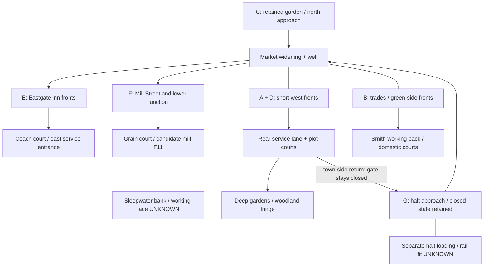

# Crossroads block-and-plot proposal

**Partial measured A/B/C candidate / D–G unscaled / not placed / not approved.** One proposed town structure for Matt to review, following [the layout study](https://chatgpt.com/library?file_id=libfile_b30bed8af740819199558691c451d410&account_id=personal). This is the seventeenth- to early nineteenth-century market/mill town, not Hearthold's medieval castle borough. It retains the current house style, soft grid, game rules and building-size requirements.

The preferred plan is a **compact market widening with connected mixed fronts, deep plots and service backs**, then a lower mill/grain quarter and two distinct goods approaches. New groups complete streets and corners around the existing gameplay core. They do not extend the rejected pattern of isolated rectangles across broad grass.

The companion [JSON](crossroads-block-plan.json) is a human-review proposal sidecar. It is not a runtime schema, adopted town plan, new validator or instruction to the producer.

[Lead amendment6533453453](https://github.com/rempemat-eng/appify/issues/149#issuecomment-6533453453) repairs an inventory omission: retain the original forty records and add one separately labelled candidate representation of the already-authored mill programme in block F. The candidate total is **41**, within Matt's large-town range of 30–45. The previous exact-forty hold was lead accounting, not a new decision for Matt. No mill identity, geometry or terrain placement is adopted here.

## Retained facts and limits

This proposal starts from PR381 source `3818de444d24c95c50daedd6e547a78bd0436551`, after the workflow-only handoff. The preceding Granary extension remains **only a placement diagnostic**. Its requirement to preserve the failed layout's first nineteen positions belongs to that engineering experiment; it does not make those nineteen positions an approved masterplan. Here, records 1–7 remain measured gameplay anchors; records 8–40 retain their block/plot assignments. The measured A/B/C sidecar section below now supplies candidate coordinates for seven of them; other D–G and mill geometry stays null.

The durable R6 actual capture is from `87ea22a4be342e3b8009b1c9b922c2fb7db56711`; `capture.json` SHA256 is `ba68fc26d029ed85e53b4ad69feb426cf9a88ec5ea61a10d180d822be0cc5b7a`. Unchanged replay later reproduced all 15 comparisons, 49 arrays and 168 support records. That verifies the failed input, not this proposal. Its producer stopped with 19 records and IDs20–23 queued; later24–40 were not attempted.

| Fact established by saved JSON/source | Constraint on this proposal |
|---|---|
| Actual cell is 8 world px; global shape is 896 × 1568 cells. Captured consumer box is `[5632,2944,7424,4608]` px. | These bounds describe evidence coverage, not a permitted town footprint or guaranteed dry land. No new plot is declared feasible. |
| Existing gameplay zone spans `[5976,3248,6616,3808]` px. Its square is `[6176,3448,240,176]`, green `[6016,3656,168,136]`, crater `[6448,3688,72,48]` as `[x,y,w,h]`. | Keep destinations, entrances, training green and shard-crater programme. Do not use them as spare packing land or change story state. |
| The seven zone buildings have actual inherited positions and `zone_door` authority. | Preserve these anchors/doors. Their missing `form` property is real schema; use the existing registry/export authority, never fabricate it. |
| Actual Sleepwater polyline bends north/east of the core: selected centre points include `(6680,3520)`, `(6680,3616)`, `(6471,3904)` and `(6296.879,4094.489)`. | The lower river crosses the diagnostic's intended Mill End. A centreline is not a bank width, bridge proof or dry-plot mask. No bank/river is filled here. |
| Named actual routes include Valley lanes north/west/east/south/to the Lull Road and Foothill Road. Fixed zone routes include `garden_walk`, `halt_road`, `harbour_road`, `green_lane`. | Retain garden, halt, coast/valley and eastward arrivals and their identities. Exact bridge-cell joins and any new service alignment remain UNKNOWN until terrain fitting. |
| The source authors a halt yard at `[5840,4304,6080,4368]`, but execution failed before `t.yard`; captured `outskirts` is empty. | This is an unreached authored intention, not an observed usable yard. The actual station/rail global footprint was not captured. Do not assert a measured platform position. |

Native water/barrier/grade/overlap, door/access/frontage, route and exporter checks remain in force. Plot extents, depths, widths, banks, levels, crossings and the final native export window remain **UNKNOWN**. The diagram and study cannot supply them.

## One street structure

**Primary public route:** the retained garden/north arrival leads to the market widening; the southward Mill Street/valley route then continues toward the coast. The west halt approach and east harbour/Foothill/Lull approaches meet this centre. Keep their route destinations and existing closed-slice/story gates. The diagram does not open the halt or create a new traversal mechanic.

Make the existing square read as a widening along that connected route, with its well and civic/trade fronts visible. Avoid a new giant empty rectangle. The market's west side retains library, bakery and herbalist; its east side retains smithy, Fern cottage and green connections. New shop/house corners close gaps and turn the approach streets, with purposeful passages rather than a detached building in every grass patch.

**Secondary public links:** a market-west passage reaches West Lane and its garden edge; an Eastgate passage reveals the inn court; a Mill Street passage reaches the grain court and a suitable bank view. The explicit first loop is market widening → market-west passage → West Lane rear/service lane → halt approach → market widening. It returns to the town-side public approach, before the existing closed halt/slice gate, rather than ending in a private plot or passing through a closed gate. The exact gate line is not captured here and must be checked before fitting that return. Other passages may remain short destinations. Connect them to named streets where feasible. Their alignments must later avoid private plot backs, the training space, yard work faces and unsupported river crossings. No assumed new bridge is part of this proposal.

**Goods movement:** keep the halt loading approach, inn coach entrance and mill/grain delivery court distinct. A back/service lane on the halt side serves market rear courts; the eastern approach serves the inns; the lower street serves grain handling. Cart access should be visually understandable without making the well or every domestic court a loading apron. This is a spatial brief, not vehicle simulation or a new numerical clearance rule.

## Blocks and plot depth

Every plot has a street front, a service/household back, and an edge. Short frontage groups should enclose public space while still admitting real side passages. Grouped fronts do not automatically mean shared collision or permission to enable Neon's continuous-frontage checker settings for Crossroads.

| Block | Existing logical records | Front / back / edge |
|---|---|---|
| **A — Market west** | 002,004,005,035,037 (5) | Library/bakery/herbalist plus two shops form short civic/trade fronts on the widening and west approach. A rear court and halt-side back lane handle stores/deliveries; gardens follow behind. |
| **B — Market east** | 006,007,013,022,033 (5) | Smithy, Fern cottage, a shop and two houses define the harbour approach and green connection. The smithy has a working rear distinct from domestic courts; the green/crater stays open. |
| **C — Garden and north terrace** | 001,003,010,011 (4) | Retain your hut and north terrace; two additional records give the approach an inhabited edge. Garden backs stay quieter than the goods streets. Do not surround the garden with service paving. |
| **D — West Lane** | 008,009,024,025,026,027 (6) | Two row-house records make short grouped fronts, then cottage/house plots turn and taper toward the woodland. A connected rear lane reaches courts and long gardens. No blind backland house with no public entrance. |
| **E — Eastgate** | 030,031,032,034,036 (5) | Both existing inn forms remain: record031 fronts the principal coach/service court, record030 has a separate smaller inn court, and connected house/cottage fronts. Their entrances belong to the east approach, not to the rail yard. |
| **F — Mill End** | 012,014,015,016,017,018,019,020,021,023 (10 retained), plus separate candidate F11 (1) | Short house/cottage groups enclose Mill Street's junctions. Side passages reach plot courts and grain handling; candidate F11 represents the existing mill programme, with identity and geometry unresolved. Garden/farm backs soften the outer edge. The river and productive court determine fit, not a long default row. |
| **G — Halt Road fringe** | 028,029,038,039,040 (5) | A small inhabited approach with long garden/work plots leads toward the halt-related working area. Rail loading is a separate destination, with fields beyond; it is not automatically an inn stable yard. |

**Front → court/work area → garden** is a relationship, not three equal bands. Deeper plots can differ in length and combine narrow passages, paved working edges, trees, vegetable ground and household space. The outer boundary should follow real plot backs and productive land; avoid an abrupt rectangle of painted town ground.

### Conceptual relationship diagram — UNSCALED

Arrows show proposed connections, not measured direction, building polygons, travel rules or approved crossings. Letter groups refer to the block table, unchanged forty-record ledger and separate candidate mill addition.

## Mill, courts, viewpoints and useful open space

A mill town needs a visible **water → mill/work face → grain handling → cart approach** relationship. Reserve that relationship below the market, using the real Sleepwater rather than a decorative pond. The handling court should be reached from Mill Street; a public bank passage/view can expose the water and work without crossing the loading face. Bank grade, hydraulic reach, candidate building identity and its exact placement remain unresolved.

**Inventory omission repaired at proposal level:** none of the retained forty records has form `mill`, but original Crossroads already authored one mill. At source3818de, `towns55.py:855–866` describes the large 30–45 market/mill town; line895 authors one mill cluster. Lines2249–2260 then show `lay_feedback` removing legacy Crossroads and substituting the replacement inventory, which omitted that programme. Its legacy cluster seed is an authored intention, not a measured building location.

The separate **F11 candidate mill** restores that existing programme without changing any of the original forty records. Record006 remains the old smithy. The sidecar keeps `count=40` for the unchanged retained ledger, `candidate_count=41` for the proposed total, and exactly one entry in `proposed_additions`; this entry has a proposal identifier, not an adopted logical building ID. There is no new occupant, job or gameplay rule.

**Identity and fit still unresolved:** the candidate mill's logical ID, legacy identity mapping, footprint, geometry, foot, door, location and plot dimensions are `null`; bank/working-face/head-and-tail reach and native fit are UNKNOWN. Main's historical web Riverside already has a `mill` object, `water_mill` sprite and `mill` stand (`scripts/art/valley_zones.py:1239–1466`), but those local coordinates do not establish placement on this continent. Resolve and deduplicate the single existing mill identity against legacy/native plans before adoption; do not create a second mill or silently convert the smithy. This revision repairs the proposed programme inventory; it does not prove a physical mill location.

The inventory also contains no dedicated stable/granary form; open service/storage courts can be proposed, but additional counted stable/granary buildings must not appear silently.

At Eastgate, the coach court is behind an inn frontage, with an entrance from the approach, working edges, room for the existing catalogue's equipment where later accepted, and a quiet public route past it. At the halt, a loading yard explains goods movement and a productive town edge. These two spaces have different reasons to exist. Their native fit is unproved.

Keep these spaces deliberately open: the well's circulation and market stopping space; training green and crater park; quiet garden approach; each separately legible work court; useful riverbank/viewing ground; gardens and fields at plot ends. Avoid treating every open patch as another house slot. View sequences should reveal the well/library from the northern approach, the market corner from the halt side, the inn court from Eastgate, and water/work from Mill Street; exact sightlines at the playing camera remain to be tested.

## Forty-record ledger

This is the unchanged source ledger of forty records, not forty placed or inhabited buildings. The separate mill candidate below makes the proposed total41, inside Matt's large-town target of 30–45. All forty existing logical IDs occur once; no candidate is inserted into or substituted for this ledger. Footprints below are retained source dimensions, **not plot dimensions or new placement coordinates**. Row-house bay data remains exact in the sidecar; its bays do not increase the forty-record count. Occupants, home/work semantics and routines are not authored here.

| Existing ID | Existing identity/form; source footprint | Proposed plot | Assignment |
|---|---|---|---|
| `crossroads-b001` | Your hut; 80 × 40 px | C01 | Your hut; identity retained |
| `crossroads-b002` | Library (roof torn); 96 × 40 px | A01 | Library (roof torn); identity retained |
| `crossroads-b003` | North terrace cottages; 96 × 40 px | C02 | North terrace cottages; identity retained |
| `crossroads-b004` | Bakery (cold); 72 × 48 px | A02 | Bakery (cold); identity retained |
| `crossroads-b005` | Herbalist's (apothecary, stage 1); 72 × 48 px | A03 | Herbalist's (apothecary, stage 1); identity retained |
| `crossroads-b006` | The old smithy; 88 × 56 px | B01 | The old smithy; identity retained |
| `crossroads-b007` | The Ferns' cottage; 72 × 48 px | B02 | The Ferns' cottage; identity retained |
| `crossroads-b008` | row_house; 80 × 24 px | D01 | Grouped market-west approach frontage; both original bays retained |
| `crossroads-b009` | row_house; 112 × 48 px | D02 | Turn West Lane court with a second grouped frontage; both bays retained |
| `crossroads-b010` | cottage; 48 × 72 px | C03 | Frame the garden-to-market arrival without occupying the quiet garden |
| `crossroads-b011` | house; 56 × 88 px | C04 | Turn the north terrace approach toward the square |
| `crossroads-b012` | cottage; 48 × 64 px | F01 | Define the upper Mill End junction frontage |
| `crossroads-b013` | shop; 48 × 88 px | B03 | Connect the market to the trades-side passage with a shop front |
| `crossroads-b014` | cottage; 40 × 72 px | F02 | Continue a short Mill Street frontage group |
| `crossroads-b015` | house; 64 × 96 px | F03 | Turn the Mill End street-to-court corner |
| `crossroads-b016` | cottage; 48 × 56 px | F04 | Face the street beside the grain-court approach |
| `crossroads-b017` | house; 56 × 88 px | F05 | Define the lower Mill Street junction |
| `crossroads-b018` | cottage; 40 × 64 px | F06 | Connect a small court frontage to garden backs |
| `crossroads-b019` | cottage; 64 × 40 px | F07 | Enclose the public-facing side of a lower plot court |
| `crossroads-b020` | cottage; 64 × 48 px | F08 | Turn the passage into the lower plot group |
| `crossroads-b021` | cottage; 64 × 40 px | F09 | Front a garden-edge lane within Mill End |
| `crossroads-b022` | house; 88 × 48 px | B04 | Give the harbour approach a connected house front |
| `crossroads-b023` | cottage; 72 × 40 px | F10 | End a short Mill End frontage at productive plots |
| `crossroads-b024` | cottage; 40 × 72 px | D03 | Front a West Lane court with a deep garden behind |
| `crossroads-b025` | house; 56 × 96 px | D04 | Turn the west market/service-lane entrance corner |
| `crossroads-b026` | cottage; 40 × 56 px | D05 | Continue the West Lane plot frontage toward woodland |
| `crossroads-b027` | cottage; 40 × 64 px | D06 | End the grouped West Lane frontage before garden plots |
| `crossroads-b028` | house; 56 × 96 px | G01 | Mark the halt approach corner facing the market link |
| `crossroads-b029` | cottage; 48 × 72 px | G02 | Front a deep garden plot on Halt Road |
| `crossroads-b030` | inn; 72 × 128 px | E01 | Secondary inn frontage with its own smaller service court |
| `crossroads-b031` | inn; 128 × 72 px | E02 | Principal coach-inn wide frontage with the main coach/service court behind |
| `crossroads-b032` | house; 48 × 88 px | E03 | Connect the inn frontages with a house-form plot |
| `crossroads-b033` | house; 96 × 56 px | B05 | Turn the market-east corner with a house-form frontage |
| `crossroads-b034` | cottage; 72 × 48 px | E04 | Turn the Eastgate court approach with a cottage-form plot |
| `crossroads-b035` | shop; 64 × 56 px | A04 | Close the west approach corner with an existing shop form |
| `crossroads-b036` | cottage; 80 × 48 px | E05 | Extend an inhabited Eastgate approach with a garden-backed plot |
| `crossroads-b037` | shop; 48 × 64 px | A05 | Define the market-widening edge with the second added shop form |
| `crossroads-b038` | cottage; 56 × 48 px | G03 | Join the short Halt Road frontage group |
| `crossroads-b039` | cottage; 64 × 48 px | G04 | Turn the halt-side group toward garden plots |
| `crossroads-b040` | cottage; 56 × 40 px | G05 | End the halt-side frontage at the productive fringe |

## Separate proposed addition: the existing mill programme

| Proposal | Count / block | Relationship | Identity and geometry |
|---|---|---|---|
| `crossroads-mill-candidate` | 1 / F11 in Mill End; candidate town total41 | Sleepwater working face → mill → grain handling → Mill Street goods approach | Proposed representation only. Logical ID, legacy identity mapping, geometry, coordinates, footprint, plot dimensions, foot, door and location are `null`; orientation unassigned and terrain/water reach UNKNOWN. |

All forty retained records, their source forms/footprints/bays, seven measured gameplay anchors and old smithy remain unchanged. F11 is a plot label in an unscaled proposal, not a measured polygon or an extra adopted mill.

## Measured market-quarter candidate — partial fit

This first flat plan measures **A/B/C only** against the real saved BEFORE crop, retaining all seven native anchor rectangles and doors. Fourteen records are shown: seven anchors and seven candidate buildings. D/E/F/G and the separate mill remain unplaced. The original forty-record ledger and candidate total41 are unchanged. The sidecar's `measured_market_fit` section is proposal evidence, not a runtime schema or adoption packet.

The west approach gains two south-facing shops, a24px public lane into the square, and a16px passage between them to a rear service lane. Garden backs follow the protected woodland edge. North homes face the existing garden walk and a quiet16px spur, with side gardens; they do not turn the garden into a loading yard. An east shop faces the native harbour road, and a house turns the northern arrival. A dashed alternative house closes the south-east market return. The native market, green, crater and garden stair stay recognisable and open.

| Candidate | World rectangle x,y,w,h | Door | Actual footprint evidence / disposition |
|---|---|---|---|
| `crossroads-b010` / C03 | `[6184, 3232, 48, 72]` | `[6208, 3304]` | barrier0, keepout0, literalpath0; tiers[3, 3]; MEASURED_DRY_CANDIDATE_NATIVE_FIT_UNPROVEN |
| `crossroads-b011` / C04 | `[6352, 3240, 56, 88]` | `[6384, 3328]` | barrier0, keepout0, literalpath0; tiers[3, 3]; MEASURED_DRY_CANDIDATE_NATIVE_FIT_UNPROVEN |
| `crossroads-b013` / B03 | `[6552, 3472, 48, 88]` | `[6576, 3560]` | barrier0, keepout0, literalpath1; tiers[3, 4]; CONDITIONAL_LITERAL_PATH_CONFLICT |
| `crossroads-b022` / B04 | `[6320, 3640, 88, 48]` | `[6368, 3640]` | barrier3, keepout2, literalpath0; tiers[3, 3]; CONDITIONAL_BARRIER_KEEPOUT_CONFLICT |
| `crossroads-b033` / B05 | `[6528, 3336, 96, 56]` | `[6576, 3392]` | barrier0, keepout0, literalpath0; tiers[4, 5]; MEASURED_DRY_CANDIDATE_NATIVE_FIT_UNPROVEN |
| `crossroads-b035` / A04 | `[6096, 3408, 64, 56]` | `[6128, 3464]` | barrier0, keepout0, literalpath0; tiers[3, 3]; MEASURED_DRY_CANDIDATE_NATIVE_FIT_UNPROVEN |
| `crossroads-b037` / A05 | `[6032, 3400, 48, 64]` | `[6056, 3464]` | barrier0, keepout0, literalpath0; tiers[3, 4]; MEASURED_DRY_CANDIDATE_NATIVE_FIT_UNPROVEN |

All fourteen footprint rectangles are pairwise disjoint, and original ordered dimensions are retained. Rectangles/area boundaries use8px world cells; inherited bakery/herbalist doors at x6148 are kept exactly. Cell masks and one-cell halos are recorded separately for every record. Five new footprints have no literal path, barrier, keepout, street or taken conflict. That is a useful measured offer, **not native acceptance**: inherited overview building paint still needs identity reconciliation, two candidates require coherent terracing, native floor/collider/door checks are unrun, and nominal route width/door contacts need later checking.

**The two east/return candidates remain conditional.** Shop013 was deliberately moved8px south to front the native harbour street edge, reducing six literal-path cells to one; the remaining cell is not ignored because `street` happens to be false. House022 was moved from the narrow Lull-side strip to a south-east market return. Its new footprint contains3barrier/2keepout cells, so it is drawn dashed rather than accepted. No density packing, footprint shrinking, terrain filling or manual-placement bypass was used to turn these into passes.

**Existing native/macro conflicts also remain visible.** Ferns cottage007 intersects43 of54 macro keepout cells,9barrier cells and5crater-mask cells, including four shardglass and one scorch cell. Its native rectangle ends3664; the native crater rectangle starts3688,24px lower. The explicit macro crater centre is6484,3712, bowl radius36 (`geo53.py44–47,130–174`), with a broader90px protection disc (`geo55.py847–848`). Separately, saved macro north/west centrelines cut the fixed hut/herbalist footprints despite the native garden/halt routes. Fixed anchors are not moved to conceal those mismatches.

The **unapplied reconciliation proposal** is to fit the procedural crater rim/scorch/protection coherently around the unchanged native cottage, crater bowl/centre/story and park approach, and align local macro arrivals with the existing native garden/stair and halt-road axes while preserving outer route joins and the closed halt. This requires actual ground, masks, tiers, route widths, doors and access to agree. It is not permission to punch holes in keepouts or erase paths. No such change has been applied; the flat plan overlays candidates on the original terrain, with conflicts highlighted.

The north house's first candidate hit six protected north-disc cells; shifting it32px south makes it face the quiet spur and leaves its final footprint/halo clear. The initial west garden band touched13protected woodland-edge cells, so its boundary stops8px farther south. These deliberate design revisions and earlier measurements are retained in the evidence packet; protected cells were not cleared.

The next scope is one coherent terrain/route reconciliation and native authoring test for this market quarter, followed by the two conditional frontages. It must preserve all seven anchors, names and story states and cannot use `Town.free`'s manual grade/barrier bypass as acceptance. Cap40/expected40 in the frozen producer remain unchanged; later adoption of the legitimate41-building candidate must reconcile them explicitly. No D–G/mill fit, whole-world generation, native placement/export/checker, camera/art/Y12/Ready/merge or Matt approval is claimed.

GO6533855827 / ASSIGN6533865862 / ACK6533866313. Actual cropped stdlib probes remained below64MiB/30seconds/4MiB, with unchanged source input hashes. The accompanying actual-cell flat SVG is the reviewable geometry offer; it is not finished game art.

## Review and next scope

The concrete choice is the seven-block arrangement above: a connected market core, west rear-service plots, Eastgate coach courts, a lower water/work quarter and a productive halt fringe, retaining the seven gameplay anchors. The omitted mill programme now has one explicit candidate representation, authorised as routine inventory repair by lead6533453453. Its identity mapping and physical fit remain unresolved. Exact plots/crossings/rail fit are later measured work, not requests for physics exceptions. Matt's applicable review of the town composition and explicit PR approval before any art/map merge remain required.

After lead/Matt reviews this structure, a separately scoped terrain-fitting step can draw actual frontage/plot boundaries against saved masks and the full route context, adjusting suitable land only where explicitly authorised. It must keep the river's meaningful upstream/downstream joins, valid crossings, existing gameplay zone and named destinations. If the required support leaves the current captured bounds, report the missing area rather than make UNKNOWN ground buildable.

Then use the existing native placement/export/checker on the newly scoped plan, accounting for all forty original IDs, the single deduplicated mill candidate, original inherited doors, terrain, fronts/rears, service yards and routes. That physical result would still not approve the composition or art. One representative street and working-court vignette at the actual character/play-camera scale should establish construction, material, contact-shadow and circulation quality before kit expansion or whole-town claims.

No producer/helper/checker/terrain/workflow/generated image was changed for this document. No packing, test, scientific import, controller, engine, render, world generation, job, Ready, merge or art approval occurred. PR381's original failure, unchanged replay and diagnostic PNG remain preserved; the existing Granary candidate is not offered as a finished Crossroads.

### Evidence references

- [Mill inventory amendment6533453453](https://github.com/rempemat-eng/appify/issues/149#issuecomment-6533453453), [repair claim6533485058](https://github.com/rempemat-eng/appify/issues/149#issuecomment-6533485058) and [separate ACK6533489951](https://github.com/rempemat-eng/appify/issues/149#issuecomment-6533489951).
- [Matt layout direction6526956297](https://github.com/rempemat-eng/appify/issues/149#issuecomment-6526956297), [study handoff6527386266](https://github.com/rempemat-eng/appify/issues/149#issuecomment-6527386266), [two-file scope6527523659](https://github.com/rempemat-eng/appify/issues/149#issuecomment-6527523659).
- [Workflow-only source handoff6527830649](https://github.com/rempemat-eng/appify/issues/149#issuecomment-6527830649); exact producer inventory blob `f23c793baf4a3b937a223c2a9fd2ac2786442f94` at parent3818de.
- [Actual unchanged replay/failed-state result6525128251](https://github.com/rempemat-eng/appify/issues/149#issuecomment-6525128251). Input `before.npz` SHA256 `95574230bb4474fa3a931ba6167fa521d609107ae79fff3f7e7022e327d7d527`; zone JSON SHA256 `cee996a1d28ce4e3523eca541522aae3e05c61c59252496b7aa9eeb334487dec`. These hashes identify evidence; they do not certify this proposed geometry.
